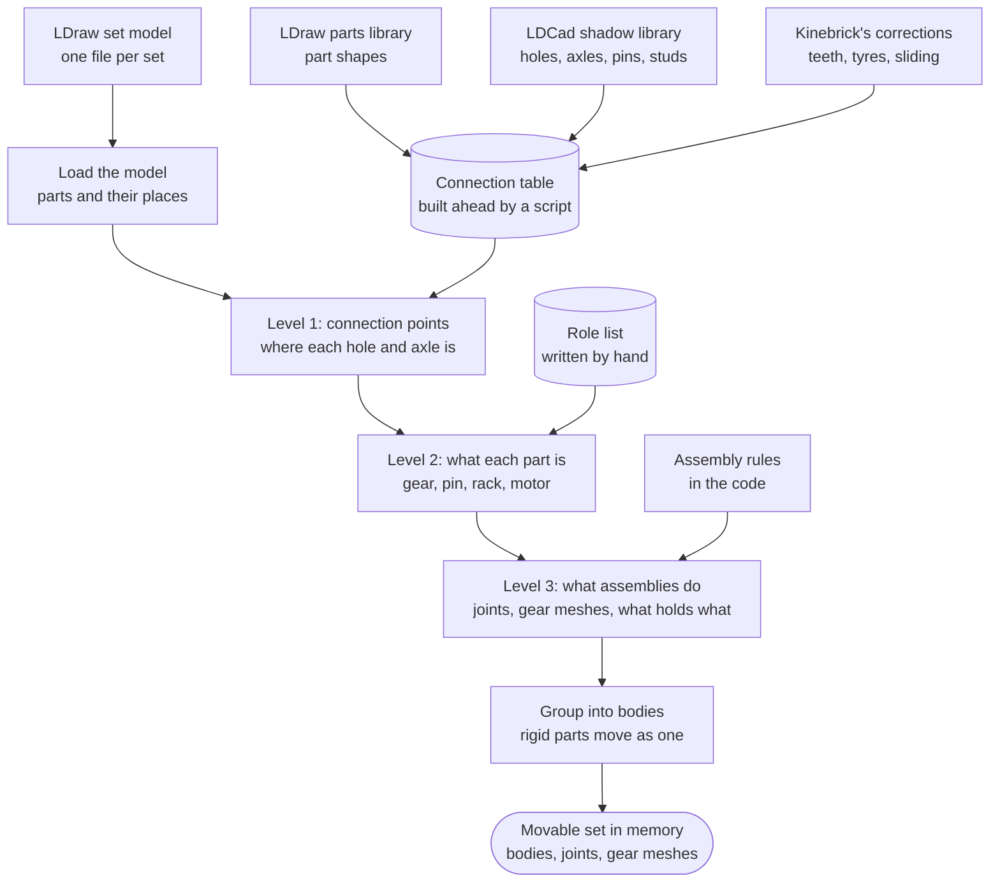
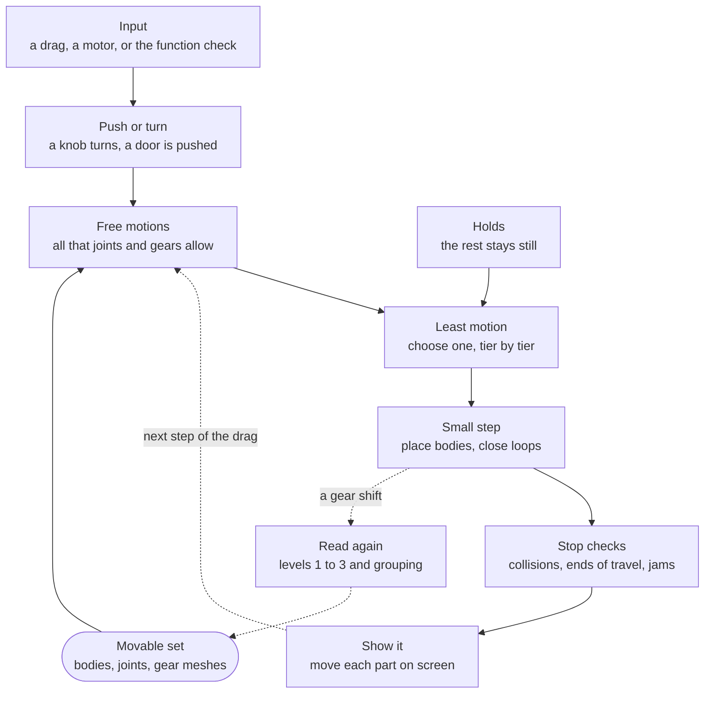
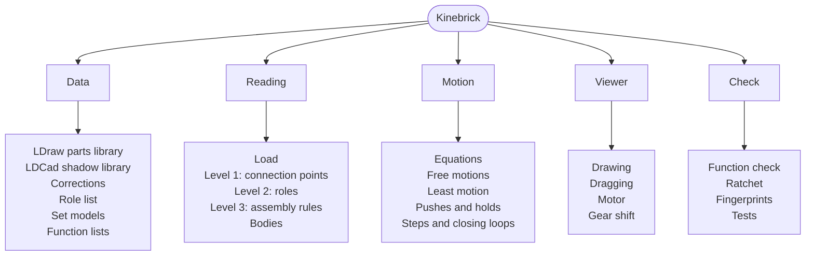

# Kinebrick Architecture

Kinebrick looks up each part's connection points (where its holes, axles, pins and studs are), finds the ones that line up, and groups parts that move together into bodies. Bodies are joined by joints: an axle turning in a hole, a beam turning on a pin, a piston sliding in its cylinder. Each joint, each pair of meshing gears and each tyre on the ground gives equations between the bodies' speeds, and whatever motion the equations leave free is what you can drive. When you drag a part, Kinebrick moves the mechanism along that motion in small steps, and stops where two parts would run into each other.

This is how it does that, for anyone changing the code. What Kinebrick does, and how to use it, is in the [README](README.md); how to build and run it, and where the project stands, is in [DEVELOPER.md](DEVELOPER.md).

Everything here is kinematics: how a mechanism can move, worked out from its geometry, with no masses or forces. That's version 1.0.

Forces (momentum, springs that spring, clutches that slip) are for version 2.0. It will hand the same bodies and joints to the [MuJoCo](https://mujoco.org) physics engine, rather than add physics of Kinebrick's own.

## Overview in three drawings

The first drawing is the reading of a model into a mechanism that can move, the second its motion when the user drags a part, and the third lists Kinebrick's pieces as a tree. The sections after these explain each box.

### Reading: from files to a movable set in memory

The reading has three levels, and each has its own source:

- **Level 1, connection points:** where each hole, axle, pin, stud and ball is on a part. It comes from [the connection table](#the-connection-table), which a script builds ahead of time from the LDraw parts library, the LDCad shadow library and a short file of Kinebrick's own corrections.
- **Level 2, what each part is:** a gear and its tooth count, a friction pin, a rack, a differential, a motor. It comes from the [role list](#part-roles), written by hand.
- **Level 3, what assemblies do:** which connection points line up into joints, which gears mesh, which parts are held rigid, what holds a part that only lies on another. These are rules in the code (`src/inference`), described under [Connect](#4-connect).

In the eight steps of [How it works](#how-it-works), level 1 is step 3, level 2 is step 2, level 3 is steps 4 and 5, and grouping is step 6. The code looks up roles before connection points; neither look-up depends on the other.

### Motion: from an input to parts moving on screen

- **Input:** a drag in the viewer, the motor a Ctrl-click starts, or the [function check](#the-function-check) working a control.
- **Push or turn:** a part that turns like a knob is turned on its joint; a door or an arm is pushed at a point. See [Drags](#drags).
- **Free motions:** every joint and gear mesh is an equation, and the solver finds every motion the equations allow. See [The solver](#the-solver).
- **Least motion and holds:** of those motions the solver takes the one that moves least, tier by tier, and holds still what the drag does not need. These rules stand in for friction and weight, which Kinebrick does not compute.
- **Small step, stop checks, show:** the bodies are placed and the loops closed; a step that makes parts collide or passes an end of travel is undone. This repeats for each step of the drag.
- **Read again:** a gear shift changes what is connected to what, so the reading runs again from where every part now is.

### Kinebrick's pieces

Under Check, the function check tries every set's functions on its model, the ratchet compares the results with an earlier commit's, and the fingerprints show which models' mechanisms a change to the code alters. Where each piece is in the code is in the [code map](#code-map).

## How it works

From a model file to a mechanism you can drag, in eight steps:

| Step | What happens |
|---|---|
| 1. [Load](#1-load) | Read the model's parts, and the paths of anything flexible |
| 2. Assign roles | Look each part up in the [role list](#part-roles); parts not in it are `structure` |
| 3. Look up connection points | From the [connection table](#the-connection-table): where each part's holes, axles, pins and studs are, which way they point, how long they are, and their shapes |
| 4. [Connect](#4-connect) | Connection points that line up become connections and joints |
| 5. [Check](#5-check) | Find parts attached to nothing |
| 6. [Group](#6-group) | Rigidly connected parts become bodies |
| 7. [Solve](#7-solve) | Joints, gears and ground contact become equations; what they leave free is what can move |
| 8. [Animate](#8-animate) | Drags move the mechanism in small steps, stopping at collisions |

### 1. Load

`LDrawLoader` reads the model, packed into one file with every LDraw part it uses (see `packed/`). A model opened from your own computer is packed the same way in the browser, its parts fetched from an LDraw library online.

- **Each part becomes its own 3D object**, so it can be moved on its own.
- **Each kind of part is built once.** The loader means to build each kind once and copy it wherever the model places it. But asked for the same part many times at once, it starts building it every time, before the first build is there to copy. So Kinebrick has the first request build it and the rest copy it. (The 8880 Super Car's 140 kinds of part were built 1411 times over, most of its loading time.)
- **The mechanism comes first.** It's worked out before the shapes are built, since it needs only where the parts are. A string's shape, which isn't shown (see [the solver](#10-show-it)), is built from its first piece only, for its colour.
- **Progress.** While it loads, the panel says how far the download has got, then which step it's on.
- **Multi-part files (MPD)** are made of submodels. Kinebrick flattens them, placing each submodel's parts where the submodel puts them, and uses any unofficial parts the file brings with it.
- **A part whose role is `split`** is read as the parts its file is made of.

**Paths drawn by LDCad.** Something flexible the LDCad program drew along a path (a chain or track round its wheels, a rubber band, a string, a hose) comes as a submodel with:

- where the path runs: `0 !LDCAD PATH_POINT` lines, as circles round wheels (with their middles, axes and radii) and points it passes through;
- what it's made of: `PATH_SKIN`;
- the links or pieces LDCad placed along it, as parts (a chain's links) or shapes (a string's pieces). Some may be in a subpart of the path's submodel: LDCad puts links it gives a colour of their own there, as on the 42131 Cat D11's tracks.

Kinebrick keeps the path, and knows those parts as its links.

**Paths drawn by LSynth.** The LSynth program's paths, as the official model repository's files have them, come with nothing to say where they run: just their segments, one after another. They're a rope of `LS60` string segments, `LS51` hose segments or `LS70` cable segments, embedded in the file as `<set> - LS60.dat`.

- **A run of segments**, each within 6 LDU of the last, is a path whose links they are.
- **A rope's circles** are where it keeps turning the same way through at least 30 degrees, round a drum or over a pulley. Each is the circle that best fits the tightest stretch of the turn, since LSynth eases a rope into and out of each. On a drum it's wound round more than once, it's its whole turns.
- **A hose or cable** only shows where it runs.

**Chains placed link by link.** Older models in the official model repository place a chain's links (3711) one by one, as parts, with no path to say where it runs (the 8835 Forklift, the 8844 Helicopter).

- **A chain** is a run of links, each one's end within 4 LDU of the pin of the one before (16 LDU along it), in whatever order the file has them.
- **It's looped** if it closes up, or if its two ends are within two links of each other: the 8835 Forklift's chain is a link short, both its ends hooked to the carriage it lifts, which closes it. A chain left open further isn't a path.
- **Its circles** are where it keeps turning the same way, at least 10 degrees at each link (a chain placed by hand bends a little along its straight runs), through at least 30 degrees. Each is the circle that best fits the links turning at least two thirds as tightly as the tightest.
- **Each circle's radius** is how far the chain moves for a radian of the wheel's turning: 8 links of 16 LDU to a turn of a 16 tooth gear, 12 to a 24 tooth one, so the wheels it wraps turn at the ratio of their teeth.
- **Placed by hand,** its circles are only roughly round its wheels (see [chains and tracks](#rules-for-real-models)).

**Shapes drawn directly.** Shapes a submodel draws directly rather than with parts (hoses, springs and strings bent to fit, as CAD programs generate them, out of triangles or LDraw primitives such as cylinders) are drawn, moving with a part placed by the same submodel line. They take no part in the mechanism.

### 4. Connect

Connection points from different parts that line up become connections:

| What | Becomes |
|---|---|
| An axle through a round hole | A **joint**: it can turn |
| An axle through an axle hole | A **rigid** connection: the parts turn together |
| A tyre on its rim | Rigid |
| A stud in an anti-stud (the socket under a brick or plate) | Attached |
| The small pin under a 1-wide plate or tile, in a hollow stud (a tile running crosswise over Technic bricks, half a stud off the grid) | Attached |
| An axle stub fixed to a part (a connector's, a crankshaft's) | Goes into holes like an axle |
| A pin fixed to a part (a cross block's pins, a long pin's beyond its stop bush, an old steering arm's pivots), told from a stud by its collar or its springy tip | Goes into holes like a pin |
| An axle hole closed at one end, even with a thin round lip at its mouth | Takes an axle |
| A pin hole closed at one end (a panel's) | Takes a pin |
| A pin through round holes in two parts | A **joint** between them: the parts turn on it |
| A piston in the bore of its cylinder, or a plate resting on smooth tiles | A **sliding** joint |
| A towball in a ball socket (where a connecting rod meets its piston, or a steering link meets a steering arm) | A **ball** joint: it turns any way about the ball's centre |

How far a sliding joint goes:

- **A piston** slides along its bore for as long as the two still overlap by half a stud. Its skirt may come out of the bottom, as on a real engine. Being round, a real piston could also turn in its bore, but that can't be seen, so Kinebrick doesn't let it.
- **A plate** slides along its row of tiles for as long as it still overlaps them by a stud, overhanging the end. A plate on tiles could really slide any way across them; rails either side keep it in line, and Kinebrick takes them as read.

**Speed.** Only connection points whose boxes share a cube of a 40 LDU grid are compared, rather than every pair. That keeps finding a 1400 part model's connections to about a second.

#### Rules for real models

Real models need a few more rules, found by working through official sets.

**Tolerances.** Built models are rarely exact, so:

| What | Counts if within | Why (an official model) |
|---|---|---|
| Connection points line up | 2 degrees in direction, 1 LDU between axes | |
| Gears mesh | 2 LDU of exactly their pitch radii apart | Real teeth still engage that much off |
| A spur gear meshes with a crown gear | Anywhere over its band of teeth, 3.5 LDU of its pitch radius | A crane's boom drive has one 2 LDU out |
| Bevel gears mesh | Their cones' tips 3.5 LDU of where their axles cross, or their pitch circles 3.5 LDU of meeting where their cones touch | A car sets one of a pair 20 LDU from the crossing, the other at 17 |
| A ball sits in its socket | 2.5 LDU between their middles | A car seats its driveshaft's ball 1 LDU deeper into a wheel hub's socket (a bore), and its steering links reach 100 LDU between towballs 98 apart |
| A tyre touches the ground | 1 LDU of the lowest | |
| A loose part gets a second chance | 2 LDU | A helicopter's rotor linkage is built a little stretched, its levers' ends 1.8 and 1.2 LDU off their pins. (Not every part: a steering arm's two pin holes are 2 LDU apart, and a pin would catch both.) |

Some parts are moved onto a line or point:

- **Turning joints on parallel axes within 0.1 LDU of one line** are put on one line. An official tractor's two rear half axles are 0.02 LDU apart, and its hitch, hung on both, would otherwise be held fast.
- **A ball joint within 3 LDU of an axis one of its parts turns about** is put on that axis.
  - An official Unimog's driveshaft ends in a ball 0.23 LDU off its constant velocity joint's axis. As that joint turned, the ball went round with it, which the shaft couldn't follow: its drivetrain locked after a step.
  - The 42110 Land Rover draws its front suspension drooped a little too far, so its half shafts' balls sit 2 LDU off the steering hubs' axes. Its steering, which turns the wheels a little as it steers them, locked the same way.
  - No ball in the OMR sits between 2 and 15 LDU off such an axis: a crank's is a stud or more out.
- **Where two such axes cross at a ball**, one each side of a constant velocity joint, the ball is put where they cross, on both. An official Porsche 911 GT3 RS's steering column ends in a ball a hair off the axis of the shaft beyond it, and stopped a few degrees on.

**Studs in Technic holes.** A stud in a round Technic hole turns in it, like a pin: an old engine's piston turns on its connecting rod's stud.

**Clips and hinges** make turning joints:

- a clip (a universal joint's ends grip its centre's arms so) is a round hole;
- a hinge described by a cylinder (the old 2x5 hinge plates) is a pin and its hole;
- a finger hinge: a row of fingers on one part interleaved with another's (a cab's window shutters, hinge plates);
- a swivel hinge: the 1x4 swivel hinge plates, one half's thin pin in the other's hole.

Hinges hold the angle they're set at, as friction pins do (see [step 6](#6-group)): bodywork set at angles on them (a car's bumper corners, its seat backs and spoiler) stays put.

**Pins and bars in other sockets.**

- A pin's end holds in an anti-stud as a stud does (a 1 x 1 round tile on a half pin, a plate on a long pin's end).
- A bar, closed at one end (a beam's angled bar, a tile's bottom pin, a minifig's sword), goes into a pin's hollow or a bar hole, and turns in it.
- A round peg closed at one end and wider than a stud turns in a round socket its size: a turntable's two halves, a linear actuator's end in its bracket.
- A square one slides along a square socket its size: a rack with a beam under it, in its housing (a telescopic boom).

**Parts a set brings with it.** The OMR embeds parts that weren't in the LDraw library yet in the model's file, named `<set> - <part>.dat` (`42116 - 42924.dat`). Most are in the library now, so such a part is read as the library's, if Kinebrick knows nothing of its own name.

**Headlight bricks.** A hole that opens into an anti-stud (through a headlight brick from underneath) sits on a stud as any brick does.

**Guided racks.** A rack held by nothing but the gear it meshes with (a fork-lift's carriage riding up its mast) slides along its length past the gear, as if guided, like a plate on tiles.

- **Also guided:** a rack that could still move with its gear held still, and everything the gear's shaft turns in held still with it (a steering rack on tie rods, which in the real model slides in a channel of bricks).
- **Not guided:** one whose linkage already sets its path (a tie bar fixed to the tops of two turntables, which moves on an arc), since a straight guide would jam it.
- **Not guided either:** one that moves only as the shaft's other mounts move round it (the 8849 Tractor's front axle rocks on its steering shaft, taking the rack with it).

**Strings.** A path that isn't looped (a crane's rope) is a string:

- **wound on a drum** at its start, if its first circle is on a wheel;
- **then over the pulleys** after that (its other circles on wheels);
- **and tied at its end** to the part nearest there.

A circle on no wheel, round something attached near its middle (within 15 LDU of its edge, and not the drum), is a **guide** the string slides over: LSynth runs a crane's rope over a cross block at its boom tip.

What hangs on a string, and so isn't loose:

- **A group of parts attached to nothing else, with one of the string's pulleys among them** (a crane's hook block).
- **One tied to its end, if the string hangs down to it** (within 30 degrees of straight down, from 20 LDU before the end; the turns of a knot there don't count as pulleys), as LSynth's cranes hang their hooks. It hangs beneath the last circle before it, as it did at the start.

A string that goes round no wheel, or is tied to something attached to nothing that doesn't hang on it (a tow truck's cable run out level to its hook), moves nothing and is left out.

**Grooves.** A plate slid edge first into a groove is held there: one of its anti-studs lies in the groove, the plate facing across it. (The bucket of an official bulldozer is two plates slotted into a pair of tipper ends.) The corrections describe each groove as a box in its part's coordinates.

**Plates on edge.** A plate standing on its edge between two rows of studs is held there: a plate is 8 LDU thick, just the gap between neighbouring studs.

**Between four studs.** A part with a single round opening underneath, centred between four studs, grips them: a classic way to set a part half a stud off the grid.

- The opening is a 1x1 round plate's or brick's anti-stud, or the open end of a Technic connector's axle hole.
- Examples: a crane's outrigger legs on their pads, the two connectors a bulldozer's bucket is wedged on.
- It works at any angle: the four studs point the way the opening does, at its level, each 14.1 LDU (half a stud's diagonal) off its axis.
- A Technic bush standing on end between four studs grips them too, as a 2 x 2 brick's tube does (the 858 Auto Engines' round caps). Only a bush that would otherwise be loose: one on an axle that turns in a Technic plate's hole may sit between its studs as well, and mustn't hold the axle still.

**On an axle's tip.** A part that would otherwise be loose, its axle hole lined up with an axle's tip and starting right there, is pushed on that axle. Real parts give a little, so a builder may press a part on an axle already filled by others, where in LDraw it can only sit against its tip (the 858 Auto Engines' fans, two round plates on an axle pin past the bush their rubber band runs in).

**On tiles.** A part held by nothing but smooth tiles under it slides along them, since nothing grips a tile from above (a crane's outriggers slide out on tiles), as long as it overlaps them by a stud.

- A part attached some other way is left to that: a tile would let it slide any way, so a slide along the tile could jam it.
- Slides between the same two bodies on parallel lines (an outrigger on two rows of tiles side by side) are one joint, which travels as far as any of its rows allows.

**Four-bar couplers.** A part pinned to two arms that turn on one body, all on parallel axes (a steering rack pinned to both steering arms), is the coupler of a four-bar linkage, which sets its path: a curve, as the arms swing. So it isn't also slid straight on that body or on the frame, by tiles under it or as a guided rack: the two together would only fit as the model was built. (The 8841 Dune Buggy's and the 8063 Tractor's steering jammed a step from the start.)

**Guided pistons.** A piston with no cylinder part of its own (the old 2x2 piston block, whose cylinder is a square of bricks) slides along its own axis against the nearest part it isn't fixed to.

**Universal joints.** As a cross on two hinges, a universal joint would lock solid if the model's shafts missed its middle by a fraction of an LDU, as built models do.

- **So the cross is fixed to one end**, and instead the two shafts turn at the same rate and their ends stay together: a *coupling*, in the solver.
- **Where both shafts turn in the same part** (a steering column's, in the frame), that part keeps their ends together already, so only their turning is tied. As an equation, their ends staying together would come out a hair's breadth from what the frame does (parts in an LDraw file are placed only so precisely), and stop some other motion altogether: the 8880 Super Car couldn't go round a corner.
- **A double universal joint's** short middle shaft turns about the line through their middles.
- **A grooved ball (2907)** on the end of a driveshaft, in a wheel hub's socket (2999), is a coupling too. Ridges in the socket fit its grooves, so the hub turns with the shaft at any angle, as a constant velocity joint does, and steered wheels are driven through it. It ties only their turning: the shaft and the hub are each held in place by their own joints, and the hub's steering pivot may miss the ball's middle a little, as the LDraw shapes have it.
- **A drive shaft that hangs on nothing but grooved balls** (the 42099 4x4 X-treme Off-Roader's four, each with a constant velocity joint's ball, 52731, in its differential's socket and its hub's) has no joint of its own, and its balls tie only its turning. So nothing says where it is. Tied by its turning alone, it turned about the model's origin, 240 LDU away, and swept its parts out at every step. So such a shaft is held in its sockets (decision 74). The ball in the socket nearest the frame (the fewest joints from it, then the socket whose body has the lowest part number) is held at its place in the socket. Each other ball is held on its socket's axis, free along it, so suspension can change how far apart the sockets are. With one end held, the shaft can't drift along its own line. A shaft with a joint of its own keeps only the coupling of its turning. The 42129 has three such shafts with one ball each, held at their place.
- **A later constant velocity joint's nudged ball (32494)** ties their turning the same way, its nudges fitting slots in the socket of a portal axle's steering hub (92909) or a joint's female half (92906). It ties them about the hub's axis: that of its holes through the socket, as a sphere has no axis of its own. Its ball joint is kept as well, since its shaft often hangs on nothing else (a half shaft with a universal joint at its other end).
- **Each shaft's turning is measured in what it turns in nearest the frame.** A driveshaft turns in the frame and in its differential's side gear alike.

**Shock absorbers.** A shock absorber's rod is fixed in its cylinder: its spring holds it at the length it was built at, so a car sits on its suspension. Springs, like everything to do with forces, wait for version 2.0.

Where the reading marks a slide as one that a spring holds at rest (`springHeld`, as a shock absorber's rod sliding in its cylinder), the solver lets it slide, but holds it wherever the question is the model at rest: the steering is found with it held (free, each suspension arm's swing turns its tyre a little about the upright, which the steering doesn't, so nothing counted as steering); the car's parked and rolling motions are worked out with it held, the suspension's own motions apart (free, rolling, chosen as the motion that scrubs least, mixed in the car sinking and tipping to scrub a hair less, and the car didn't come back); least motion's friction-pin tier counts its sliding, so it gives only where nothing else can move; and a drag or push that can go with it held keeps it held for its whole length, its loops closed with it held too, so the car stays at its height while a motor steers or drives it (free, the 42124's steering motor slid its front shock absorbers' rods, built at the top of their travel, past it as the loops closed, and stopped at once). Only a drag that needs it (a suspension arm, a shock absorber's rod) lets it slide. Nothing pushes it back until springs come.

**Linear actuators.** A linear actuator is three parts: its body, an input at its back end, and a piston that a screw inside drives in and out of its front end as the input turns. Built separately or as one of the LDraw library's shortcuts (read as its pieces: see `split`), each is found by its body, with the input and piston on the body's axis. Whatever their shapes connect them by (the piston's rod sits in the body's bore like a stud in a hole) gives way to:

- **the input turning in the body;**
- **the piston sliding in the body,** from where its head is in the library's contracted shortcut to where it is in the extended one;
- **a screw between them:** the piston goes one lead along the axis for each turn of the input, relative to the body.

| Actuator | Stroke | Lead (LDU per turn) | From builders' measurements |
|---|---|---|---|
| Small (92693c01) | 60 LDU (3 studs) | 3.02 | 7160 degrees, 19.9 turns, end to end |
| Large (62271c01) | 100 LDU (5 studs) | 3.73 | 9649 degrees, 26.8 turns |
| Extra large (u9487c01) | 160 LDU (8 studs) | 3.66 | 43.75 turns |
| Large, later type (u9559c01) | 100 LDU | 3.66 | none: it shares the extra large one's base, so taken to be geared alike |

Like a worm, the screw can't be driven from its piston (see [Holds](#holds)): pushing what the piston moves doesn't turn the input. Its input, 47157, also comes on the 9V geared motor, where it holds its axle still, so it stays on the [list of parts that don't move yet](#parts-that-dont-move-yet), but the viewer doesn't list it where it's an actuator's input.

**Motors.** A motor's output, its axle hole (on the old 4.5V and 9V motors, an axle stub), turns in the motor: an axle in it, and the gears on that, turn in the motor rather than being fixed to it and to whatever it's built into. It turns stiffly, as a friction pin's joint does: a drag holds it, as the motor's gearbox does, unless nothing else can move (see [Holds](#holds)). Keeping a gear on it turning (see [Motor](#motor)) runs the motor. Each LDraw shortcut for a whole motor is one part, so its output's bush isn't drawn turning. Motors whose case has axle holes of its own besides the output (the Mindstorms EV3 motors, the old 4.5V motor with its gearbox) aren't given the role yet.

**Bushes in Technic plates.** A Technic plate's holes are counterbored 4 LDU deep for a bush's flange (a brick's only 2). So a bush pushed at least 3 LDU into one grips the plate, which turns with the bush's axle: an old helicopter's rotors are Technic plates driven so.

**Toothed half bushes on toggle joints.** A toothed half bush (4265a, 6577) has teeth on one face, which fit those round the pin hole of a toothed toggle joint (4273a, 4273b). So a toothed half bush on an axle, its teeth against a toggle joint turning on that axle (their faces within 2 LDU), locks the toggle joint to the axle: the 8849 Tractor's rear cross axle raises its hitch's lower links so.

**Sliding on axles.** A part turning on an axle may slide along it too, as far as the parts either side of it on the axle let it, when a linkage works it that way. That is, its body turns on another body about an axis across the axle, in a closed loop of joints back to the axle. (An old helicopter's swashplate, raised and lowered on its rotor shaft by the pilot's levers, tilts the blades through their pitch links.)

- **Parts stacked against it** that turn on the axle too ride along with it, turning against it (the swashplate's top half, which turns with the rotor while the bottom one doesn't).
- **What stays put along its axle:** a connecting rod on a crank, which swings across its axle; the frame's holes; other parts held on the axle in several places; and other parts generally, held there by their neighbours or by friction.

**Resting parts.** Kinebrick has no gravity, so a part that only rests on another is kept touching whatever is highest under it, as its weight would keep it (`restingParts`). Both kinds are in the 858 inline engine's valve train:

- **A push rod:** an upright axle with bushes on it and nothing else, turning in round holes in one other body, standing by its bottom bush on a shaft that turns across it below. It rests on the highest of that shaft's cylinders under its foot (the camshaft's pins, or the camshaft itself between them), or by a bush higher up on the hole under it. Its holes become slides that turn, so pins lift it as they come round under it, and it drops back after them.
- **A rocker:** a part turning on an axle across a push rod, whose underside lies on the rod's top bush. It rests on the rod, or on whatever studs are under its parts' undersides, whichever is higher: when the rod drops, a valve's rocker comes down on the plate the rod stands through.
- **Only where built resting:** the rod (and the rocker) must be built touching what it rests on, to within an LDU. A part built a little into a flat thing it rests on (the rockers, 1.6 LDU into the studs under them) rests where it's built: that's taken as much lower.

**Decoration** connects to nothing that matters; each piece moves with the part whose connection point is nearest:

- stickers (the parts the LDraw library calls stickers);
- flexible sections (the segments of ribbed hoses and cables), and the other segments real sets draw their cables and hoses with;
- the old pneumatic hoses used for exhausts and cables.

**Chains and tracks.** A path's links (role `path`) only show where it runs: their own pins connect to nothing, and each moves with the part nearest it, like decoration. Its caps (a cable's plugs, or the receiver it comes out of) are parts in their own right, and connect as any part does.

A looped path (a chain, a track, a rubber band) goes round wheels:

- **Which circles are on wheels.** A circle of the path whose middle a turning joint's axis runs through, along the circle's axis, is on a wheel. The wheel is the joint's body with a part on that axis nearest the circle's middle along it (a 40 tooth gear a track runs round, or an axle a winch's string is wound on).
- **A chain placed link by link** is only roughly round its wheels: its circle is on the wheel whose axis passes within 2 LDU of its middle (the 8835 Forklift's are 0.7 LDU off its sprockets), and is moved onto that axis.
- **What's hooked to a chain's ends.** A chain placed link by link that doesn't close up is closed by what's hooked to both its ends: the biggest group of otherwise loose parts with a connection point within 24 LDU of the middle of its gap (the 8835 Forklift's carriage, 20 LDU from it, behind the chain tread that closes the gap). It isn't loose: it slides along the straight run the gap is on, as far as that run goes, on what the wheel at one end of it turns in (of the two, the one furthest from the frame: a fork-lift's mast, which tilts on the frame about its bottom sprocket's axle), and the chain carries it along at its speed (see [step 7](#7-solve)). Smaller groups there ride along with what's nearest, as loose parts do: the 8835's chain tread, which the real model holds between four bushes on the carriage, rides along with it. With no wheel at either end of that run, or its gap round a wheel, it can't slide, and is loose after all.
- **What it turns in.** It turns in the joint's other body. Of its joints on that axis, it's the one in what's nearest the frame: a gearbox's output shaft turns in the frame and in the clutch gears freewheeling on it, and it's how it turns in the frame that drives its chain.
- **A circle on nothing that turns** (a peg a rubber band is hooked round) is left out: the band slides round it.
- **A rubber band** is drawn afresh round where its circles are now. One whose circles don't lie in one plane keeps the pieces LDCad drew it with, and they move with the first thing it's hooked round (the 855 Mobile Crane's, on its cab, slews with it).
- **A track's links** (those [the corrections](#the-connection-table) give a depth) reach a little beyond the path, so under each of its wheels it touches the ground like a tyre that reaches as far.

### 5. Check

Every part should be attached to the rest of the model through some chain of connections.

- **Parts that aren't** get a red outline and a ⚠ badge (both with the Warnings option on), and are listed in the viewer. They're usually in the wrong place: a brick half a stud off, sitting between the studs instead of on them, or floating above the plate.
- **Loose parts still ride along with the model.** Each group of them attached to each other is fixed to the part with the connection point nearest to one of them, preferring a part of the same submodel.
- **Why ride along:** left where they were, they'd stand in the way of everything moving past them. (An official bulldozer's bucket plates, before Kinebrick knew its tipper ends' grooves, stopped its tracks.)

### 6. Group

Parts that are rigidly connected (an axle in an axle hole, a tyre on a rim) or attached by studs move as one *body*. The body with the most `structure` parts is the *frame*.

- **The simple car** has three bodies: the frame (plate plus bricks), and two axles, each with its two rims and tyres locked onto it.
- **The steering car's** pivoting front axle carrier, a few bricks and plates of its own, is a separate body that turns on the frame.
- **Two parts pinned together at two places**, on different axes, can't turn on either, so they're one body too (the engine's cylinder head, pinned to the frame).
- **Parts joined by friction pins** are one body as well, if the model can still move that way: friction holds a structure together (the V8's engine block, cylinder banks and intake). If the model couldn't move at all with its friction pins held, they're its only way to move (a linkage built on friction pins), so they stay joints, stiff ones.
- **Friction pins freed on demand** (`src/inference/friction.ts`). A friction pin gives way where something forces it: where a drag holds a part that has no motion, or the check works a control that has none, or a part a function lists to move is held fast to what it's measured against, the pins that hold it are freed, and the model is worked out again with them as stiff joints. Which pins: first, from a build of the model with every friction pin free (made once), the fewest of those that turn in a motion that moves the part (`pinsToFree`). That build can differ from the one as read in more than those pins: a held axle pin joins an official mobile crane's motor axle to the frame as read, and with every pin free that axle is jammed anyway, so nothing is named. Where the pins named don't let the part move, they're found by trying them in the build as read (`pinsByTrial`, decisions 126 and 134 of 2026-11-16), each try a build: first the held pins on the part's own body, all at once; if that isn't enough, the 1, 2, 4 and so on to 64 held pins nearest the part, in turn, until the part can move (freeing more can jam what fewer let move, as with every pin free), and no further; then that set cut down, half by half, keeping what each half needs with the other freed. The search runs only for a part that can't move even on play, as a drag holds it, or a push that has no point to push (decision 139 of 2026-11-17): where play moves the part, freeing a pin elsewhere could let a part swing away (an official container yard's wheels roll on play; a pin the search freed let a part that hangs on it swing 157 LDU). pinsToFree still comes before play. The check and the viewer ask the same questions, in Kinematics, so that they can't drift apart: whether a drag with its holds moves a part, exactly or on play (`dragMoves`), and whether a part a drag would push can't start its push, its hinge having no exact motion or swinging the model round it (`hingeStuck`). The viewer's answer (`pinsForDrag`, src/pinSearch.ts, which its pin helper runs) is tested as it runs. The viewer shows that it's looking for the pins that hold the part while it waits. The viewer does this beside the page (`pinWorker.ts`); the check does it for its controls and held parts (the `KINEBRICK_PIN_TRIAL` switch, on by default). No pins are freed for a part that only fails to follow its control: nothing forces it. A press with Shift frees the pins that hold a part in its body, where that body comes apart with every friction pin free (`pinsForShift`, decision 173 of 2026-11-17: an official crane's cab door, fused to the cab, so that its drag slews the cab): pinsToFree's pins, without the trial search. The check does the same for a function that doesn't work as read, whose control moves only so: it works the function again with those pins freed, and keeps that only if it comes out better (`shiftPressed`). Nor are any freed for a part that sits in the frame even with every friction pin free (`freeWithEveryPin`, decision 166 of 2026-11-17): a pin that let it move could only let a larger body, with the part in it, swing on that pin, and the part would never move against what it sits in (an official forest machine's knobs, where the pin found joins the machine's two halves). A motor started in the viewer (Ctrl-click) whose output can't turn asks for its output's pins once, as it starts, and starts if they're freed (`startMotor`, decision 155 of 2026-11-17): its drive forces them as a hand would. The motor's own output joint is never one of them: it turns stiffly in the motor's gearbox, and is no friction pin.

### 7. Solve

Joints and ground contact become equations between the bodies' speeds. [The solver](#the-solver) explains how.

| What | Equation |
|---|---|
| A turning joint | Two bodies move together, except for turning about its axis |
| A sliding joint | Also lets them slide along it |
| A ball joint | Lets them turn any way about its centre |
| Two meshing gears | Their teeth move at the same speed where they touch, so their speeds are in the ratio of their tooth counts. The same for spur gears side by side, bevel gears at an angle, and a gear on a rack |
| A part resting on others (a push rod on a camshaft) | Where it touches the highest of them, it moves as that does, towards it: it neither lifts off nor sinks in |
| A part the user has frozen | Its body doesn't turn |
| A tyre on the ground | The point touching the ground doesn't move up or down, or along the way the tyre rolls, so it rolls without slipping. Sideways it may scrub a little, as real tyres do |

- **Tyres on one body**, such as the two on a solid axle with no differential, roll without slipping only on average. Going round a bend, the axle turns both alike though the outer one travels further, so one skids back and the other forward, as on a real car. Held to rolling exactly, a steered car with a solid axle couldn't roll at all.
- **The ground** is level with the lowest tyre. A model with no tyres has no means of locomotion, so its frame stays put, as if standing on a table. A model lifted off the ground (the viewer's **Lift off the ground**, `Options.lifted`) is the same: no tyre touches the ground and its frame stays put, as if held in the hand.
- **Several models in one file** (a set's second vehicle: `Mechanism.frames`) are each a frame of their own. Each model's tree of joints starts at its frame, each stands on its own tyres on its own ground (its lowest tyre: the 42062 Container Yard's reach stacker stands higher, on the yard's base plate), and each is set back down on its tyres by itself after a step. A model with no tyres, or every model when lifted, stays put by itself (`stillFrames`). A drag holds still every model it doesn't need, as it holds the main model's frame, and what it can't reach is held on the frame of the model it is in. The function check measures a part, unless told otherwise, against the frame of its own model.
- **Whatever motion the equations leave free** is what the user can drive. If no motion is left free, the mechanism is jammed.

### 8. Animate

The user drags a part (see [Drags](#drags)); the solver works out how every body moves, in small steps; the viewer moves each body's parts.

**Collisions.** After each step, Kinebrick checks whether any two parts have started to pass through each other. If so, it undoes the step and the drag stops there, like a steering wheel turned until the front tyres meet the chassis.

**The ground.** The same goes for a part that would go below the ground (a crane's hook let down too far).

- It's checked by the box round each part, and where that reaches below the ground, by the part's own shape. A box turned with its part reaches further: a big wheel's rim, turned an eighth of a turn, would seem to reach below its tyre.
- Parts that reach the ground when the model loads (tyres, outrigger pads) aren't checked.

**Pairs that aren't checked:**

- parts directly connected (an axle in a hole, a tyre on its rim and meshing gear teeth all touch legitimately);
- any two gears: Kinebrick doesn't know where each gear's teeth are round it, so two gears coming into mesh would seem to run into each other tip to tip, short of it (the 952 Tractor's harrow, lowered onto its power take-off, stopped 3 LDU short, its gears not quite meshing);
- parts on the same pin or axle (two beams on one pin lie face to face);
- parts that already touch when the model loads;
- parts within an LDU of each other when the model loads: real models are built tight, and a bush built flush against a brick just rubs past it as the wheel steers.

Each shape is pulled in a quarter of an LDU at each face of its box, so parts that merely touch, such as a beam sliding across the flush head of a pin, don't count.

**Speed.** Pairs are checked by the bodies they're on. Parts on two bodies that haven't moved against each other since last found clear can't have started to overlap, so all their pairs are skipped at once, and a box round each body's parts skips most of the rest. The shapes are the parts' own LDraw meshes, tested with [three-mesh-bvh](https://github.com/gkjohnson/three-mesh-bvh). A group keeps only its parts on each side, and its pairs are walked from those when it is checked: on a model of thousands of parts nearly every two parts on two bodies are watched (22 million pairs on the 42100), and listed one by one they took 1.6 GB. In the function check, every copy of a part in one colour shares one shape and one tree, read once (decision 235 of 2026-11-19): read copy by copy, the LDraw loader held more than 4 GB at once for the 42100's 7,283 parts. With both, one of the 42100's functions peaks at 1.3 GB, not 8.4. The viewer still reads its shapes copy by copy.

**Shifting.** Shifting a gearbox changes what's connected to what, so when a driving ring clicks into a new position, Kinebrick works the mechanism out afresh (steps 2 to 7) from where every part now is.

### Bodies and the frame

Treating every `structure` part as one frame only works while no group of structure parts moves against the rest. That stops being true with a steering front axle (M4), linkages (M6) and suspension arms.

From M4, structure parts form bodies by how they're attached, through stud and rigid connections (already found for the check in step 5), and the frame is the largest of those bodies.

## The solver

Moving one part affects the others, but the solver doesn't pass motion along a chain from part to part ("the wheel pushes the axle, the axle turns the gear…"). Instead:

- it writes every connection down as a rule;
- then solves all the rules at once;
- and chains only at the very end, to place the bodies on screen.

The code is in `src/kinematics.ts`. The linear algebra it runs on (the null space of step 4, the eigen-solve and the tiers' least squares of [least motion](#least-motion), and the damped solution of step 9) is in `src/linalg.ts`, which knows nothing of parts or joints.

| Step | In short |
|---|---|
| 1. Bodies, not parts | Parts locked together move as one |
| 2. 6 numbers per body | How each body spins and moves, at this instant |
| 3. [Connections become equations](#3-connections-become-equations) | Each connection is a rule those numbers must keep |
| 4. [Solve for what's free](#4-solve-for-whats-free) | Every motion that keeps all the rules |
| 5. [Tyres scrub a little](#5-tyres-scrub-a-little) | Which of those the tyres allow |
| 6. [Pick a motion and an amount](#6-pick-a-motion-and-an-amount) | The one the drag asks for, and how far |
| 7. [Small steps](#7-small-steps) | Re-solve as the model moves, and stop at dead points |
| 8. [Place the bodies](#8-place-the-bodies) | Chain out from the frame along a tree of joints |
| 9. [Close the loops](#9-close-the-loops) | Pull back the joints the tree doesn't follow |
| 10. Show it | Move each part to its body's place |

### 1. Bodies, not parts

Parts locked together move as one ([step 6](#6-group) above), so the solver moves bodies. The simple car's 15 parts are 3 bodies: the frame, and two wheel-and-axle bodies.

### 2. 6 numbers per body

At any instant a body is:

- **spinning:** 3 numbers, about which axis and how fast;
- **moving:** 3 numbers, which way and how fast.

From those six, the speed of any point on the body follows. With three bodies, the car's whole motion at that instant is 18 numbers. The solver's job is to work out which sets of 18 numbers are allowed.

### 3. Connections become equations

Each connection is a rule about those numbers, written as "this combination of numbers must equal zero". Each kind of connection writes its rules in a file of its own in `src/constraints/`, each rule with its gap (how far the connection has come apart, for [step 9](#9-close-the-loops)) and its weight there: `joints.ts`, `gears.ts`, `tyres.ts` and so on, called in a fixed order by `buildEquations` (the order of the rules decides which step 4 takes first, and so the motions to the last bit): A rule is kept as its places and their values (`BodyRow` in `src/linalg.ts`), not as a list of every number: a rule is about two bodies or so of hundreds, and on a big model the lists, 2,500 numbers nearly all 0, were made and gone over in every round of a step (decision 265 of 2026-11-20). What reads a rule goes over its places in order and passes 0s, as it went over a list, so it gets the same numbers to the last bit; a test (`tests/kernels.test.ts`) and a hash of every rule on three big models, old against new, show it.

| Connection | Rule | Equations |
|---|---|---|
| Joint (an axle in a round hole, say) | Both bodies move together, except for turning about the axis | 5 |
| Two gears meshing (spur, bevel or worm), or a gear and a rack | Where the teeth touch, both gears' teeth move at the same speed across the mesh | 1 |
| Tyre on the ground | The point touching the ground doesn't move along the way the tyre rolls (sideways and up or down: see [step 5](#5-tyres-scrub-a-little)). Tyres on one body (a solid axle) get one rule between them: on average | 1 |
| A universal joint | Its two shafts turn at the same rate, each in its mount, and its two ends stay together | 4 |
| A grooved ball in a wheel hub, or a nudged ball in a steering hub | The driveshaft and the hub turn at the same rate, each in its mount (a nudged ball is a ball joint too) | 1 |
| Sliding joint (a piston in its bore) | Both bodies move together, except for sliding along the axis | 5 |
| A linear actuator's screw | Where the screw's thread meets the piston's nut, they move together across the thread, as a worm's thread and its gear's tooth do: the piston slides one lead for each turn of the input | 1 |
| A part that slides and turns on an axle (a swashplate) | Both bodies move together, except for sliding along the axis and turning about it | 4 |
| A part resting on others (a push rod on a camshaft's pins) | Where it touches whichever is highest under it now, both move at the same speed towards each other | 1 |
| Ball joint (a towball in its socket) | Both bodies move the same at the ball's centre | 3 |
| A body held only by a ball joint at each end (a steering link) | It turns about the line between the balls as the bodies at its ends do, on average. Nothing else would stop it spinning there, and nothing would make it. (Unless gears or a coupling turn it: a half shaft with a constant velocity joint's ball at each end, which turns its wheel's hub, isn't held so.) | 1 |
| A body held only by a turning joint and a ball on that joint's axis (a towball in a steering rack, its tie rod's socket on the ball) | It doesn't turn on that joint. Nothing would make it, and with nothing to stop it, any amount of that spin could be mixed into a motion (the 8448 Super Car's steering, once its tyres stood on the ground) | 1 |
| A frozen body that turns on a joint | It doesn't turn against what its shaft turns in (`housing`: up the tree past every body turning on the same line, so a differential housing whose joint is on a half shaft is held against the frame, not the half shaft) | 1 |
| The frame, frozen or with no tyres on the ground | It doesn't move | 6 |
| A chain, track or rubber band looped round wheels | Each wheel's rim moves at the loop's speed, relative to what the wheel turns in: wheels it goes round the same way turn the same way, at speeds in the inverse ratio of its radii round them | 1 per wheel after the first |
| What's hooked to a chain's ends (a fork-lift's carriage) | It slides along its run at the chain's speed: as fast as the rim of the wheel at one end of the run turns in what it slides on | 1 |
| A string | Its free length changes by just what its drum pays out: worked out from its layout (round each circle and straight between them) and how that changes as the bodies carrying its circles move | 1 |
| A pulley on a string | Its rim moves at the string's speed past it (what the drum pays out, less how fast the string up to it is getting longer), unless it shares its body with another of the string's pulleys (two pulleys side by side on one axle can't both: one slips) | 1 each |
| A hook hanging on a string | It stays beneath the middle of the two pulleys either side of its own, as it was at the start, and upright, turning with what it hangs from only about the vertical | 5 |
| A train's wheels on the rails (see [Trains](#trains)) | Each wheel's rail-head point neither rises nor sinks (exactly: no lift allowance), and the wheelset rolls without slipping, as tyres do. Each axle's middle doesn't move across the track's centreline, by the track's direction where the axle is; an axle alone in its bogie also turns about the upright as fast as the track bends under it (its curvature times its speed along), to stay square to the track. Two axles in one bogie are kept square by both middles being on the line | 2 per wheel, 1 per axle, and 1 for a lone axle |
| A train motor's wheels | As a train's wheels, but they don't roll: they're part of the motor | 2 per wheel, 1 per axle |
| A track on the ground | Under each of its wheels, like a tyre at the path's radius (the run along the ground moves at the path's speed), except that it skids sideways freely there, as a tracked vehicle does to turn. But its middle doesn't slide sideways: the average of its wheels' sideways speeds is 0 | 1 per wheel, and 1 |

The car gives 2 joints × 5 + 2 axles × 1 (each axle's two tyres share one rule) = 12 equations in 18 unknowns, plus the tyres' sideways and up-and-down rules, which [step 5](#5-tyres-scrub-a-little) applies.

### 4. Solve for what's free

The algebra-class method of eliminating unknowns one at a time (Gaussian elimination, here Gauss-Jordan) finds every motion that satisfies all the rules at once: the *free motions*.

- **Repeated rules.** A rule counts as already implied by the others when what's left of it after elimination is tiny (under a millionth). That matters for linkages: a flat four-bar moves only because some of its joints' rules repeat each other.
- **Rounding.** Each elimination uses the entry that's largest in both its row and its column, which keeps rounding errors small. Eliminating down one column at a time let them grow, on a car steered askew, until a repeated rule looked like a new one and the steering jammed.

How many free motions:

| Mechanism | Free motions |
|---|---|
| The simple car | 6: rolling along its length with each wheel turning just the right amount, sliding sideways, turning on the spot (each axle's tyres skidding opposite ways), and rising, pitching and rocking on its tyres. The next step rules out all but the first |
| The gear train | 1: its three gears turning together at 1 : −1/3 : 1/5 |
| The differential | 2 |
| A jammed mechanism, such as two gear paths that disagree | 0 |

Solving everything together is what handles loops, repeated rules and jams; a chain would have to decide which part wins.

### 5. Tyres scrub a little

Real steering only gets close to every wheel rolling round one centre, and real tyres scrub. So:

| Motion | Kept if |
|---|---|
| The tyres roll | It first takes on whatever mix of the non-rolling motions scrubs least; then what's left scrubs sideways by at most 2% of how far the tyres roll, over all the tyres on the ground together |
| The one way of rolling that scrubs least | It scrubs at most 10%, or as much as the model allows: `0 !KINEBRICK SCRUB [percent=16]` in its main file, or the Tyre scrub option. A motion asked for that needs more (a drag, or a part kept turning or moving) raises the option to what it needs and 2 points over, whole percent, up to its limit of 30%, and a message says so; past that, the model stays put and the message says by how much |
| It leaves the frame where it is (steering a parked car) | Always, however much it scrubs: a car whose wheels sit off their steering pivots drags its tyres round, as a real one does |
| No tyre rolls, and the frame moves | No tyre scrubs at all: a car can't be pushed sideways |
| The frame rises or sinks over its tyres (a car moving on its suspension) | Its tyres scrub sideways no further than the frame rises or sinks over them, though none may rise or sink itself |

- **Suspension.** A car's arms swing its wheels out and in as they go up and down, and its frame tips. They often swing its wheels straight up and down as the model was built, scrubbing nothing, but a step on they don't: the 42000 Grand Prix Racer's wishbones jammed after one.
- **Why only the least-scrubbing way gets 10%.** A car whose front wheels turn alike, rather than the inner one further, needs more than 2% to roll at full lock (an official fork-lift truck's, at 2%, couldn't roll with its steering turned). But any other way to roll must still keep within 2%, or a steered car could also scrub its way straight on.

**Rising and sinking.** A tyre may also rise or sink, by at most 5% of how far it moves across the ground. A wheel steered on a pivot that leans a little (an official go-kart's lean 1.4 degrees) rises or sinks a little as it turns, but an axle can't rock with the car standing still, pushing one tyre into the ground. Lift counts against 2% too, however much scrub is allowed.

- **The limit holds for each free motion, not for the motion a drag takes.** A drag takes a mix of free motions, and a mix can cancel the travel while the lifts add up: turning one free wheel of the 8020 Building Set tipped the whole car over, its tyres lifting 298 LDU for each radian against 27 of travel, and it came back upside down, 11,714 LDU away. So a limit set for each free motion, by a share of its travel or by a fixed amount, can't stop such a mix. Three mends were tried on 51 sets (2026-11-15) and none is in:
  - **Every standing tyre held to the ground exactly** (no rise or sink at all). Too strict: a model's tyres are built a fraction of an LDU apart (the 8416 Forklift's by 0.2), so rolling its wheels jammed after a step, and steering on a leaning pivot jammed at once. 5 functions better, 9 worse, and new tumbles.
  - **A tier of its own that moves the tyres up or down as little as it can**, before the tier of every part's turning (tier 4). A tier is minimised exactly: it would take a near-singular motion, turning joints thousands of times as fast as the control, to shave a rounding-sized lift (the 9397 Logging Truck's rolled wheels, its joints at 8,265 radians for each radian; the 42000 Grand Prix Racer's pushed rear suspension, at 86), and the drag stops there. 3 better, 2 worse. Placed first, it did the same to the 8416's wheels.
   - **Lift weighed together with every part's turning, in tier 4**, as closing the loops already weighs it (see Tyre scrub in closing): 1 LDU of a standing tyre's lift counts as much as 1 radian of a part's turning. It mended the 8020's tumble (back within 0 LDU, where it came back 11,714 LDU away) and made no function worse, but three cars' rolled wheels ended further out: the 8270 Rough Terrain Crane's from 0.8 LDU to 58, the 8837 Pneumatic Excavator's from 72 to 178, and the 42053 Volvo EW160E's from 222 to 256. Tried at 0.25, 0.5, 2 and 4 times that weight, the result changes smoothly with it, so it isn't on a knife's edge, but those three get worse as the weight grows (the 8270's 7, 30, 58, 81 and 99 LDU). The likely reason, not traced: the lift rows are first order, and a frame that tips about the line between two standing tyres hardly lifts those tyres at first, so weighing the lift pushes the drag toward that tip.
  - So the tumbles are set aside (decision 71 of 2026-11-15): what's missing is gravity itself, which keeps a car on its tyres, and that belongs to the dynamics phase. The functions that tumble stay as they are, and `torn` tells them apart (see the counts). The trials' code is kept as a patch in the orchestrator's notes, not on a branch.
**A steered tyre pivots on the ground.** In short: a car's tyres scrub when it is steered or rolled, and hold when something else on it is pulled. A tyre whose wheel turns about an upright against its model's frame (a kingpin, a fork's steering head, a swivelling leg: the first joint within 45 degrees of upright on the tree's path from the tyre to the frame) pivots on the ground about that axis, as a parked car's tyre does, for a drag that works the steering (the part grabbed is a steering body, or turns one through gears) or rolls a wheel. A drag of anything else (a hitch, a lever) keeps the tyres' grip as before: swung on its hitch, the 8049 Tractor with Log Loader slewed round on its steered front wheels and came back turned half round. The way its contact is carried round the axis by that joint's turning isn't counted as scrubbing sideways or lifting. Carried round, the contact rolls along by its distance out to the side of the axis, which the tyre turning on its axle takes up, slides sideways by its trail (how far it is ahead of or behind the axis), and rises or sinks as the axis leans. Only within a stud of trail: further off, the slide is refused as before. It changes what counts as scrub, not what's preferred: least motion still keeps the tyres from scrubbing where it can (see chooseMotion). Without it, the 8049 Tractor with Log Loader's and the 8820 Mountain Rambler's steering stuck at once against their front tyres' grip, which a lifted model doesn't have. A function whose steering used it says so in its result (`pivoted`: the most slide and rise, in LDU for each radian of the control, and the tyre), and the check counts them. The mark means used, not needed: a steered wheel whose kingpin has trail or leans carries its contact so whenever it turns, as it did before the pivot (a parked car's sideways movement counted as travel, its lift within the allowance), so a marked function that works as it did before needed nothing from it. Read it beside the result.

**Setting the car back down.** Rolling, a car makes use of that little rise and sink to scrub less, and step after step it would add up: a car driven round in circles slowly tipped over. So after each step, unless the car is held still, the whole model is set back down on its tyres. It's moved as one, up or down and tipped about level directions, as little as puts each tyre back at the height it touched the ground at the start. Moving it all as one opens no joint.

How the test cars scrub:

| Car | Scrub |
|---|---|
| The steering car, with its pivoting front axle | None at all |
| The Ackermann car, its steering arms pointing at the middle of its rear axle | Well under 1% at full lock |
| The same car with its rear axle moved forward to half the wheelbase | More than 2% at full lock: allowed only 2%, it could steer there but not roll |

The readout shows how far each tyre has scrubbed.

### 6. Pick a motion and an amount

**Which motion.** When more than one motion is free, the drag decides which. The free motions are made orthonormal (independent, and of equal size), so mixing them by least squares gives the smallest overall motion that does what the drag asks.

How a turn measures how big a motion is:

- **By how fast the joints turn**, every joint, rather than by how fast every body moves. Measured by the bodies, a turn of a bulldozer's track would also nudge its bucket arm, which nothing holds, against the way the whole bulldozer turns, and step after step the arm drifted into the bulldozer.
- **Every way a joint turns counts:** a ball joint's turning each way, and a part's turning as it slides on an axle. Otherwise a part free to spin to no purpose (a steering rack in its round guide) would cost nothing.
- **What doesn't count:** a body with a position of its own (a crane's hook) moves only as it must, and the pulleys a string turns don't count either. How fast a sliding joint slides doesn't count: in LDU rather than radians, it would outweigh everything else.

What a turn prefers:

- **Turning a part prefers a motion that leaves the frame still**, so turning the steering wheel doesn't also roll the car.
- **Not a tyre on the ground:** turning one rolls the car. Where the suspension would let it steer its wheel round the tyre with the car standing still (the 8448 Super Car's front wheels, there being no springs yet), that way is left out, and the drag's holds are chosen as if only rolling could turn it.
- **Holds** remove the free motions the drag doesn't need, before it starts (see [Drags](#drags)).

**How far.** A push picks the amount that brings the grab point closest to the pointer, and a turn the amount that turns the part's joint by the angle the pointer swept.

### 7. Small steps

The equations depend on where things are: tyre contact points and axles move as the car rolls. So each move is split into small steps, at most 1 LDU or about 2 degrees each, and every step rebuilds the equations, re-solves, and moves a little. After a step, the motion for the next one is worked out, to check that the step left no jam. A turn keeps that motion for the next turn of the same joint the same way, where nothing has changed since: everything where that turn left it, and the same holds, frozen bodies and scrub (decision 174 of 2026-11-17). The viewer turns a step at a time, and would otherwise work it out again: on an official 4,000-part truck its motor's step went from 7 s to 4. On play, a motion kept and one worked out again differ in their last digits, the solve magnifying the rounding of each turn's move to the origin and back.

**Dead points.** A turn stops short of a *dead point*: a linkage at the end of its reach, such as a steering arm whose tie rod has come into line with it, so the rack can't push it further round. There its joints would have to turn faster and faster, and a step past it can't be followed (the loops can't be closed again, or closing them would flip the linkage over). So a step isn't taken, and the turn stops there and won't go on that way:

- **if the fastest joint in a closed loop would turn more than half as fast again as in the step before**, for each turn of the joint being turned, as long as it turned no more than 10 degrees in the step before. (Other joints' rates may change for other reasons: a steered tractor's front wheels as it rolls and scrubs. And sampled more coarsely, an engine's connecting rods, geared up from a wheel the motor turns, swing faster and slower from step to step.)
- **if any joint would turn more than 50 times as fast as the joint being turned**, unless gears tie it to that joint. Linkages turn their joints a few times as fast at most. Faster, the mechanism is near singular as read, and its steps tear it apart however small they are: the 42125's front uprights would turn 41 times as fast as its wishbone, and the gears they mesh with 312 times. Gears may rightly turn things far faster, so geared joints don't count. Before this rule, only a big step was refused there; the viewer's small steps tore the model apart.
- **if after it a joint is left apart**, or closing the loops had to wrench well away from where its motion was taking it (the step is undone). Not a resting part's joint: what it rests on may change in the step (a pin coming round under a push rod), and with it how fast it goes, as a dead point wouldn't.
- **if after it the joint can't move at all, or some joint would turn more than 50 times as fast** (the step is undone). Those two stops are the same both ways: a step into such a pose is a step into a jam the drag can't leave, back the way it came or on. Before this, the drag stopped one step in, and couldn't be turned back: an official sport cycle's steering went one step and then stuck, left 3 LDU out of place. An undone step is tried again at half the size, down to a sixteenth of the usual step, before the drag stops: a smaller step may leave a way on (an official crane's steering, whose first whole step from where it was built jammed, turns a little each way and comes back).

Gears keep that rate steady, and linkages change it gently, except near a dead point. Without this, an official car's steering, turned past its dead point, flipped its front wheels over and let its rack slip against its gear.

**Play.** Real parts have a little play, and some loops of rigid parts are built to fit only where the model was built. An official race car hangs each front upright on two towballs 81 LDU apart from arms 80 apart; a step on, the loop is a hair out, so to the solver it can't move at all. So where nothing turns a joint exactly, the solver lets the loops' joints come a little apart. Play is an amount, not a rate (decision 121 of 2026-11-16):

- **The budget:** each joint that closes a loop may open by the clearances of the joints round its loop, added up. The clearances are estimates: a pin or axle in a round hole 0.1 LDU across and 0.25 along, a slide 0.1, a towball 0.05. Gears, tyres, universal joints and holds take none. `KINEBRICK_PLAY_SCALE` multiplies them all.
- **Which motion:** of the motions that keep every rule that takes no play (gears, holds, universal joints, and tyres rolling without scrubbing or lifting at all, so this never stands in for scrubbing more than allowed), the one that opens the loops least.
- **When a step goes:** while every loop is within its budget, and every other row is closed as tightly as without play. After a step on play, the loops are closed as far as they go, and then those other rows again on their own, the loops left as they are. Closed only together, the loops' misfit was shared out into the universal joints, step after step, until an official forklift's mast drive stopped. Closed only on their own, with the loops left as the step opened them, the loops of an official off-roader's rear suspension passed their budgets within its first step. Other joints may stray from where the step had them going, as closing the loops turns them, on a step on play and on the step after it, but the dragged joint must turn at least half the step the way asked: else closing the loops can undo its turn, and a ski counted 6 radians of play while its joint never turned. Nor may any joint stray more than a quarter turn (`PLAY_STRAY`): that is a linkage flipped, not play. In twenty sets that go on play the most was 0.73 radians; an official tow truck's winch, a step after one on play, turned a joint 27.7 radians off its way and moved 506 parts up to 140 LDU, and only the collision test stopped it, naming a pair of parts that never met.
- **The last resort:** an exact motion first, then friction pins freed for a control with none, and play only where neither gives a motion. So only a drag of that very joint takes play, never a test of whether a control can move at all. The check and the viewer's drag both ask first for an exact motion. Otherwise a play motion found there kept the pins, and an official off-roader's bonnet went 5 radians on play and never lifted.
- **Not while choosing holds:** play counts only when a drag turns, not when its holds are chosen. Counting it there kept holds a drag needed to let go of: an official concrete mixer truck's drivetrain, so that turning a wheel steered the truck instead of rolling it, and stopped partway round.
- **Not past a dead point:** where an exact step was refused at a dead point, the drag's retry that holds the joints that strayed asks for an exact motion only. Play took an official auto chassis's steering a step past where its linkage nearly locks, and it couldn't come back.
- **No dead point by rate:** a step on play doesn't stop the turn for its rates changing, as an exact step near a dead point does. A play motion's rates change as the loops open, and tell nothing of a dead point.
- **What the check records:** how far each function's drags went on play (`onPlay`), as a record beside `turned`. It doesn't change the result.

`KINEBRICK_LOOP_PLAY=0` turns play as an amount off. Play is then a rate, as before: at most 1 LDU of opening for each radian the joint turns, and steps on it may leave the loops up to 0.1 LDU apart.

**Less work for the same steps.** Most of a step's time is finding the free motions and choosing among them (steps 4 to 6), over every joint of the model. Two things cut it:

- **A drag's working set** (decision 266): a drag's first two steps are worked in full; its later steps only on the joints those steps turned and the joints tied to them, every other joint held where it is. A step that would move a joint outside that set, stops, plays, or turns short is worked again in full, and the set made afresh. A step on the set starts from the motion the last step kept for it, as a step in full does, wherever that step was worked (decision 278): worked out afresh, the motion can differ from the kept one, and a drag whose motion turns on a near choice went elsewhere. The set's answer can still differ from the full one in its last bits, or a little more where the free motions are split by cut-offs (the 42106's rolling scrubs 0.0628 on the set against 0.0634 in full). The 9397's steering takes 15 ms a step on the set against 120 ms in full. `KINEBRICK_WORKING_SET=0` turns it off.
- **A search reused:** a drag tests its holds from where it starts, then its first step searches again from the same place with the same holds. The second search takes the first one's free motions and choices, where everything they depend on (every body's place, the holds, the tyres on the ground, the scrub allowed, the options) is the same to the last bit. A drag's first move (its holds and first step) takes 384 ms against 644 on the 9397's steering, 783 against 903 on the 42083's. `KINEBRICK_REUSE_SEARCH=0` turns it off; `=check` works every such search out again and counts any that differ.

### 8. Place the bodies

Positions aren't stored per body. The solver stores the frame's position and one angle per turning joint, and places each body by starting from the frame and walking outward along a tree of turning joints: an axle body is the frame's position, turned by its joint's angle.

- **So an axle can never drift out of its hole**, however long the drag.
- **A body reached only through sliding and ball joints**, such as a piston, has a position of its own.
- **Which body of such a group has the position of its own** (the root of its tree) is chosen by what holds the group, not by the bodies' numbers: first a body that slides on a body already placed, then one that hangs by a ball on one, then, for a group held by nothing, any of its bodies; of several, the one with the most parts. The rest of the group hangs from it by its turning joints. A drag, and the function check, work a body by the joint it hangs on, so the root matters: the 8258 Crane Truck's outrigger beam, which slides in the chassis, is pushed along its slide with the beam that hangs from it, where rooted at the lower-numbered hanging beam it spun on the hinge between them. The function check works a control that is such a root, sliding on another body, by a push along its slide (`slideMeasuring`). A control that is such a root hanging by a ball is turned about the ball's middle (`ballMeasuring`), about the line the free motions turn it most against the body it hangs on, by pushes of its middle the way that line carries it: the 42038 Arctic Truck's front axle on its ball pivot.

**The tree also keeps the solving small.** Rather than 6 numbers per body, steps 4 and 9 solve for 6 per body with a position of its own, plus 1 per joint in the tree (for the Auto Chassis, 58 numbers instead of 228). Every motion that keeps the tree's joints together is just the bodies with positions of their own moving and the tree's joints turning, so the tree's joints drop out of the equations: they always hold.

- **Orthonormal first.** Those numbers are first mixed into an orthonormal set (by Gram-Schmidt), so that the smallest motion in them is the smallest motion of the bodies too.
- **Faster.** Elimination costs grow with the cube of the numbers solved for, so this makes a step 4 to 9 times faster: a Go-Kart step went from 12 ms to under 2.
- **Mixed from the deepest bodies up.** A joint's number moves only the bodies beyond it, so each number is mixed only with those of the bodies beyond it, staying among those bodies.
- **Kept until the bodies move**, since a drag asks for the free motions many times at one place.

### 9. Close the loops

A closed loop of parts, like crank, connecting rod, piston, cylinder and back to the frame, has joints the tree doesn't follow: one per loop, and every sliding and ball joint. Small steps would slowly let those drift apart.

So after each step, Kinebrick works out how far each has come apart, and moves every body by the smallest amount that closes the gaps while keeping every other rule. It doesn't turn the joint a drag is turning, so that turns by exactly what the drag asked.

**Keeping to the tiers.** For a turn chosen by [least motion](#least-motion), the smallest amount isn't by size alone: of the ways to close the gaps, it's the one the tiers prefer, as in choosing the step's motion, so closing them doesn't nudge what the drag leaves still ([one problem for each step](docs/one-problem.md)). Where that only opens the gaps again, and would leave the step refused, the rest of the rounds go by size alone. So do they all with `?passes` in the address (`KINEBRICK_ONE=0` for the tests and scripts).

**Tyre scrub in closing.** Closing the loops, the tier of every part's turning (tier 4) also counts a tyre scrubbing sideways or lifting off the ground: each LDU as much as a part turning a radian. Else, to close a gap of a hundred-thousandth of an LDU, the cheapest way would be to slide the whole car sideways on its tyres, which no tier counts, rather than turn a part a hair: the 42029 Customized Pick up Truck, pushed along by a rear wheel, went a quarter further than the wheel rolled. A tier whose free motions move it by next to nothing is left out altogether: by a hundred-millionth of a radian or less for each unit of motion, which is what's left of rounding. Kept, the tier that keeps the steering still (tier 2) slid a car this way to undo its rounding: the 42110 Land Rover Defender, whose free motions turn its steering about a billionth, rolled 0.4 radians forward on its four wheels and back, came back 116 LDU to one side.

**When the rules can't all hold.** A model's rounded-off positions can make two rules that should repeat each other disagree slightly. Then it comes as close as it can, by least squares:

- **Every rule is scaled to the same size first.** Rules about turning would otherwise count for less than rules about moving, whose numbers (in LDU) run larger, and a single-cylinder engine's piston would tip a little further out of line at every step.
- **Rules that pass turning on** (gear meshes, universal joints, chains) **count a thousand times as much as the rest.** Being about speeds, a slip in them would never be undone, so where the rules can't all hold, a joint is left apart instead, which a turn notices ([step 7](#7-small-steps)).

**Hooked to a chain.** What's hooked to a chain's ends has a gap of its own too: how far it has slid short of how far the chain has moved round. Closing the loops pulls it back, as for a rack.

**Racks.** A rack that slides in what its gear turns in also has a gap of its own: how far it has slid short of what its gear has turned. A step's motion keeps a gear's rule only at the step's start. For a rack the tree reaches through a linkage (a steering rack on its tie rods), that left it a little behind its gear every step: each step's travel a fifth of a percent short at first, and up to a tenth short in the last steps before a dead point. Closing the loops now pulls it back.

**Resting parts.** A resting part (see [step 4](#4-connect)) has a gap too: how far it is off whatever is highest under it now, or into it. Closing the loops puts it back on that. As a camshaft turns, that may be a different thing from the step before: the rod drops onto the plate it stands through as a pin goes from under it, or jumps up onto a pin that comes round beside its foot.

**How it's solved.** By QR on the rules themselves, which keeps rounding errors small (on rules times their own transposes, an engine drifted):

- **By Givens rotations**, taking in a rule at a time, and working only on what isn't zero.
- **Kept mostly zeros.** In the tree's numbers, a rule about one joint involves only that joint's bodies, and the joints back to the frame. So taking the deepest bodies' numbers first, the rules stay mostly zeros as they're rotated.
- **The tree's mixing is kept from round to round** while the gaps at least halve each round.
- **Speed:** on the 8880 Super Car (137 bodies) a step went from about 3 seconds to under a tenth of one this way.

**When it stops.** A few rounds of that bring the gaps back to within a hundred-billionth of an LDU, or, once a round no longer halves the gap, as close as the model's rounded-off positions allow. A round that opened the gaps up is undone.

### 10. Show it

Each part on screen gets its body's position, so the plate and bricks move with the frame, and the axle, rims and tyres with their wheel body.

- **A chain's links** go round it as far as it has moved.
- **A string** is drawn afresh as a thin tube along its layout. The pieces LDCad drew it with fit only where the hook hung in the model file, so they're hidden.

### Trains

A train layout (the 10001 Metroliner: an oval of 9V track, a platform and three cars) is several models standing apart on the table, where everything else Kinebrick reads is one model. So, where a model has rails:

- **The track is the frame**, its pieces joined end to end, and stays put. Each car is an assembly of its own (a group with a train wheel or motor in it), never loose; what's left standing apart (the platform, with its figures) is scenery, which rides along with the track rather than counting as loose, as a few parts on their own still do.
- **A car's bogie** (two wheel bogies, 2878, on a bogie plate with a long pin, 4092a) turns on the pin in the car's train base (4093c). A wheelset turns in the bogie's clips, and its wheels run on the rail heads (the rules above). The track's centreline is kept piece by piece, each a straight or an arc, and a wheelset's middle is held to whichever piece passes nearest.
- **Set on the rails.** A layout places its cars by hand, a few LDU off the centreline on a straight and a stud or more on a curve, and its magnets a little apart. So when the kinematics is built (and on every reset), the loops are closed from where the model was built, as many times as it takes: the cars snap onto the rails and the magnets together, before anything moves.
- **Couplings.** Two magnets face to face are a ball joint. Each coupling's two holders swivel on their buffer beams; one is fixed, so the cars hang together as on a drawbar with one swivel. Both swivelling, the holders could fold while the cars stood; held in line as well (flat faces together), the cars couldn't round a curve, the distance between their pins having to change. A holder's swivel is left out of the dead-point check, since it turns as the magnets' meeting asks, and for least motion its turning counts against its car, since nothing keeps its heading as the car rounds a curve.
- **In the viewer**, a train's wheels and the track's rails never count as colliding (the wheels reach each piece of track in turn), nor do the parts of couplings with each other (with one holder fixed, they run into each other a little on a curve, where the real ones swivel clear). A sticker drawn by a file of its own, with no part, moves with the part nearest it. `?option=debug` puts the mechanism, its kinematics and the interaction on `window.kinebrick`, to drive from the browser's console.
- **Squared up.** The 10001's file places its trains and curved track with their rotations' cosines rounded to 1 (a train turned 15 degrees as `1 0 0.259 / 0 1 0 / -0.259 0 1`), which stretches them by 2 to 3%: a bogie's pin then misses its hole. With `0 !KINEBRICK SQUARE` among a set's lines, `npm run import` writes its main file's placements again with the nearest rotation (see `squaredUp` in `src/ldr.ts`); a submodel's own lines, and every line of other sets, which may scale a part on purpose, are left alone.

## The connection table

The connection table lists the connection points of every part Kinebrick knows about. The viewer only reads the table; a script builds it from three sources.

### 1. The LDraw parts library

Parts are built from shared pieces of geometry called primitives, and the library says which primitives each part uses and where they sit. Many parts reuse the same primitives for the same features: a rim's centre is a copy of `axlehol5.dat`, a stud is a copy of `stud.dat`.

### 2. The LDCad shadow library

LDCad is a LEGO CAD program, and its [shadow library](https://github.com/RolandMelkert/LDCadShadowLibrary) adds connection data to LDraw parts and primitives:

- each hole, axle, pin or stud, with its position, direction, length and cross-section (round, axle-shaped, or a pin's ridges and collars);
- each towball and ball socket.

Data on a primitive carries into every part that uses it, so describing `axlehol5.dat` once covers every rim built from it.

It's called a shadow library because its files mirror the LDraw library's folders and file names. LDCad loads each one alongside the LDraw file of the same name, as if its lines were part of that file, without changing the official file.

From the shadow library:

- **a finger hinge's fingers** and the gaps between them become their own section shape (H), so fingers turn between fingers;
- **a rim that clicks onto a wheel hub** (its `techWhlCon1` connection) is keyed, so it turns with the hub.

### 3. Kinebrick's own corrections

A short hand-written file, `data/corrections.ldr`, adds what neither source covers:

- where a tyre sits on its rim;
- gear tooth counts;
- the teeth that lock a clutch gear to a driving ring, and the positions the ring clicks into;
- the connection points of parts the shadow library doesn't describe (the engine crankshaft), or describes only in part (the pin hole behind the ball of a torque tube's ball joint, 92910, that the drive shaft turns in);
- where a rack's teeth are: the LDraw shapes draw them 8 LDU apart, but they're really one gear tooth, 7.854 LDU;
- which parts may slide along which (below);
- pins the shadow library closes at one end, as it does a stud, opened up: a towball pin's, and the 2x2 and 4x4 turntables', whose tops turn on their bases by that pin;
- for a track's links, how far they reach out beyond the line through their pins (a chain tread's grousers, 8 LDU): how far beyond its path a track touches the ground;
- for a part with grooves a plate slides into (a tipper end), where the grooves are;
- where a window's glass sits in its frame (a pane, N), which fixes the two together: train windows, doors and the sloping front, a light prism in its wedge, and the 4 x 4 dish's four anti-studs.

**Sliding.** The shadow library marks most holes as ones an axle or pin could slide through. But Kinebrick doesn't model what stops an axle sliding out (bushes, gears either side), so it only lets parts slide where the corrections say so: a piston in its cylinder, a 1x8 plate along 1x4 tiles, a 1x4 plate on a 1x1 tile.

**What the script works out itself:**

- each tyre's outer radius, measured from its shape, since that sets how far it rolls per turn;
- the parts the LDraw library calls stickers or flexible sections (a ribbed hose's or a cable's segments, "Flexible_Section" in their header, or a file moved to one), which are decoration.

### Reviewing it

The table is committed to the repository so that changes to it can be reviewed. When the LDraw or shadow library updates, we rebuild it and check the diff. It covers every part used by the test models, and grows with each milestone's test models.

### The whole library's table

The same script builds a second table, `data/library-connections.json`, for every part in the LDraw library, for models opened from your own computer.

- **Size.** Most parts share their connection points with others (each printed version of a part has the same ones). So it lists each cylinder once, and gives each part the places of its cylinders in that list. That takes it from 42 MB to under 7 MB (600 KB as the site sends it, compressed).
- **Fetched only when needed:** the viewer fetches it only for such a model.
- **Corrections and roles** are still only those of the parts the test models use, so in another model a gear Kinebrick hasn't been told about doesn't mesh.

**Tyres and rims are the exception.** Each one the corrections don't give a seat (its title says which it is, "Tyre …" or "Wheel Rim …") gets one measured from its shape, in both tables:

- around the axis it's round about;
- at a rim's largest radius (its flanges too), and at a tyre's smallest (its bore);
- and each tyre its tread.

A tyre sits on a rim that reaches out to its bore or as much as 16 LDU past it (on the tyres and rims the corrections give seats, a rim's flanges reach 2 to 14 LDU past). That gives every tyre and rim in the OMR's Technic sets a seat, and the 8448 Super Car's racing tyres too.

## Part roles

A role is a short label for what a part does in a mechanism. It tells Kinebrick which connections the part makes and how it may move.

- Each part has exactly one role.
- Parts nobody has described yet get `structure`.

| Role | Examples | What it does |
|---|---|---|
| `structure` | Bricks, plates, beams | Nothing on its own. Part of the frame. |
| `axle` | 3706 Technic Axle 6; 32062 Technic Axle 2 Notched; 6538b Technic Axle Joiner Offset | Locks into axle holes, turns freely in round holes. Axle joiners count as axles. |
| `bush` | 3713 Technic Bush with Two Flanges; 32123a Technic Bush 1/2 Smooth | Locks onto an axle. Doesn't count towards which body is the frame. |
| `toothed bush` | 4265a, 6577 Technic Bush 1/2 Type 1, Type 2 (the toothed half bushes) | Locks onto an axle. Its teeth, on one face, lock a toothed toggle joint they're pushed against to it ([above](#rules-for-real-models)). Doesn't count towards which body is the frame. |
| `toothed toggle joint` | 4273b Technic Connector Toggle Joint Toothed; 4273a, the same without slots | An axle hole, and a pin hole across it with teeth round one end. Turns on an axle through the pin hole, unless a toothed bush's teeth are against them ([above](#rules-for-real-models)). Doesn't count towards which body is the frame. |
| `rim` | 3482 Wheel Rim 8 x 17.5; 2998 Wheel Rim 32 x 56; 56145 Wheel Rim 20 x 30, and the other common studless rims | Carries a tyre. Locks onto an axle through its axle hole, or (2998) clicks onto a wheel hub (2999), turning with it. |
| `tyre` | 3483 Tyre 56 x 17; 3634 Tyre 10/130 x 17 (a bigger tyre for the same rim); 2997 Tyre 34/38 x 56 ZR; 55976 Tyre 26/52 x 30 Off Road, and the other common studless tyres | Locks onto the rim it sits on. Rolls on the ground without slipping. |
| `gear` | 3647, 4019, 3648, 3649 Technic Gear 8, 16, 24, 40 Tooth; 3648a, the old 24 tooth gear; 10928, 94925, the reinforced 8 and 16 tooth gears | Locks onto an axle through its axle hole. Meshes with a gear whose axle is parallel and the two gears' pitch radii away. |
| `gear` (crown) | 3650a, 3650b, 3650c Technic Gear 24 Tooth Crown; 4142, the old differential's (73071) 28 tooth crown wheel | Its teeth also point along its axis, so a gear meshes with them on an axle crossing its own ([below](#gears-and-racks)). Meshes side by side as a spur gear too. |
| `gear` (bevel) | 32270, 32269 Technic Gear 12, 20 Tooth Double Bevel; 18575, the reinforced 20 tooth; 6589 Technic Gear 12 Tooth Bevel; 87407 Technic Gear 20 Tooth Bevel with Peghole; 32198, the old 20 tooth bevel; 4143 Technic Gear 14 Tooth Bevel (the older differential's); 32072 Technic Gear 4 Knob, the knob wheel | Bevel teeth lie on a 45 degree cone. Meshes with another bevel gear whose axle crosses its own ([below](#gears-and-racks)); a knob wheel only with another knob wheel. Double bevel gears also mesh side by side, like spur gears with teeth of the same size, and with racks. |
| `worm` | 4716 Technic Worm Gear 2L | Locks onto an axle through its axle hole. Meshes with a spur gear whose axle crosses its own at right angles, the two pitch radii apart (2 studs for a 24 tooth gear); each turn of the worm moves the gear on one tooth. Can't be driven from the gear: it locks. |
| `gear` (clutch) | 2471, 18946 Technic Gear 24, 16 Tooth with Clutch on Both Sides; 6542a Technic Gear 16 Tooth with Clutch (on one side, for the older ring) | Turns freely on an axle through its round hole. The clutch teeth on each face lock it to a driving ring pushed against them. |
| `driving ring` | 18947 Technic Transmission Driving Ring 3L; 6539, the older 2L ring | Locks onto the ridged axle joiner it slides on (18948; 6538a for the older ring). Clicks into three positions along it: the middle (neutral), and half a stud either way (5 LDU for the older ring), where its teeth lock it to the clutch gear on that side. Dragging it shifts gear. |
| `shift lever` | 6549 Technic 4 Speed Shift Lever | A stick on a ball, standing up through a gate (the 6543 plate with its H-shaped slot), its foot below the ball between two driving rings ([below](#shift-levers)). Dragging it, or the knob on top of it, shifts gear. |
| `pin` | 3673 Technic Pin; 39888 Technic Pin Long without Friction Type 2; 32002 Technic Pin 3/4; 4274 Technic Pin 1/2 | Joins two parts through round holes, and both turn on it. It turns with one of them, since which way a pin spins doesn't matter. |
| `friction pin` | 2780 Technic Pin with Friction and Slots; 4459 Technic Pin with Friction; 6558 Technic Pin Long with Friction and Slot; 61332, 42924 Technic Pin, Pin Long with Friction Type 2 (the ones studless sets use); 65487, 15100 Technic Pin with Friction with Perpendicular Pin Hole; 6628 Technic Pin Towball with Friction (a towball on a pin); 313, the pin of the old 2x5 hinge plates, which hold their angle | The same, but holds what it joins: as one body if the model can still move that way, else as a stiff joint, turned during a drag only if nothing else can move. |
| `connecting rod` | 2852 Technic Engine Connecting Rod | Its big end turns on the crank's pin; its small end is a towball that sits in the piston's socket. |
| `piston` | 2851 Technic Engine Piston Round; 3652 Technic Piston 2 x 2 Block | Slides in the bore of an engine cylinder (2850a Technic Engine Cylinder Head). Holds the connecting rod's towball. |
| `rack` | 3743 Technic Gear Rack 1 x 4; 87761, 64781 Technic Gear Rack 1 x 7, 1 x 13 with Pegholes and Axleholes; 2790a Technic Steering Rack | Teeth in a row that a gear slides ([below](#gears-and-racks)). A body carrying racks is named after them. |
| `crankshaft` | 2853a Technic Engine Crankshaft with Slot (2853 is an old name for it); 2854 Technic Engine Crankshaft Centre | Locks onto an axle through its axle hole. Its crank pin, an axle stub half a stud away, carries a connecting rod; a crankshaft centre joins two crank pins. A body carrying a crankshaft is named after it. |
| `universal joint` | 3326a, 3326b Technic Universal Joint Centre; 62519, the 3L joint's | The cross between a universal joint's two ends: the shafts either side turn together, and the joint bends. |
| `decoration` | 165, 166, the old pneumatic tube end and segment, which models use as exhausts and cables; the segments real sets draw cables and hoses with: u9190, u9218 Power Functions cables, 71944k01, 71944k02 (and 79, 80, moved to them) ribbed hoses, 343 Flex-System cable | Moves with the part nearest to it; never loose. Stickers and flexible sections count as decoration too. |
| `grooved ball` | 2907 Technic Ball with Grooves | On a driveshaft's end, in a wheel hub's socket: the hub turns with the shaft (see [universal joints](#rules-for-real-models)). |
| `nudged ball` | 32494 Technic Wheel Spindle Axle Driver | A constant velocity joint's ball, on a half shaft's end, in a steering hub's or a joint's socket: the hub turns with the shaft, and the ball stays in the socket (see [universal joints](#rules-for-real-models)). |
| `steering link` | 2739a Technic Steering Link 6L | A ball socket at each end, 100 LDU apart, on the towballs of a rack and a steering arm. Turns any way on them, except about its own length. |
| `path` | 3873 Technic Chain Tread, 3711 Technic Chain Link, when LDCad placed them along a path, or 3711 placed link by link; LSynth's segments, run one after another | Not looked up: a part in a path's submodel, a link of a chain placed link by link, or a run of LSynth's segments (see [Load](#1-load)), is one of its links. Connects to nothing; moves with the part nearest it, or round its loop. |
| `split` | 3403c01 Turntable 4 x 4 (Complete); 61927-f1, 92693c01-f2, 40918-f1, the linear actuators' shortcuts, contracted and extended, and their old names | One LDraw file (a shortcut) for parts that move against each other: read as those parts, here the base and the top that turns on it. |
| `linear actuator` | 92693c01, 62271c01, u9487c01, u9559c01 Technic Linear Actuator Body Assembly, small, large, extra large and the later large; 92695, 62273, their inputs; 92696, 62274c01, 62274c02, their pistons | The input turns in the body, and a screw slides the piston out of it as it does ([below](#rules-for-real-models)). |
| `motor` | 58120, 99499, 58121 Power Functions Medium, Large and XL Motors; 22169, 22172 Control+ L and XL Motors; 69730, 54675, 54696p01, 68488 Powered Up Angular Motors; 21980, 26913, 87577, 99498 and the other Power Functions motors; 71427, 74569, 47154c01 the 9V motors; 6216m and the other 4.5V and 12V Technic motors; 2985c01 Technic Micromotor; 53787 Mindstorms NXT Motor; each with its coiled cable too; 12799 Technic Motor Pull Back 6 x 5 x 3, whose spring waits for forces in 2.0 | Its output turns in it ([below](#rules-for-real-models)). Doesn't count towards which body is the frame. |
| `rail` | 74746, 74747 Train Track 9V Straight and Curved (2865, 2867 are their old names) | A piece of train track. Pieces whose ends meet (within half a stud) hold together, and the track is the frame of a train layout, which stays put on the table while the trains run on it. Each piece gives the track's centreline: a straight 320 LDU long, or an arc of 22.5 degrees on a circle of 800 LDU radius, taken through the piece's ends and middle as placed, since layouts often place curves with their rotation rounded ([below](#trains)). |
| `train wheel` | 70720c01 Axle Steel 5 x 112 LDU with Two Train Wheels (a 9V wheelset) | Its axle turns in a wheel bogie's clips (2878); its wheels run on the rail heads, 22 LDU in radius (see the corrections). A group of parts with one in it stands on its own, as a train car does: never loose. |
| `train motor` | 70358 Electric Train Motor 9V (Complete) | Its four wheels are part of it, 20 LDU in radius, so it slides along the rails rather than rolling; a pivot pin on its top turns in a train base's hole, as a bogie plate's does. |
| `magnet` | 70023 Magnet Cylindrical; 2959 its casing; 2959c01 the two together | A train coupling's magnet, fixed in its casing. Two magnets whose faces lie near each other (within a stud and a half: layouts leave them apart) couple their cars, as a ball joint where they meet ([below](#trains)). |
| `figure` | 3626 and its printed heads; 973 torsos; 3815, 3816, 3817 hips and legs; 3818, 3819 arms; 3820 hands; hats and hair; and what a figure holds or rides: 2495 hand truck, 2496 its wheel, 3899 cup, 4719c01 bicycle | A figure, posed by hand, rides along with what's nearest, as a decoration does, and isn't loose; nor is anything else in the figure's own submodel (a porter's suitcase). A printed part has its plain part's role. |
| `coupling` | 2920 Train Coupling Type 2 | The holder a magnet casing clicks onto, which swivels on a pin in its car's buffer beam (4022). The casing's hinge is held, as a friction pin is, and of a coupling's two holders one is fixed ([below](#trains)). |
| `steering wheel` | 2819 Technic Steering Wheel Small | Locks onto an axle through its axle hole. Like `structure`, but the body it's on is named after it. |
| `differential` | 6573 Technic Differential with Gear 16 Tooth and 24 Tooth; 62821 Technic Differential with One Gear 28 Tooth Bevel | Turns on the two output axles that pass into it. Carries gear rings outside, and a post inside for the middle (planet) bevel gear, which meshes with a bevel gear on each output ([below](#gears-and-racks)). |

### Gears and racks

**Tooth size.** Every gear's pitch radius is 1.25 LDU per tooth, LEGO's one tooth size, rather than measured off its shape: an 8 tooth gear's is 10 LDU, a 24's 30, and the 12 and 14 tooth bevels' 15 and 17.5.

**Crown gears.** A spur gear of the same tooth size meshes with a crown gear's teeth on an axle crossing its own at right angles, its pitch circle touching the crown gear's pitch plane (3 LDU from its middle, measured from official models).

- Their teeth mesh one for one wherever the spur gear sits along the crown gear's radius (an official helicopter's sits 2 LDU in), so they turn in the ratio of their tooth counts.
- The old differential's crown wheel is driven by a 14 tooth bevel gear (4143). Its sloping teeth engage it over their depth, within 3.5 LDU of its pitch radius from the crown wheel's pitch plane.

**Bevel gears** mesh with another bevel gear whose axle crosses their own:

- **when the tips of their cones meet where the axles cross;**
- **or, on axles at right angles,** the cones also touch all along a line when their tips are either side of the crossing, as far from it as each other. Then gears with teeth of the same size mesh if their pitch circles meet on that line:
  - a 12 and a 20 tooth double bevel gear, 30 and 20 LDU from each other's axle;
  - a 12 tooth bevel and the old 20 tooth one, as in the 8281 Mini Tractor's power take-off;
  - a differential's 28 tooth ring and a 20 tooth gear.

Once found, a bevel mesh keeps its crossing as the gears turn: the middle of the shortest line between the axles, even where rounding takes them a hair further apart than the meshes are found with. The 8859 Tractor's differential has its half shafts half an LDU off the spider's axis, right at that limit; after one step its spider lost both meshes, and the prop shaft stopped as the tractor rolled on.

**Racks.**

- **Their teeth.** A plate with teeth along its top, its pitch line 4 LDU above it. The 1980s steering rack (2790a) is a round bar whose teeth are rings round it, its pitch radius 8 LDU, which slides through its holder (2791a).
- **What meshes.** A spur gear whose axis lies across the rack, square to its teeth or tipped by up to 31 degrees about the rack's length (a slanted steering column's gear; a round rack's teeth face every way), and whose pitch circle touches the pitch line, within 4.5 LDU. Official models set a rack's gear up to 4 LDU off it.
- **How it moves.** The rack moves one tooth for each tooth the gear turns, until the gear reaches the end of the teeth.
- **Rows of racks.** Racks lined up end to end on one body make one long row of teeth, and the gear rolls from one to the next.

**Differentials.**

- **6573** carries a 16 and a 24 tooth gear ring outside.
- **62821** carries a 28 tooth bevel ring, whose cone's tip is 10 LDU from the differential's middle, on the far side from the ring. It meshes with the 20 tooth bevel gear official models set 40 LDU out, its axle crossing the differential's at its middle and its tip 10 LDU the other side, their cones touching along a line.

### Shift levers

A shift lever clicks between its gate's five places:

- **the middle**, where every ring it reaches is in its middle (neutral);
- **the end of each slot.** Tilted into one, its foot swings the other way, into the ring on that side, and slides it to its click-in position that way.

### Roles still to come, and parts that need none

- **More roles arrive with each milestone**, as real models need them: pulleys and strings.
- **Shock absorbers need none:** a square rod fixed in a square cylinder (see [Rules for real models](#rules-for-real-models)). Their springs, like everything to do with forces, wait for version 2.0.
- **A steering arm needs no role of its own:** it's plates and a towball on the part a wheel turns on.

### Parts that don't move yet

Parts Kinebrick knows it can't move yet are listed in `data/not-moving-yet.json`, each with what it doesn't do:

- a gear without teeth data, which doesn't mesh;
- a tyre without a tread, which doesn't roll;
- shock absorbers, which don't compress;
- pneumatics;
- the pull-back motor, whose output holds its axle still.

They connect as plain parts. The viewer lists any in a model, so a part that silently doesn't move is said to.

- **Where the list came from:** it was checked by hand from the scan (`npm run scan`), whose report also lists the parts that look like they move but have neither a role nor a place on the list, still to be checked.
- **A part that gets a role comes off the list** (a test checks).

## Drags

What a drag does for the user is in the README's [Viewer](README.md#viewer) section. In the solver, a drag's state (what it holds, what it turns, what it has found out on the way) is one object, a `Drag`, made when the drag starts (`holdWhatTheDragDoesntNeed`) and dropped when it ends (`letGoAfterDrag`); between drags the solver has an empty one, which holds nothing. Underneath:

### Push or turn

A part that turns like a knob is turned: one on a joint whose axis stays put in what it's mounted on. That's when it:

- is mounted on the frame, or on something that can't move against it (the 858 V-6 engine's crankshaft turns in its block, which is held between its two cylinder banks, the bigger of which is the frame);
- isn't part of a closed loop;
- or turns on one axis wherever it's held: a shaft rather than a link.

Turned: a gear, a crank, a wheel, a linkage's rocker, a crane's winch drum (whose axle also passes through bricks pinned to the cab), or the axle at the top of its boom (which drives the boom's luffing).

Pushed: anything else, such as a frame part, a piston, a connecting rod, the middle beam of a linkage.

Only knob-like parts can be kept turning, and only they get a line in the readout.

- **Push.** Each step works out, for every motion the mechanism allows, how far the grab point would move on screen. It picks the mix of motions that best closes the gap to the cursor (least squares), moving at most 1 LDU per step.
  - **By least motion** (the `leastPush` option, on by default; `KINEBRICK_LEAST_PUSH=0` turns it off for the tests and scripts). A push of a part that hangs on a turning joint (a door, an arm of a linkage) is held as a drag that turns that joint is, and each step's motion is chosen by the tiers of [least motion](#least-motion), with how fast the grab point goes sideways of the way it's pushed as a tier of its own before them. Each step is taken as a turn's is: its loops closed by the tiers, and undone if that leaves a joint apart or turned well off where the step had it going. A step that turned a joint more than a turn's step does is tried again in pieces that don't. But a step that would turn a joint gears don't tie to the pushed part more than 50 turn steps (1.75 radians) for each LDU pushed stops there, as stuck: the point pushed hardly moves in the motion chosen, and in pieces small enough for a turn's step, one push step of an official race car's rear wheels, with its suspension's friction pins free, came to 256,000 (the `pushWild` option, on by default; `KINEBRICK_PUSH_WILD=0` turns it off). Without the `leastPush` option, a push holds everything it can and takes the least-squares mix, and never undoes a step.
- **Turn.** The part turns like a knob, by the angle the cursor sweeps around its axle since the last pointer move (`src/turn.ts`).
  - Close to the axle the turn is damped, so a short drag never gives a big turn.
  - Seen side-on, where that doesn't work, it turns by how far the cursor moves along the way the grab point turns on screen.
  - A pointer that stops moving stops the turn, even while the axle is carried along (a car rolling).
- **A frame at a time.** Pointer movements are gathered up and worked through once a frame, for at most 25 ms, so a big model on a slow computer keeps redrawing while it catches up with the pointer. What's left (a turn still owed, or a push not yet at the pointer) carries on in the next frame, and letting go first finishes it.

### Least motion

A drag that turns a joint, and a motor, chooses how the rest of the model follows by [least motion](docs/least-motion.md): of the motions that turn the joint as asked, the one that moves least, judged tier by tier, most important first. Each tier is kept as still as the drag allows, all of it at once, and then the next, among the motions that do that:

1. what slides or swivels on the car (a bumper on tiles, a gear lever on its ball);
2. on a car on the ground, or lifted in the hand, what steers it: the parts that turn when its wheels turn to steer (see [Holds](#holds)). Kept still, the car rolls on as it was steered rather than steering itself; and lifted, a chassis turned in the hand (an excavator's, slewed under its cab) doesn't steer its wheels, as friction in the steering holds them to it. Lifted, not for a drag that rocks a steering part about a level axis: an official tractor's front axle, rocking on its steering shaft, turns the steering gear in it a little, and with the steering kept still the shaft turned as the axle rocked;
3. joints on friction pins and motors' outputs, then what the grabbed part turns against, kept still against the frame as a hand holding the model by its frame would;
4. every part's turning against the frame: a gear freewheeling on a shaft turns on it rather than turning the shaft, and an assembly hanging on a turning axle stays level. A balanced part, whose middle is on the axis it turns on (an axle, a gear, a propeller), counts its turning against what it turns on instead: nothing keeps it level, and friction carries it round. A clutch gear on a gearbox's driving ring shaft (the body carrying the ring) counts nothing at all, with the `freeClutch` option (off by default; `KINEBRICK_FREE_CLUTCH=1` turns it on for the tests and scripts): it's made to spin free there. Counted, two clutch gears driven round at their own rates carried the free shaft round with them, two joints against one: the gearbox model's output turned 0.44 radian for each radian of its input in neutral;
5. every joint's turning;
6. every part's moving against the frame, for what no joint's turning settles.

Before these the car's frame stays where it is, if it can. Worms and linear actuators still lock, and frozen parts stay frozen. It's solved afresh at each step, from where the model is, so nothing has to be chosen again as the model moves.

**Ties** (decision 191 of 2026-11-18; `src/linalg.ts`). A tier's motions that cost nothing are kept for the next tier, and the rest are kept as still as they can be. Two numbers decide that, and both come from double precision (2⁻⁵²), not from trying:

- A motion costs nothing if its cost is below 2⁻³⁴ of the tier's scale, both squared (`TIER_TOLERANCE`). The motions that cost nothing must also be set apart from the rest by at least as much (`freeCut`): two motions closer than that are taken together, so rounding can't put one on each side. A cut g leaves free motions that cost up to √g of the scale, and lets rounding through at up to 2⁻⁵²/g. The sum is least at g = (2 × 2⁻⁵²)^(2/3) = 2⁻³⁴. (It was 10⁻¹⁰, picked. At 2⁻²⁶, the 8880's gear ratio of 2.25 came out 2.251.)
- A tier minimised by its sum of sizes (friction, by reweighted least squares) often has many least points: two friction joints that could each slip as much. Each round's least squares gets a least-norm term of 2⁻²⁶ of its scale (`RIDGE`), so that it has one answer and rounding doesn't choose it. The term moves the answer by about 2⁻²⁶, and lets rounding through at about 2⁻⁵² ÷ 2⁻²⁶; the sum of the two is least where they're equal.
- Still picked, in the same reweighting (`leastTurning`): each round weighs a component by 1 over its size, but never more than 1 over 10⁻⁸ of the largest (the floor), so that a component that comes to nothing doesn't get an infinite weight; and the rounds stop after 30, or once a round changes the answer by less than 10⁻⁹ of its size. Whether the least-norm term makes the floor needless is open (decision 197).

Pushes still choose by holds, below, and so does a turn with `?holds` in the address (`KINEBRICK_LEAST=0` for the tests and scripts). These switches are each solver's own, its `options` (see `Options` in `src/kinematics.ts`): those set from the address or the environment are only what a new solver starts with, so a test or script can compare two settings on one loaded model.

**Only what the drag can reach** (the `reach` option, on by default; `KINEBRICK_REACH=0` turns it off for the tests and scripts). Each step is solved over every part of the model, wherever the control is: on the 42082 Rough Terrain Crane, rolling it along means choosing among about 320 free motions, most of them the crane's own. With `reach`, a drag holds where they are on the frame the parts it can't reach: those no chain of connections (joints, gears, universal joints, chains, strings, screws, resting parts) joins to the grabbed part, or to a tyre on the ground, but through the frame. On the 42082 that leaves one free motion, and a step takes a fifth of the time. Each held part is held whole on the frame, not just on its joint, so the rows on nothing but held parts (and the frame) have nothing left to say but their rounding, and are left out. (Held only on their joints, without those rows, the 8859 Tractor's cab and hitch came loose, and rolling it back on a front wheel stopped at a dead point.) Kept, a string's rows on the 855 Mobile Crane's held hook block, a hundred-thousandth out when the crane moves as one, held back the car rolling on its wheels, turning it a little until the rolling stopped. It's not the same to the last bit as the whole solve: the held parts stand exactly still, where the whole solve leaves them moving by rounding, and choosing among fewer motions rounds differently. In the function check no function does worse with it, and one leaves a part fewer not back (the 8274's function 6). It applies only to a drag that turns a joint: a push (a drag that moves a part along, not round its joint) still holds what it doesn't need as before.

**Centres on axes** (the `centres` option, off for now; `KINEBRICK_CENTRES=1` turns it on for the tests and scripts). A gear's or tyre's centre is taken on the axis of the turning joint the part sits on, not where the part itself is placed, for every kind of gear mesh (spur, bevel, crown, worm and rack). That joint is the one of its body's turning joints, along the part's own axis, whose axis runs nearest the part's centre, and the centre is moved only if it is within 1 LDU of it (`ON_AXIS`). Not the joint the body turns on in the tree: a body may turn on one axle and carry a gear on another. A chain's rows need no centre: they say only how fast its wheels turn. A joint's axis comes from the axle and its hole, and the gear or tyre is a part of its own, which a model may place a hair off that axis. Off it, two meshing gears' teeth no longer move in the ratio of their teeth, tyres geared together no longer roll alike, and a gear train that closes on itself jams. With every part of the 858 Auto Engines nudged by up to 0.05 LDU, its gears jam this way, and with the option they turn. It is off until a full check shows no function worse with it.

### Holds

For the length of a push (or, with `?holds`, a turn), Kinebrick holds still every part it can without stopping the drag, so that anything the drag doesn't need to move stays put. These holds last only for the drag, are never shown, and are separate from the parts the user freezes (Alt-click), which stay frozen until unfrozen.

**What it tries to hold, in order:**

1. **The car's frame**, unless the drag needs it to move (pushing the car, or turning a wheel, which drives it). So steering never moves the car.
2. **Whatever only slides or swivels on one other part**, held on that part: a bumper resting on smooth tiles, a crane's outriggers, a gear lever on its ball. But not if it carries a gear (a rack, which its gear moves or holds), or ends in a universal joint (a half shaft on a ball in its wheel's hub: held against the wheel, it would go round with it, and on the 42110 Land Rover, whose half shafts sit at an angle to their wheels, rolling steered the car to let it).
3. **What steers a car standing on its tyres:** the parts that turn when, and only when, its wheels turn about upright axes (found with the tyres lifted off the ground and not turning on their axles). So turning a wheel rolls the car rather than steering it (a steered wheel turns, too, as it swings round its pivot). Not a gear that only idles on the steering shaft, carrying no steering of its own: it turns against the shaft as the steering does, but doesn't steer, and counted, a drive through it turned the steering along (an official tow truck's drive to its engine idles on its steering shaft). Only if no tyre's heading depends on it, that is, its mesh holds it still against the frame: a gear that is itself the steering turns against the frame as the tyres do, and stays in, though the tyres it steers hang on a linkage rather than under it (an official forest machine's turntable).
4. **Parts on friction pins, and what turns in a motor.**
5. **The deepest parts of the mechanism** (a differential's planet gear before the differential).

**What it never holds, or holds differently:**

- **Not in a way that carries along the shaft a part turns on**, if that shaft could have stayed put (a clutch gear freewheeling on a gearbox's output shaft).
- **Not carried round by a shaft that has to turn about the part's own axis:** such a part is held against the frame instead (an assembly hanging on a tractor's driven rear axle stays level). Or rather, against what the shaft turns in: the first body up the tree from it that doesn't turn on the same line, which is usually the frame. On the 42111 Dodge Charger, whose rear axle hangs on a ball joint, the differential on its half shafts is held against the axle, so one rear wheel turns the other the opposite way. (Held against the car, it left a rear wheel turning only by swinging the whole axle on its ball.) On the 8110 Unimog, whose frame (the body with the most structure parts) is its cab, which tilts, each differential is held against its axle: held against the cab, a differential left a wheel turning only by tipping the cab with it, and the truck couldn't roll.
- **Not parts in a closed loop**, since whether one is needed can't be told from the starting instant alone (a steering tie rod doesn't turn at straight ahead, but must as soon as the wheels do). What turns in a motor is held all the same: its axis stays put in the motor (the 42129 Mercedes-Benz Zetros's two motors, their axles through one beam, drive its centre differential's housing, which turns the rear axles against the front ones only with the motors held).
- **Not wheels on the ground**, since rolling is their job, nor a string's pulleys, which turn as it runs round them.
- **Not resting parts**, which move as what they rest on does, and whether one has to can't be told from the starting instant alone (a push rod stands still on a camshaft until a pin comes round under it).
- **Worms lock:** a worm is held still during any drag that would drive it from its gear's side. A drag that turns the worm through gears, universal joints or chains is on the worm's side (the 42049 Mine Loader's claw knob turns its worm through two universal joints).
- **So do linear actuators:** an actuator's input is held still during any drag that doesn't turn it, through gears, universal joints or chains.

**Keeping to the plain motion.** A drag that turns its joint without the car moving on its suspension keeps to that while its holds are chosen: a hold that would leave it only a lurch of the car on its suspension is let go. (An official Ferrari 488 GTE's driveshaft, which its front wheels drive through constant velocity joints: held, turning one front wheel turned the other back and pitched the car, and stopped a step on.)

**Choosing fast.** Asking afresh whether the drag can still happen for each part tried would take seconds on a big model. So a turn tries them with a quick stand-in instead:

- the free motions, tyres' scrub aside, are worked out once, and each try only adds what's been held since;
- the holds it settles on are then checked properly;
- if they leave the turn impossible after all (scrub can rule out motions the stand-in allows), as many of them are kept as the turn allows, in the order they were chosen (those held against the frame among the rest).

**Scrub while choosing.** While the holds are chosen, the tyres may scrub only as much as the drag needs with nothing held but the car's steering (or 2%, if that's more). Else a hold that only makes the tyres scrub more would be kept: the Ackermann car's differential, its tyres scrubbing round a bend at 8% rather than its rear wheels turning at different speeds at under 1%.

**Choosing again.**

- **When the holds make a turn turn too much:** holds that leave a turn turning things more than 10 times as much as it would with nothing held are chosen again, with what the turned part drives through its gears tried last. They've shut off what turning it is for. (The 855 Mobile Crane's boom extension knob: holding the pinion on the extension rack, deep in the boom, left the knob turning only by luffing the boom, its gear rolling round the crown gear it drives and the luffing knob spinning 80 times as far.)
- **When a turn gets stuck:** holds that suited where a turn started may not suit it further on (as a steered car's wheels turn, they turn by more and more different angles, and its differential has to turn a little too), so it chooses them afresh where it is.

### Ends of travel

A sliding joint that reaches either end of its travel, or a gear that reaches the end of a rack's teeth, stops a drag like a collision does, and the two parts flash red. (Collisions can't do it: the two parts are connected, so they may touch.)

**A slide held at its end** (decision 192 of 2026-11-18; `pushedPastEnds`, `endHeld` in `src/kinematics.ts`). In a turn, a slide that stands at an end of its travel, or would pass it in the smallest step a turn takes, is held there if the step's motion pushes it on, and the motion is chosen again with it held, until no slide is pushed out: an active set. Without it, the step passed the end, was undone, and the turn stopped, where another motion would have turned the joint and left the slide at its end (the 9397's plough, whose play pushed a slide on). A joint that can't turn at all with its slides held, though it could without them, has reached the end of its travel: the turn ends there (`endReached`), without choosing the drag's holds afresh, and the check names it a limit. So has one whose motion pushes a screw's own slide on at its end (a linear actuator's piston, or a rack a worm drives; `screwTurns`, decision 208): the slide isn't held. A real actuator's clutch slips there and nothing else moves; the solver has no clutch, and with the piston held it found another motion on play that the real model can't make (the 42055's actuators spun in their mounts, the 42108's screw turned against its held piston). A step whose own motion pushes a slide past its end has reached the end too: it is refused, as atLimit refuses any end. So has a step on play refused while slides are held at their ends, where the joint has an exact motion without them (the 42124's front suspension, its shock absorber fully in): the check names it a limit, not a dead point. Only a slide that the step's second-order drift pushes past its end, while closing the loops, is held for the rest of the turn and the step taken again (`turnHeld`). A slide the motion pulls back from its end is not held, nor one it doesn't move at all, though it stands at an end (an axle built against its stop, in a connector it may slide in): held, it changed which of two near-equal motions was chosen, and the 9397's plough came back 68 degrees off. The holds are found afresh for each motion.

- Closing the loops after a step can push a held slide on to second order (the 9397's plough, 3.5 × 10⁻⁴ LDU). A held slide past its end is brought back to it as the loops close. One within the limit's tolerance of its end (10⁻⁶ LDU) is left where it is: brought back as well, the 42079's mast, tilted on play, stopped at 0.07 radians of the 0.21 asked (`tests/keep-ahead.test.ts`). Why is not traced.
- A step that leaves a slide past its end that wasn't held is undone, the slide is held for the rest of the turn, and the step is taken again.

So does a dead point (see [the solver](#7-small-steps)), though nothing flashes.

### Shift

The mechanism is worked out afresh at each click of:

- a driving ring;
- a gear lever: the lever turned about its ball to stand up through that place in its gate, and the ring its foot moves slid with it;
- a shaft a model says slides: its `SLIDE` line (the 956 Auto Chassis's input shaft, with the gear lever that rides on it).

Every part's current placement becomes its new starting placement, and the mechanism is worked out afresh: new bodies, joints, collisions to watch, and readout. Frozen parts are unfrozen, since the bodies they refer to are gone. The readout counts from zero again.

### Meshes afresh

Gears mesh where the model is built, but a drag can bring gears together or draw them apart. (The 952 Tractor's lever lowers its thresher until its 40 tooth gear meets a crown gear the rear axle drives, a power take-off.)

So when a drag ends, and after each part the address turns (`turn=`), Kinebrick looks for meshes with every gear where its body now is. If they're not the mechanism's, it's worked out afresh from where everything now is, as after a shift.

### Motor

A part kept turning (Ctrl-click) is driven every frame like a turn drag, but in steps of up to 15 degrees rather than 2: one step a frame, up to 150 rpm.

**Which way.**

- It starts counter-clockwise as seen from where the camera is when it's Ctrl-clicked: turning about its axle's axis pointing towards the camera (seen side-on, either way).
- The address keeps it as `autospin=`, with its direction as seen from where the camera starts, with the model as loaded. So opening the address turns it the same way, whatever the camera did before the Ctrl-click.

**Big steps.** Bigger steps are just as exact (loops close after each, and a steadily turning car follows its circle exactly), except:

- where they run into something: a step that would is undone, and the motor creeps up to it in 2 degree steps, getting as far as a drag would;
- a step too big for the loops to follow in one go is taken again in 2 degree steps too, and only those can tell a dead point.

**A pushed part kept moving** (a door, a cylinder) is pushed every frame as a push drag is. Each step is aimed the way its grab point now goes as its own joint turns (`wayOnJoint` in `src/push.ts`), as a hand follows a door round its hinge, not along the line it first went: kept to that line, the push moved other parts to keep the point on it, and the 8862 Backhoe's bucket cylinder rocked back and forth instead of swinging.

**At the end of its travel** it turns back, and runs the other way until it gets as far as it can go again, and so on: a crane's hook goes up to the boom and down to the ground, over and over. If it can't get anywhere either way, it stops.

**Its holds** are worked out once when it starts and kept while it runs (on the V8, working them out takes longer than a step). They're worked out again after a drag, a freeze or a shift, or if a step fails with them.

**The camera** moves by however far the frame moved, and the floor grid follows in whole squares, so it seems endless while its lines still slide past.

**Pausing.** It pauses while the user drags something else, and keeps going through a shift.

**A part that doesn't spin on an axle** (a frame, a rack, a piston) is kept moving instead, as a push drag would move its middle:

- it starts the way, of those it can go, nearest straight away from the camera;
- at a tenth of the model's size that way each second, in steps of up to 1 LDU;
- each step the mix of the ways it can go nearest the way it was going, so a steered car rolls round its circle;
- where it can go no further that way, it turns back, as a part kept turning does;
- `autospin=` keeps it too, with `,cw` if it's going the other way from how it started.

## Per-set data

What Kinebrick knows about each real LEGO set comes from three kinds of source, kept apart so that it's always clear where a fact came from and what may change it:

- **Imported**: copied from outside sources by scripts: BrickLink's catalogue, the LDraw Official Model Repository, LEGO's building instructions. Running the script again refreshes it.
- **Curated**: judgements drawn from a set's books, its model and the people who know it: what each control does, what's wrong with a model. Agents draft it and people review it; it changes only in a commit someone has read, never by a script.
- **Generated**: Kinebrick's own measurements, which change whenever its code does: what each of a set's functions does today, how far each control turns. Only scripts write it, afresh each time, with the commit and date it was measured on.

Two places hold it:

| | `models/technic-sets.csv` | `data/sets/<set>.json` |
|---|---|---|
| What | One row per set: what fits in a column, to sort and filter every set by | One file per set: everything nested or long, in three sections, `imported`, `curated` and `generated` |
| Imported | Set number, name, year, part counts, BrickLink and OMR links, the pinned OMR file | `instructions`: its instruction books as downloaded, each LEGO PDF or a folder of scans |
| Curated | `errors` (the model's mistakes, in plain English) and `corrected_model` (the repo file of a model put right) | `model` (the file its parts are counted in), `instructions` (which books build the main model, where its functions are drawn), `functions` (what each control does, and which parts it moves), `questions` and their answers, and `settings` (Kinebrick's own lines for a set in `models/`); see [data/sets/README.md](data/sets/README.md) |
| Generated | Summary columns at the end, such as `functions_working` (none yet) | `generated`: each function's result, loose parts, and the commit and date, written by `npm run functions` (see [The function check](#the-function-check)) |

The rules that keep them tidy:

- **Each fact in one place.** A set's JSON refers to it by its number, and doesn't repeat the name, year or model path the CSV has. A summary column in the CSV is generated from the JSON's `generated`, never typed.
- **A script owns its fields.** Each script rewrites only the columns or keys it owns, by name, and leaves the rest as they were, as `npm run omr` does the `omr_file` column.
- **No script writes curated data.**

Where the earlier files went:

| Was | Now |
|---|---|
| `data/functions/<set>.json`, the function lists | Each `data/sets/<set>.json`'s `curated` `model`, `instructions` and `functions` |
| `models/sets.json`, Kinebrick's lines for the sets in `models/` | Each set's `curated.settings`, only where it has lines |
| `omr/instructions/index.txt` and the scan folders, which file holds which book | Each set's `imported.instructions`, written by `npm run instructions` |
| `tests/joints/`, the joints probe's baselines | Stays where it is: the tests' own |

## Testing

`npm test` runs the tests, which are in `tests/`. They check the mechanism logic: given a test model, Kinebrick finds the right bodies, joints and gear meshes, and moves them correctly.

They run in Node with no browser. Each loads a real model from `models/`, works out its mechanism, moves it, and checks the numbers.

### Reading models

| File | What it checks |
|---|---|
| `ldr.test.ts` | Reading model files: submodels flattened in order, each part placed where its submodels put it, colour 16 inherited through every level, parts the file brings with it, shapes drawn without parts, a part read as the pieces it's made of, Kinebrick's own settings from `0 !KINEBRICK` lines, and a part written back as one line. |
| `import.test.ts` | Bringing in real LEGO sets. Every set in `models/` already has its own lines from its file in `data/sets/`, so importing it again changes nothing. A fresh set's files are renamed wherever they're named (`956 - main.ldr` to `956-main.ldr`), its lines go after its main file's license, its line endings are kept, and importing twice gives the same file. |
| `attachment.test.ts` | Every test model is fully attached, and a misplaced brick is caught, sitting between the studs or floating above the plate. Real sets Kinebrick can't fully read yet are listed, with what each needs. |
| `not-moving-yet.test.ts` | A part Kinebrick has learned to move comes off the list of those it can't. |
| `paths.test.ts` | A path LDCad drew is read with its circles where its submodel puts them, and its links known; its loop goes round the circles and along the straight runs between them; and its links move along it, half way round swapping places. Links LDCad put in a subpart of the path are its links too. A path's caps are parts of their own. A rubber band round two axles turns them together, at speeds in the inverse ratio of its circles, and crossed, the other way. A run of LSynth segments is a path: a rope wound on a drum is read with the drum's circle, a hose with none; and a winch wound with such a rope raises the hook tied to its end as far as the drum's rim turns, straight up. Chain links placed one by one, out of order, are a looped chain round a circle at each gear, as far round as the chain goes in a turn, and turn the gears together; one a link short is closed, one left open further isn't a chain. The 8835 Forklift's chain turns its top sprocket with the bottom one, and the 8844 Helicopter's is found on its front axle. |

### Mechanisms built for the tests

| File | What it checks |
|---|---|
| `mechanism.test.ts` | The simple car splits into a frame and two wheel-and-axle bodies, with one turning joint per axle. A constant velocity joint's nudged ball in a portal axle's steering hub drives the hub, about the hub's axis, and stays in its socket. |
| `kinematics.test.ts` | The simple car stands on four tyres and can move exactly one way; its wheels turn by distance ÷ tyre radius, it stays on the ground, and it rolls back to where it started. With no tyres, the frame stays put and only the axles turn. |
| `kernels.test.ts` | The solver's kernels made cheaper with the same arithmetic (decision 263 of 2026-11-20: `gramOf`, `combine`, `mixes`, `orthonormalize`, `nullSpace`) give the very numbers the old ones gave, compared by `Object.is`, on what a step of the 9397, the 8110 (its steering, and function 8's holds), the 42083 and the 42100 gives them (skipped without `omr/`), on random vectors with −0, subnormals, ∞ and NaN, and (the null space, decision 277) on random sparse rows as big as a step's, with ties and rows that repeat others, but no NaN: the rook pivoting never ends on one, in the old elimination as in the new; the old kernels are kept in the file for it |
| `gears.test.ts` | The 8, 24 and 40 tooth gear train turns at the right ratios, both ways. Rolling the geared car spins its extra axle the other way. Turning a wheel rolls the car one tyre circumference per turn. Every gear in the library's table has LEGO's tooth size, 1.25 LDU of pitch radius per tooth. |
| `bevel.test.ts` | The right-angle drive turns 1:1. The differential has two free motions; the input drives the housing at a third; with the input frozen the outputs turn opposite ways; with one output frozen the housing turns half as far; a drag on the input keeps the outputs together; and freezing the input and one output jams it. The 8865 Test Car's old differential (73071) is named one, its crown wheel meshing with the pinion and its planet with both side gears; with the engine held, a rear wheel turns the other the opposite way, on the ground. |
| `lifted.test.ts` | A model lifted off the ground has no ground and keeps its frame still. The 8865 Test Car lifted, its engine held: turning one rear wheel turns the other the opposite way, and the car stays where it is. The Ackermann car's differential housing, whose joint is on a rear half shaft, frozen: lifted, it stays still and one rear wheel turns the other back as far; on the ground nothing moves. |
| `roots.test.ts` | A group the frame reaches only by a slide is rooted at the body that slides (of several, the one with the most parts), else at one that hangs by a ball, else at its body with the most parts; pushed along its slide, the root slides with what hangs on it and the hinge between them doesn't turn. |
| `frames.test.ts` | Two cars by hand in one file, one standing higher: each stands on its own tyres; each rolls on its wheel while the other stays where it is; lifted, both stay put; a further model with no tyres stays put while a car rolls. |
| `worm.test.ts` | The worm meshes with its gear, turns it one tooth per turn, can be driven from the worm, and locks when driven from the gear. The 8849 Tractor's worm meshes with the 24 tooth gear on its long shaft, and turns it one tooth per turn. |
| `actuator.test.ts` | A large linear actuator raising an arm: its input turns in its body and its piston slides in it, leaving one way to move. A turn of the input slides the piston out one lead and swings the arm up. It stops at the end of its stroke going out, and coming in where the arm comes into line between its pins (a dead point). It can be worked from its input but not from the arm. The library's shortcuts read as their three parts, under their old names too. |
| `motor.test.ts` | A motor's output turns in it: an axle in a Power Functions Medium Motor's, and the gear on that axle, turn together in the motor; so does an axle in a Control+ L Motor embedded under its set's name; and a gear on a 9V Mini-Motor's axle stub turns on it. The output turns stiffly, so a drag holds it unless nothing else can move. |
| `gearbox.test.ts` | The driving ring sits centred on its joiner with three places to click into. Neutral leaves the output still, first gear turns it a third as far as the input, second as far. The gearbox is fully attached in every position. Its gear lever finds the ring: the two slots of its gate on the input axle's side put it in first and second, and the middle and the other two slots leave it in neutral. |
| `rack.test.ts` | The plate and its racks slide along the tiles and mesh with the gear, leaving one way to move. A quarter turn of the gear slides the rack 2 teeth, and the rack can be pushed along its length, turning the gear. The plate may overhang the tiles down to a stud of overlap, and the rack stops where the gear reaches the end of the teeth, 80 LDU either way. Started over one rack, the gear meshes with both and rolls from one onto the other. |
| `linkages.test.ts` | The engine has a frame (the cylinder head pinned on), crankshaft, connecting rod and piston, and moves one way. A turn of the crank moves the piston down its 20 LDU stroke and back, a quarter turn as far as crank-and-rod geometry says. Pushing the piston works mid-stroke but not at the top. The four-bar's pins are each locked to a beam, its crank turns all the way round and its rocker swings about 63 degrees. After 10 turns no joint of either has drifted apart, and each turns its cranks like knobs and pushes its connecting rod or coupler. |
| `play.test.ts` | A parallelogram with a second link between its arms a little longer than there's room for, so it fits only as built, turns a quarter radian on its play, stops by half a radian, where the misfit outgrows it, and turns back. A beam on two pins doesn't turn, and a four-bar turned by its rocker stops at its dead point. |
| `balls.test.ts` | A ball set 0.23 LDU off the axis of the part it sits in, as a model built by hand may have it, or 2.2 LDU off, as the Land Rover's are, is put on that axis; one where two axes cross is put where they cross; one well off it (a crank's), or far along it past the part, is left where it is. |
| `couplers.test.ts` | The 8841 Dune Buggy's steering, built by hand: a rack pinned to both steering arms jams a step on if it also slides straight on tiles, and steers once that slide is left out. A rack on tie rods keeps its slide, and so does a frame with two arms hinged on it. A half shaft on a ball in a steered wheel's hub, driven by a universal joint, isn't held against the wheel as a gear lever would be, so turning the wheel doesn't steer it. |
| `v8.test.ts` | The V8 from LEGO 8448 is fully attached (lipped axle holes, axle stubs on parts, tiles on hollow studs). Its friction-pinned block, banks, stands and intake are one frame; it has one crankshaft, eight connecting rods and eight pistons; and one turn of the crankshaft takes every piston through its 20 LDU stroke and back. Rebuilt with the newer cylinder heads (2850b) and read with the whole library's table, it still runs, each piston sliding in its own cylinder. A four-bar rebuilt with friction pins still turns, its pins stiff joints; rebuilt with the Type 2 friction pins studless sets use, it's still four bodies. |
| `steering.test.ts` | The steering car can move two ways, steer and roll. The steering wheel turns the front axle a third as far without moving the car. Going straight, the rear wheels turn the same; round a curve, the outer one rolls further. Pushing the car, or turning a rear wheel, leaves the steering alone. With a solid rear axle it still rolls round a bend once steered, its rear tyres skidding: the axle turns them alike, the outer one travels further, and on average they roll as far as the axle turns. |
| `ackermann.test.ts` | The Ackermann car is fully attached, its steering links on towballs, and moves two ways, steer and roll: the links don't spin about their length. The rack stops after 30 LDU, where its plate would overhang its tile, with the inside wheel at 30 degrees and the outside one at 20, and the car hasn't moved. Steered, it rolls round a centre on the rear axle line, each front wheel within 1.5 degrees of the angle that centre needs, its tyres scrubbing under 1% of how far they roll. With the rear axle moved forward to half the wheelbase, it rolls when steered a little, scrubbing under 2%; at full lock it rolls scrubbing between 2% and the usual 10%, and allowed only 2%, it doesn't. |
| `suspension.test.ts` | A car built by hand whose front wheels hang on swing arms, level as built: turning one arm a quarter radian either way raises or lowers the front of the car, every tyre staying on the ground as the arms swing the wheels out and in. With its arms held, it only rolls. |
| `steering-pivot.test.ts` | A frame on three tyres with a front wheel on an upright kingpin: within a stud of trail the tyre pivots about the kingpin, further off not; a wheel that only turns on its axle has no pivot. |
| `springs.test.ts` | A car built by hand on four swing arms, each held by a shock absorber whose slide a spring holds at rest: it stands on its four tyres with its suspension free; rolled along by a wheel and back, its shocks stay where they were and it comes back level; an arm turned by hand slides its shock; a wheel's drag holds its shocks, built at the top of their travel, and an arm's frees them; it has one way to roll and its suspension's three apart (with the shocks only free, a fifth, rolling mixed with tipping). |

### The viewer's pieces

| File | What it checks |
|---|---|
| `collisions.test.ts` | On simple boxes: parts apart move freely and are caught when they start to overlap; parts on the same body, connected parts, and parts touching at the start aren't watched. |
| `turn.test.ts` | The knob: it turns by the angle the pointer sweeps around the axle and keeps in step over full turns; it doesn't turn when the pointer is still; a short drag next to the axle gives a short turn; it turns the right way; and it gives up when the plane of turning is seen edge-on. |

### Real LEGO sets

`tests/sets/*.test.ts`, one file per set, loaded by `sets/load.ts`.

**852 Helicopter**
- Fully attached, its rotors Technic plates gripped by bushes, and its swashplate's two halves turning and sliding on the rotor shaft.
- A turn of its crank turns the tail rotor once and the main rotor a third of a turn, through a crown gear, the blades keeping their pitch.
- A pilot's lever slides the swashplate along the shaft, both halves together, pitching both blades alike, until it meets the bush above or the frame below.

**854 Go-Kart**
- Fully attached.
- Its steering wheel turns both front wheels the same way through its universal joint, without moving the kart.
- A turn of a rear wheel rolls it one tyre round, and runs its piston through its 28 LDU stroke.
- At full lock either way, about 33 degrees where a knuckle meets its chassis, a turn of a rear wheel still takes it round, its file allowing 16% scrub, which 15% wouldn't.
- Allowed only 8%, steered 22 degrees, it says how much more its tyres would have to scrub.

**855 Mobile Crane**
- Fully attached, its hook hanging on its string over three pulleys, its cab on a 4x4 turntable read as base and top.
- A turn of its winch pays out 7.5 LDU of string per radian, and the hook drops half that, straight down.
- The hook stays beneath the boom tip, upright, as the cab slews and the boom luffs.
- The cab slews on its turntable, and the crane stays where it is.
- Each of its four outriggers slides 160 LDU along its tiles, and stops at either end.
- Its boom extension knob slides the boom's inner section out and in, leaving the boom's angle and its luffing knob where they were.

**856 Bulldozer**
- Fully attached, its bucket's plates in its tipper ends' grooves and two connectors wedged between its studs.
- Runs on two tracks of 50 links, each round two 40 tooth gears, and stands on its tracks, 8 LDU below their path.
- A turn of one track's gear moves that track 51.2 LDU round per radian, turning its other gear alike, and the bulldozer turns.
- Moved one link along, each link lands where its neighbour was.
- Driven round and round, it keeps going, nothing else moving.

**950 Fork-Lift Truck**
- Fully attached, its forks sliding on the mast and its steering driving a crown gear.
- The lift shaft raises the forks 10 LDU per radian, until the gears reach the end of the racks.
- Its steering wheel turns both front wheels the same way.

**952 Tractor**
- Fully attached, its big rear wheels tyres.
- Its lever raises and lowers the hitch hung on both rear half axles, without moving the tractor.
- Its steering column turns both front wheels the same way.
- A turn of its rear wheels rolls it one tyre round, the assembly on its rear axle staying level.
- Steered 40 degrees either way, a turn of its rear wheels still takes it round, within the usual 10% scrub.
- Steered a little, a rear wheel kept turning by the motor for 150 steps takes it round a corner, its steering left where it was. (Further on, its hitch, which rolling nudges round, creeps down until the thresher's wheels touch the ground, and the tractor lurches over.)
- Lowered all the way by its lever, its thresher's 40 tooth gear meshes with the crown gear its rear axle drives; worked out afresh there, a turn of its rear wheels spins the thresher's gears.

**956 Auto Chassis**
- Fully attached, with a double universal joint and a guided steering rack.
- Its steering wheel turns both front wheels the same way. Turned 3 radians, it slides its rack 10 LDU per radian of its gear, without slipping.
- At full lock either way, where its tyres meet its chassis, a turn of its rear axle still takes it round, its tyres scrubbing more than 2%.
- Turned on past that, its steering stops short of its linkage's dead point, in the same place however it gets there, and turns back with its rack unslipped.
- Driven round in circles, it stays level.
- A turn of a front wheel rolls it one tyre round, and runs each of its four pistons through its 32 LDU stroke.
- Steered, a turn of its rear axle, which has no differential, takes it round a bend.
- At full lock either way, its rear axle kept turning by the motor for 200 steps takes it round and round, its fast-swinging connecting rods no dead point. And there, its gear lever, which sits on the drive shaft, stands where it was, rather than swinging round with the shaft into the engine.
- Its gear lever slides that shaft between two speeds: the engine turns 9 times for each turn of the rear axle as built, and 3 times slid back 20 LDU, its gear meshing straight with the crankshaft's.

**1972 Go-Kart**
- Its steering wheel, on its slanted column, steers both front wheels alike, its 16 tooth gear meeting the rack at 26 degrees and sliding it 20 LDU per radian.

**8024 Universal Set and 8832 Roadster**
- The 8024's deck knob and the 8832's steering wheel steer through the 1980s steering rack, whose teeth are rings round a bar, about 10 LDU per radian. The Roadster's gear meets it from a column slanted 30 degrees.

**8448 Super Street Sensation**
- Its rear cross shaft turns its propeller shaft as far, through a pair of the old 20 tooth bevel gears.

**8835 Forklift**
- Its chain, placed link by link, turns the mast's top sprocket as far as the bottom one.
- Its fork carriage is hooked to both ends of its chain, which is a link short, and slides up and down the mast. Only the chain tread closing the gap, held between four bushes on the carriage in the real model, rides along with it.
- Its crank raises and lowers the forks as far as the chain moves round, straight up the mast and upright, until the chain tread reaches the top sprocket, 150 LDU up.

**8844 Helicopter**
- Its landing gear chain, placed link by link, is found on the front axle's sprocket.

**8849 Tractor**
- Fully attached, its hitch's 24 tooth gear corrected onto its shaft.
- Its steering wheel slides its rack 10 LDU per radian, its front axle, which rocks on the steering shaft, staying level.
- Its worm turns the long shaft under it one tooth per turn.

**8859 Tractor**
- Its 24 tooth steering gear, 4 LDU further from its rack than its pitch radius, slides it 30 LDU per radian.
- Its prop shaft turns the old differential's 28 tooth crown wheel half as far, through the 14 tooth bevel pinion on its end, and the tractor rolls.
- Rolled a radian on a rear wheel, it turns the prop shaft two radians, all the way: the half shafts' bevels, half an LDU off the spider's axis, keep their meshes.

**8865 Test Car**
- Its old differential (73071), with the engine held, turns one rear wheel the opposite way to the other, the car standing on the ground.

**8880 Super Car**
- Fully attached, two universal joints in its steering and four grooved balls in its hubs, and a chain from its gearbox to its engine.
- A turn of a wheel rolls it one tyre round, through its three differentials, its V8 staying still in neutral.
- Its steering wheel turns the front wheels one way and the rear ones the other, about half as far, without moving it.
- Steered near full lock, a front wheel kept turning by the motor takes it round a corner, its steering left where it was, within the usual 10% scrub.
- Each of its two driving rings, shifted either way, puts the engine in a gear: 2.25, 1.5, 0.75 and 0.5 turns per turn of the wheels.
- Its gear lever clicks into its gate's five places, neutral in the middle and each slot's end sliding one ring, so the engine is in each of those four gears.

**42110 Land Rover Defender** (from the OMR: checked only where `omr/` has been downloaded)
- Rolled 0.4 radians forward on its four wheels, turned together, and back, it comes back where it started.

### The joints probe

Every model's controls are tried by `npm run joints` (`scripts/probe-joints.ts`), too slow to run with the tests: about three minutes for the models in `models/`.

**What it does.** For each part a drag turns like a knob, it:

- turns the joint a drag would, both ways, as far as 1.5 radians, holding what a drag would hold;
- writes down how far it went, and which bodies it moved, and how far;
- tries the mechanism alone, without the collision checks the viewer adds.

**Baselines.** `tests/joints/<model>.json` keeps what it found, one line per knob, as a baseline.

- A run compares against it, and fails if a knob turns much less than it did, or no longer moves a body it moved. That's how a change that seizes a model's linkage (the 856 Bulldozer's bucket, once) gets caught.
- When a change is meant, the baselines are written afresh (`npm run joints -- --update`), and the diff shows what changed.
- `npm run joints -- --report` lists, from the baselines, each model's knobs that stop after a little, turn only one way, or can't move at all.

**Surveying the OMR's sets.** `npm run joints -- --omr` surveys the OMR's sets in `omr/` the same way, its baselines in `omr/controls/` (not committed). It tries only the controls a person would use:

- wheels with tyres;
- steering wheels;
- gears of 20 teeth or more that can be reached from outside the model: one of its parts with nothing of another body within 30 LDU of a line out from it, along one of the six axis directions.

Not the pins, axles and small gears inside, nor each link of a track: in seven of the biggest sets, 109 controls out of 3,185 knobs. Each finding says what kind of control it is.

| Option | What it does |
|---|---|
| `--all` | Tries every knob (baselines in `omr/joints/`) |
| `--reach 0.25` | Turns each only a quarter radian each way: enough to tell which are stuck |
| `--resume` | Carries on where a run stopped, within a model too |
| `--limit` | Stops a model that takes longer (4 hours by default), and writes it down as timed out, to be looked into |

**How a survey runs.**

- The smallest models go first.
- Each is probed in batches of 20 knobs, a process to each batch. Each batch's findings are kept as it finishes, so a run says how far a big model has got.
- Every five minutes, a run says, for each process that has been going that long, where it has got to and how long since that changed, so a process stuck in one step shows.
- Once a minute, it says how many models are done and to go.

### The function check

The joints probe can tell that a control moved, but not whether it moved the right thing. `npm run functions` (`scripts/check-functions.ts`) checks each set's functions, what its controls are supposed to do (`curated.functions` in `data/sets/<set>.json`), against what Kinebrick does with its model, and writes what it found into the set's `generated`, afresh each time.

**The machine's pool.** Each set is checked in a process of its own (or each function, for a slow set), and a large model's process can take 8 GB. Two checks side by side once took 82 GB of a 32 GB machine, and it stopped answering. So every heavy process on the machine goes through one pool (`scripts/check-pool.ts`, decisions 229 and 231): a folder in the repository's common git folder, shared by every working folder. Each process is entered there with the memory it is expected to take, and it starts only while both limits hold: all the live entries and it within half the machine's memory (or it alone, if it is expected to take more), and at most 10 live entries on the machine (Erik's figure for this 12-thread Mac, decision 232). An entry whose process has ended is dropped. The oldest waiter goes first: a request that must wait writes a waiting entry with its time and size, and no request takes room while an older one waits (a waiter whose process has ended is dropped), so a large request, such as a gate's tests, is not passed over by a check that starts its next child the moment one ends. A check's child is expected to take what it took the last time (`peak`, stored in the set's record, or in the function's for a set checked a function to a process), else 1000 MB and 0.75 MB a part. Its heap limit is that half too, so a child that runs away fails alone. Any other heavy command (reading all the models, `npm run collisions`, `npm run pivots`, a probe that loads a large model) goes through the pool's wrapper, `npx tsx scripts/check-pool.ts run --mb <expected MB> --what <words> -- <command …>`, which waits for room, runs it, passes on its exit code, drops its entry when it ends, and prints the most memory it took. It counts every process the command makes, found by parent process whatever its process group, so a browser that Playwright starts in a group of its own counts too (decision 255); those processes are stopped with the wrapper, and any still running when the command ends are stopped then. A browser is expected to take 1000 MB and 0.85 MB a part (`open-all.ts` asks for that). The pool is the one way: the manual slot folder that came before it is no longer used.

**Held results.** `data/holds.json`, the orchestrator's to edit, names functions whose gain the viewer does not show, each with the result to hold it at, the reason and the date. Such a function that comes out better is stored at its held result, with what the check found kept in `found` and the hold in `hold`, so the ratchet, the status page and the counts count the held result. One that comes out as good or worse is stored as found, and the run says that its hold is no longer needed (`scripts/holds.ts`).

**What it does.** For each function with a control, from where the model was loaded:

- works the function's `first` controls, in order. One that doesn't go its distance (turned or slid less than 0.9 of its `by`, or a driving ring left at its click-in place) leaves the function at most partly, with the cause `first-failed`, whatever the drag then does: until 2026-11-20 it only named the cause of a function that failed anyway, and an official tow truck's winch passed with its selector lever turned 0.07 radians of 0.3;
- works its control both ways, as a drag would, holding what a drag would hold: a turn of 1.5 radians, or a push of 20 LDU for a slide (each control on its own, or for controls marked `together`, the first with the others turning with it, as pushing a vehicle along turns its wheels);
- works it further where its parts would move too little at 1.5 radians (the cause `too-little`): up to three turns each way, ending as soon as every part in `moves` has moved (for controls that share out the parts, every part this control moves at all, and at least one), and judges it then. It still counts as having gone far enough at 0.75 radians. Not a slide's control, and a pushed control is pushed the whole way. Parts beyond a worm or a linear actuator need it: the 42100 Liebherr R 9800's boom goes 0.25 LDU in 1.5 radians;
- pushes its control instead, where the viewer would push it and not turn it: a part that hangs on a hinge but doesn't spin on it like a knob (a door, an arm of a linkage, a gear on a shaft that also slides; see `turnsLikeAKnob`). The control is grabbed by a point on it that moves as its hinge turns (its part's middle, or a point 10 LDU from it along one of the part's own axes), and pushed, each step the way the hinge now carries that point (`wayOnJoint`), by the viewer's own steps (`pushStep` in `src/push.ts`), holding what a push holds, until it has turned 1.5 radians or can go no further. It is then pushed back as far as it went, and on, or back, until its hinge is where it began, the last steps shortened to stop there: pushed back the same length only, it ended up to a fortieth of a radian off, and the 42056's rear wing 2.4 LDU out of place; pushed back only to its hinge's angle, a push that carried a part away while hardly turning the hinge (an official container yard's spreader, 200 LDU) brought it nowhere back. Such a function's results have `pushed`. Until 2026-11-12 the check turned these controls on their joints, which no drag in the viewer does, and passed functions that a push does not work;
- stops a turn or a push where the viewer would stop it for two parts that run into each other (decision 189 of 2026-11-18), and judges that way as one stopped at the end of a slide's travel: far enough if the control turned more than 0.001 radians (or LDU), working if every part in `moves` moved and none in `stays` did. Until then, the check turned through such meetings, which no drag in the viewer does. `KINEBRICK_COLLIDE=0` turns it off, for comparing;
- checks that every part in `moves` moved and every part in `stays` didn't, each against the frame or the part it names (a part moved if it went 1 LDU or turned 1°, or, where its gears move it less than that over the control's turn, if it went at the rate its gears give it, within 3%);
- measures how much: how far each listed part turned and slid for each radian the control turned, adding up every piece of the drag (it's worked in pieces of 0.1, since a part geared up turns further than half a turn, which its pose alone can't tell);
- compares that with what the gears say, where they alone say it (`scripts/gear-rates.ts`): for parts that turn in the frame (straight off it, or on joints all on one line down to it, as a differential's carrier on its half shaft), tied to the control by gears, racks, worms, universal joints (through a CV joint's middle too), chains or a linear actuator's screw, and through a differential once two of its carrier and side gears are known (controls marked `together` give both sides), each speed signed, about its joint's axis, against its housing;
- compares each piston in `moves` with what its crank's turn says (`scripts/slider-cranks.ts`): of a piston sliding in a cylinder, a rod and a crank turning in what the cylinder is part of, how far the piston should slide for however far the crank turned, worked out from the parts' places;
- works each way back again, as a new drag, and checks that everything comes back to where it started.
- counts how far the control turned against what its shaft turns in (the first body up from it not on the same line), not just its joint's angle. A part on an axle free in its holes can have its joint turned with the part itself standing still, the axle spinning back under it: the 8865 Test Car's suspension arms and seats "worked" so, though nothing moved.

**Results.**

| Result | |
|---|---|
| `works` | For each of its controls, one way went at least half as far as it was worked, with every part doing what it should |
| `partly` | The control moved, and something moved, but not all it should, or something that should have stayed moved. A listed part's motion with the control at rest counts for nothing: the control must have turned 0.01 radians (or slid 0.01 LDU), or, pushed, gone 0.01 LDU (decision 121 of 2026-11-16; `KINEBRICK_CONTROL_MOVED=0` turns this off) |
| `no` | Nothing moved: the control is part of the frame, or has no joint to work |
| `skipped` | Marked `skip`: it only matters under gravity or force |
| `not checked` | Nothing is worked by hand |
| `error` | The check couldn't be made: a part its list names isn't in the model |

Two more counts, beside the result rather than changing it, so results stay comparable with earlier checks:

| Count | |
|---|---|
| `wrong amount` | A listed part turned or slid more than 3% off what its gears say |
| `not back` | After there and back, a part is more than 0.5 LDU or 0.5° from where it started |
| `torn` | Not back, and a part is more than 0.5 LDU from where it started against its frame: the model came back torn |
| `free-turned` | Torn, but with the control held, every part goes back within 0.5 LDU along what the model can do freely: a branch, shaft or suspension that the drag left out of place, which a user would put back by hand. It still counts as not back |
| `moved whole` | Not back, but no part is more than 0.5 LDU from where it started against its frame: the model came back whole, somewhere else (rolled away, or tipped over) |

**What it writes.**

- The commit it ran at, and `"uncommitted": true` if `src/` or `data/` had changes not yet committed.
- The date, how many functions came out each way, and the model's loose parts.
- One entry per function, in the same order as `curated.functions`: its result, how far each control went each way (`turned`), the parts in `moves` that didn't move (`still`), those in `stays` that did (`moved`), and `why`, where it couldn't work a control.
- For each control, each listed part's turning (radians) and sliding (LDU) for each radian the control turned, the way it was worked that came out best (`rates`); what the gears say, where they do (`expected`), and the parts off it (`wrong`).
- For each control and way, the furthest any part was left after there and back, in LDU and degrees (`back`), and the part furthest out (`strayed`), if it's beyond 0.5. The ratchet (`npm run ratchet`) counts the ways beyond 0.5 in `back`, not the parts named: where two parts are left equally far, rounding picks which is named. Beside it, `torn`: the same, against each part's frame. A whole model rolled away or tipped over is far out by `back` but not by `torn`. Torn is judged by LDU only: a free wheel left turned on its axle, its car rolled away, isn't torn. In `back` too, a part that is back within 0.5 LDU but left turned about the axis of a joint it is free to turn on (a pin in its holes, a free wheel on its axle, an axle turning in its holes) counts only by its turn off that axis, unless a gear is on it, which would leave what it meshes with turned too (decision of 2026-11-15; scripts/back.ts). The 42111 Dom's Dodge Charger's pin and the 1972 Go-Kart's axle, left turned in their holes, are back. The ratchet judges by `back`; the run's summary counts the functions not back as torn, free-turned or moved whole. Free-turned (`freeTurned` in a function's result) is found after each torn way back: the control's body is frozen, and the model is moved along its free motions, in steps that move no part more than 5 LDU, each the least-squares motion that brings every part nearest where it started against its frame, at most 40 steps. If every part ends within 0.5 LDU on every torn way, the function is free-turned. The model is then put back as the way back left it, so nothing else in the result changes. Of check 28's 71 torn functions, 29 are free-turned (the 42124 Off-Road Buggy's front axles, left 42 LDU out on its suspension by its steering, among them).
- For each control and way, what stopped it short of its reach, if anything did (`stop`): `limit` (the end of a slide's or a rack's travel, or two parts that ran into each other, noted in `collisionStops` with the two parts and how far the control had turned), `dead point`, `no motion` (nothing left that turns it) or `stuck` (a step that couldn't be taken).
- For a function that doesn't work, why (`cause`, and `detail`, the part it's about): see [Causes](#causes).

#### Causes

Every function that comes out `partly` or `no` gets one cause from a fixed list (`scripts/causes.ts`), which says where to look and who looks. Most are told without dragging anything, from the motions the mechanism allows where the control starts: whether the control can move at all, whether a part that should move can move at all against what it's measured against, and whether that part must move whenever the control does.

| Cause | Says | For |
|---|---|---|
| `bad-reference` | The function names a part that isn't in the model | The function lists |
| `loose-part` | The control, or a part it should move, is loose | The inference |
| `control-fixed` | The control is part of the frame, or has no joint to work | The inference |
| `first-failed` | A control that has to be worked first didn't go | The check |
| `control-jammed` | The control has a joint, but nothing lets it move | The inference |
| `part-fixed` | A part that should move can't move at all against what it's measured against. Not where every part left still moves with the control at a rate that isn't zero (over a millionth): that is `too-little`, and the longer turn is tried (decision 121 of 2026-11-16; `KINEBRICK_SLOW_PARTS=0` turns this off). An official heavy lift helicopter's doors, which a worm and a toggle move a thousandth of a radian for each radian of the control, read as fixed | The inference |
| `not-driven` | A part that should move can move, but the control can move without it, and no gears tie the two | The inference |
| `other-motion` | Gears tie a part to the control, but the control can also move without it, and did (a differential's other side) | The solver |
| `stopped-early` | The part must move with the control, but the drag stopped before half way | The solver |
| `one-link-too-many` | The drag stopped before half way, and from where the control starts, its loops close only to first order: a step leaves them apart by more than the solver allows, a quarter as far for a step half as long. The design has one link too many for rigid parts; the real set moves by the give of its pins and a bending shaft (the 42060 Roadwork Crew's steering). Only for a turned control | The dynamics (version 2.0), or the reading where a part is misread so |
| `too-little` | The control went far enough, but a part it must move hardly moved | The solver |
| `stay-forced` | A part that should stay has to move whenever the control does | The function lists |
| `stay-chosen` | A part that should stay moved, though the control can move without it | The solver |
| `unknown` | None of these | The check |

`npm run functions -- --causes` works the causes out afresh from the results already written, without a drag: a few minutes for every set. It judges each control as the check did: from the way its cause was judged from (`judged`), and, for controls that share out the parts, only those whose way didn't work, from the parts each moved (`movedBy`, `wrongBy`). Without those, a function's first control stood for it whether it worked or not, and the labels of 8 functions depended on how they were run. `npm run probe -- 8880 2` works one function's control piece by piece and says which bodies moved most at each, how far each listed part went, and what stopped it (`scripts/probe-drag.ts`).

**How it runs.** Each set is checked in a process of its own, half the cores' worth at once, slowest first, by how long each took the last time (`seconds`, in its results). A set that took more than 5 minutes the last time is checked a function to a process instead, its slowest function first (each function's entry has its own `seconds`), side by side with everything else, and its results are put together when its last function is done. Every function starts from the model as loaded, so the results are the same as from one process; the set's `seconds` are then its functions' added up. In the slow check (`--slow`), a function with several controls not worked together goes further, a control to a process (`--way`): each control starts from the model as loaded too, and the parent puts their shares together as one process would (if that needs the first control's working, which it can't have, the function is checked again whole). `KINEBRICK_SPLIT_WAYS=1` splits every set so, to try it on a quick set. So the whole check takes about as long as its work shared out over the processes, or as its slowest single function (or control), not as long as its slowest set. As each set finishes, every function that comes out better or worse than the set had before is listed: its result, or how many parts move by the wrong amount or don't come back.

**The slow check.** A set that took more than 2 hours of work the last time (`SLOW_OVER`) is left out of the plain run, and the run says which it left. `npm run functions -- --slow` checks only those sets, with 4 hours for each process, and naming a set checks it too. For now that's one set, the 8110 Unimog: 5 to 6 hours of work, and 2 hours even with its 16 functions side by side, since one of them, rolling the truck by each of its four wheels, takes that long alone. The slow check is run before `preview` is merged into `main` (see [the plan](docs/plan.md#the-gate)); till then the set's results stay as the last one left them, with their commit and date. Without it, the plain run took 51 minutes on this Mac (12 cores, 10 processes at a time) on 2026-11-11, for 7.6 hours of work: short enough to run whenever it's wanted, so nothing is scheduled.

**Invariance and jitter.** `npm run invariance` (`scripts/invariance.ts`) asks whether a set's results hang on where its model sits. It copies each quick set's model five ways (as it is; moved; turned a quarter turn about the upright; turned 37 degrees; every part nudged by up to 0.05 LDU, at random but the same every run), runs the check on each copy, and compares each function with the plain copy's: the same, a control that went a different distance, other parts listed, or another result. The plain copy must match the set's stored results, which shows the comparison itself is sound. It fails if any result changes; today some do (see [the plan](docs/plan.md#results-that-hang-on-where-the-model-sits)). About 8 minutes for the 33 quick sets, 6 at a time. Each changed result is listed with the cause the check now gives. `npm run nudge` (`scripts/probe-nudge.ts`) asks the same of the mechanism alone, without a drag: it works out the mechanism of each quick set's model as built and nudged, and lists the connections, joints, gear meshes and loose parts lost and gained, and the parts that change body. Both take their changed copies from `scripts/variants.ts`.

**The quick check.** `npm run functions -- --quick` checks only 33 sets, which between them have every kind of mechanism the check can work in the [mechanism catalog](docs/mechanisms/README.md) (bar two only the slow 42054 and 42055 have), chosen for the least time: about 2 minutes on this Mac, 5 at a time. It's for every change; the whole check, about an hour, is for a piece of work before it's handed in.

A process (a set, or one function of a slow set) that takes longer than 60 minutes (`--limit`) is stopped, and its set written down as timed out. (The slowest function of the daily check, the 42082's second, takes 23 minutes alone and over 30 beside nine other processes.) `npm run functions -- 855 8880` checks only those sets. Once a minute it says how far it's got: how many sets are done and left, their functions' results so far (works, partly, no, and skipped or not checked, each with its share), and which sets it's checking, with how long each has taken so far.

**What it can't do yet.** It doesn't click a slide between positions set by a `SLIDE` line, as the viewer does (the 956's gear lever), shift a gearbox's rings, or run a motor, so those functions come out `partly` or `no` here even where the viewer works them.

### What the tests don't cover

Checked by hand in the browser instead:

- **Anything on screen:** hover, arrows and arcs, push drags, the motor and its address (`autospin=`), parts turned from the address (`turn=`), shifting, freeze outlines and badges, and the options.
- **Re-reading the model in the viewer after a shift.** The gearbox tests rebuild the mechanism with the ring moved, but not through `src/main.ts`.
- **Collisions between the test models' real part shapes.** Those need the parts' meshes, which only load in the browser, so clashes in the test models have been found by checking there.
- **The script that builds the connection table**, beyond what the model tests use of the table it builds.

Browser-level tests for these paths can come later.

## Conventions

- **Units.** LDraw units (LDU). 1 stud = 20 LDU, a brick is 24 LDU tall, a plate is 8 LDU.
- **Axes.** LDraw's own axes: −Y is up. The viewer flips the model when it displays it. A vehicle's front is usually at −Z, so its left is at +X.
- **Spelling.** Part names follow LDraw, so `tyre`, not `tire`.

## Code map

### The viewer

| Path | What's in it |
|---|---|
| `src/main.ts` | The viewer: model picker, opening your own model, loading, camera, readout, re-reading after a shift |
| `src/pack.ts` | Packs a model with every LDraw file it uses into one file the loader reads, for `npm run pack` and for a model opened from your own computer |
| `src/studio.ts` | Reads the LDraw model out of a BrickLink Studio file (`.io`): a ZIP archive, encrypted with Studio's password |
| `src/library.ts` | For a model opened from your own computer: fetches its parts from an LDraw library online (erik-larsen.github.io/ldraw, or another given with `?library=`, such as `?library=/ldraw/` for the one in `ldraw/` under `npm run dev`), and keeps the file and the parts in the browser |
| `src/ldr.ts` | Reads the parts of an LDraw model file, .ldr or .mpd, flattening submodels, the paths LDCad and LSynth drew, and Kinebrick's own settings in it; brings a real LEGO set's file into the shape Kinebrick keeps it in |
| `src/mechanism.ts` | Works out bodies and joints from the connection table ([How it works](#how-it-works), steps 2 to 6): the types the rest of the code reads, and the order the rules run in (see [The inference](#the-inference)) |
| `src/inference/` | The inference rules, a file for each rule or group of rules that belong together, and in `shared.ts` what they share (see [The inference](#the-inference)) |
| `src/kinematics.ts` | Works out the allowed motions and moves the bodies (step 7), and the holds of a drag |
| `src/constraints/` | The equations each kind of connection writes (see [Connections become equations](#3-connections-become-equations)), a file for each kind, and in `equations.ts` what they share |
| `src/linalg.ts` | The solver's linear algebra: null spaces, orthonormal bases, the symmetric eigen-solve, the tiers' least squares and the damped solution that closes the loops. A step's vectors are mostly 0 (98% on the 9397), so its sums go over the places that are not 0, which gives the same numbers to the last bit: each sum starts at +0, and a product with an exact 0 adds ±0, which changes no sum; vectors holding −0 where a subtraction could flip it, or anything not finite, are worked as before. The null space keeps each row's places and each column's rows that may not be 0, so its pivot searches and its elimination go over those only, with the same pivots and sums (decision 277) |
| `src/shift.ts` | Finds the parts that slide into set positions (driving rings) and the gear levers that move them, and moves them |
| `src/paths.ts` | Where a chain's or track's links go as it moves round its wheels, and a string's layout round its drum and pulleys |
| `src/collisions.ts` | Stops parts passing through each other |
| `src/interaction.ts` | Hover, press, drag, freeze, keep turning (see [Drags](#drags)) |
| `src/push.ts` | One step of a push, and the helpers it needs: shared by the viewer's pushes and the function check's |
| `src/turn.ts` | How far to turn a part when the pointer moves, like a knob |
| `src/appearance.ts` | How parts look: fill colour (LEGO colours, or one per body), yellow glow for hover, outlines and badges for status, and see-through for what drivetrain focus leaves out |
| `src/outlines.ts` | Outlines drawn around parts after the scene renders |
| `src/thumbnail.ts` | A picture of the model for its card in the README, taken when the page is opened with `?thumb` |
| `src/jointAxes.ts` | Draws joint axes |
| `src/connections.ts` | What a connection point looks like in the table |

### The inference

`buildMechanism` in `src/mechanism.ts` runs the rules in `src/inference/` in five stages. Each stage reads what the ones before it found. Within a stage, the order matters where a rule reads what an earlier one did: a rule for parts that would be loose comes after the rules that attach parts, and a rule that replaces connections comes after the rules that find them. The comments in `buildMechanism` say where.

| Stage | Files, in the order they first run | What they do |
|---|---|---|
| 1. Connections | `shared.ts`, `fits.ts`, `trains.ts`, `pins.ts`, `studs.ts`, `tiles.ts`, `grooves.ts`, `racks.ts`, `rideAlong.ts`, `pistons.ts`, `actuators.ts`, `bushes.ts`, `couplings.ts` | Connection points in model coordinates; which of them fit (axles and pins in holes, studs in anti-studs, balls in sockets, tyres on rims); a train track's pieces and the magnets that couple its cars; which part each pin turns with; parts held between studs, on tiles or in grooves; racks guided past their gear; decorations; pistons, shock absorbers and linear actuators; bushes that lock a part to their axle; universal joints and balls in wheel hubs |
| 2. Loose parts | `studs.ts`, `looseFits.ts`, `strings.ts`, `hooks.ts`, `rideAlong.ts`, `trains.ts` | A second chance for parts no rule attached; what hangs on a string or is hooked to a chain; what is a figure's own or a layout's scenery; the rest ride along with what's nearest |
| 3. Bodies | `bodies.ts`, `axleSlides.ts`, `rests.ts` | Parts fixed to each other become bodies; parts a linkage slides along their axle, and parts resting on others, which turn connections into slides |
| 4. Joints | `joints.ts`, `lineUp.ts` | Joints between bodies, then axles and balls built a hair out of line put on one line |
| 5. Between bodies | `treads.ts`, `trains.ts`, `gears.ts`, `couplings.ts`, `loops.ts`, `hooks.ts`, `strings.ts`, `actuators.ts`, `bodies.ts` | Tyres and train wheels; gears and their meshes; couplings; loops of chain, track and rubber band; what's hooked to a chain; strings; the actuators' screws; each body's middle |

`inferMechanism` runs `buildMechanism` with friction pins rigid, and again with them as stiff joints if the model can't move so. Then `racksToGuide` (`racks.ts`) asks which racks need a guide, and if any do, it all runs again with them guided.

### Data

| Path | What's in it |
|---|---|
| `models/` | Test models |
| `models/technic-sets.csv` | Every LEGO Technic set, one row each (see [Per-set data](#per-set-data)) |
| `data/sets/` | Everything known about each real LEGO set, one file per set, in `imported`, `curated` and `generated` sections (see [Per-set data](#per-set-data)): its instruction books, what its controls should do, and Kinebrick's own lines for a set in `models/` (settings such as tyre scrub), which `npm run import` puts into its file |
| `data/corrections.ldr` | Kinebrick's own additions to the connection table |
| `data/roles.json` | Each part's role; parts not listed are `structure` |
| `data/not-moving-yet.json` | The moving parts Kinebrick can't move yet, each with what it doesn't do, which the viewer lists |
| `data/check-sample.csv` | The standing sample for proving a change that may move results (decision 269): about twenty sets of different kinds, each with the functions to check (all if blank, numbered from 1) and the kind it stands for. A branch checks these sets, plus the sets its change is about, instead of a full check |
| `data/connections.json` | The connection table (generated, don't edit) |
| `data/library-connections.json` | The connection table for the whole LDraw library, for models opened from your own computer (generated, don't edit) |
| `packed/` | The packed models and part titles the viewer loads; the LDraw library's primitives and colours; and `pieces.json`, the pieces of every part read as its pieces, for the scripts that read sets from the OMR (generated, don't edit) |

### Tests and scripts

| Path | What's in it |
|---|---|
| `tests/` | The tests (see [Testing](#testing)) |
| `tests/setup.ts` | Runs before every test file: after each test, lets vitest's worker read its messages, so long synchronous tests one after another don't time it out on GitHub's machines |
| `scripts/build-connections.ts` | Builds the connection table (`npm run connections`) |
| `scripts/import-sets.ts` | Brings real LEGO sets downloaded from the OMR into `models/`, renamed, with their lines from `data/sets/` (`npm run import`, run first by `npm run data`) |
| `scripts/pack-models.ts` | Packs each test model, flattened, with the LDraw parts it uses (`npm run pack`, or `npm run pack -- 10001` for the models named, the rest keeping their packed files), and lists the library's primitives and colours for models opened from your own computer |
| `scripts/thumbs.ts` | Makes the README cards' pictures, opening each model in headless Chrome with `?thumb` (`npm run thumbs`) |
| `scripts/download-omr.ts` | Downloads the OMR's Technic sets into `omr/` for the scan (`npm run omr`), each the version pinned in `models/technic-sets.csv`'s `omr_file` column, pinning new sets |
| `scripts/download-instructions.ts` | Downloads each set's building instructions into `omr/instructions/`, LEGO's PDFs or else brickinstructions.com's scans, and writes which are which into its `imported.instructions` (`npm run instructions`) |
| `scripts/probe-joints.ts` | Tries every knob of every model both ways and compares what each moves with `tests/joints/` (`npm run joints`; see [The joints probe](#the-joints-probe)) |
| `scripts/check-functions.ts` | Works each set's functions and writes what happened into its `generated` (`npm run functions`; see [The function check](#the-function-check)) |
| `scripts/invariance.ts` | Checks changed copies of each quick set's model (moved, turned, nudged) and says which functions come out differently (`npm run invariance`; see [The function check](#the-function-check)) |
| `scripts/digest.ts` | `npm run digest`: a fingerprint of the mechanism worked out for every set's model, field by field, to the last bit of every number. Written to a file before a change and compared after it, it shows in under a minute whether a change to the inference altered any set's mechanism |
| `scripts/probe-nudge.ts` | Says what a nudge of every part changes in the mechanism worked out from each quick set's model (`npm run nudge`) |
| `scripts/variants.ts` | The changed copies of a model that the two scripts above check: moved, turned, nudged |
| `scripts/causes.ts` | Why a function that doesn't work doesn't: one cause from a fixed list, for the function check (see [Causes](#causes)) |
| `scripts/probe-drag.ts` | Works one function's control piece by piece and says what moved and what stopped it (`npm run probe`) |
| `scripts/drags/` | Drags in the viewer as a user's pointer makes them, in a browser with no window (Playwright, `drag.ts`): one script per function, each ending in yes or no on whether the viewer shows at least what the check gives (`npx tsx scripts/drags/8272-fn2.ts`, with preview's viewer running on 5174, or another's address after it; `scripts/drags/all.ts` runs them all, a line each). Not in `npx vitest run`: they're run for the functions a change can touch, and all of them before main is offered. `open-all.ts` opens every model the sets use in a viewer given by its address and prints a line each: the error, or the parts drawn as parts of their own against the model's parts, with the reason for each part the loader drew into the model (see `src/loadedLines.ts`); every change to how the viewer loads a model is gated with it (decision 250) |
| `scripts/gear-rates.ts`, `scripts/slider-cranks.ts` | What gears and slider-cranks say parts should do, without the solver, for the function check |
| `scripts/status-page.ts`, `scripts/status-page.html` | Writes the status page from each set's results: every set as a box, sized by its pieces and coloured by the share of its checked functions that work (`npm run status`; see [docs/plan.md](docs/plan.md)) |
| `scripts/bench-solver.ts` | Times the solver on a fixed set of drags, small models to the biggest (`npm run bench`; `--quick` leaves out the 8110 Unimog) |
| `scripts/load-model.ts` | Reads a model as the viewer does, from `models/` or `omr/`, for the probe and the function check |
| `scripts/scan-omr.ts` | Reads every set in `omr/` as the viewer would and reports what Kinebrick connects and what it's missing, in `omr/coverage.md` (`npm run scan`) |
| `scripts/mpdflatten.py` | Flattens an LDraw multi-part model (.mpd) into one parts-only .ldr. No longer needed for test models, which may be MPDs |
