# [Kinebrick Viewer](https://erik-larsen.github.io/kinebrick/)

A web viewer that enables LEGO models to move as they were designed. Load an LDraw model and drag its parts: push a car and it rolls, turn its steering wheel and the front wheels turn.

**Kinebrick works all this out from the parts themselves, with no hand-made animation.**

Technic comes first, since its models are built to move. The long-term goal is any LEGO model with moving parts, such as Creator sets and trains.

The project is currently working its way through Technic models available on LDraw's Official Model Repository (OMR), generally from oldest models first.  Available sets from years 1977-1980 are done, and the goal is to work through every available model up to the present.

## Credits

Many thanks to the projects Kinebrick builds on:

- **[Roland Melkert's LDCad](https://www.melkert.net/LDCad)** provides the [shadow library](https://github.com/RolandMelkert/LDCadShadowLibrary) to specify the location of each part's studs, holes and axles, and its path data specifies where a chain, track or string runs.
- **[LDraw's](https://www.ldraw.org)** parts library gives every part its shape, and its [Official Model Repository](https://library.ldraw.org/omr) provides official LEGO sets.
- **[LSynth](https://wiki.ldraw.org/wiki/LSynth)** draws the flexible hoses, cables and ropes in many OMR models, and Kinebrick reads its ropes as winch strings.
- **[Three.js's LDraw loader](https://threejs.org/examples/#webgl_loader_ldraw)** renders models in the browser.

Full credits and licenses are under [Data sources and licenses](#data-sources-and-licenses).

## Related Projects

| Project | What it does | How Kinebrick differs |
|---|---|---|
| [Kinebrick Studio](https://youtube.com/@fhareide) | Desktop LDraw editor by fhareide, written in Rust, that solves motion as you build: chains, strings and shock absorbers, gears and mechanisms you can drive while building, and a simulation mode with forces. Mainly aimed at GBCs, and about to go public in beta. | Runs in a browser with nothing to install, and is a viewer, not an editor. No forces yet. |
| [SR 3D Builder](https://wiki.ldraw.org/wiki/Sr3d) | Windows LEGO CAD that could animate gears, hinges and pistons. Discontinued, and its own website is gone, so this links to the LDraw wiki. | Runs in a browser, and is a viewer, not a CAD program. |
| [LDCad](https://www.melkert.net/LDCad) | LEGO CAD whose animations are written by hand in Lua for each model. | Works out how a model moves from its parts, with nothing written by hand. Kinebrick uses LDCad's shadow library for its connection points. |
| [TechnicBrickPower gear calculator](https://www.eurobricks.com/forum/forums/topic/186656-new-technic-gear-ratio-calculator-tool) | Web tool that finds the gear trains in an LDraw file and shows their ratios. | Covers the whole mechanism, not only gears (axles, pins, pistons, steering, wheels on the ground), and moves it live as you drag. |
| [yoff/LegoTechnicSimulation](https://github.com/yoff/LegoTechnicSimulation) | Python tool that finds bodies, joints and gear meshes in an LDraw file and exports them to Blender or MuJoCo. | Closest in approach: both find connection points from LDraw primitives. Kinebrick solves and animates in the browser instead of exporting to another program. LTS code can't be reused directly: it's Python and has no license. |

## Models

Click a model to open it in the viewer; each opens ready to drag, and some with a part already turning. Models marked WIP load, but don't yet move as they should. Open Details on a card to read what it does, and what to try.

### Official Models

Read straight from their files in the [LDraw Official Model Repository](https://library.ldraw.org/omr), oldest first. What Kinebrick knows about every LEGO Technic set, these and the OMR's others, is listed in `models/technic-sets.csv`, with each set's details (what its controls should do, drafted from its instructions) in a file of its own: see [Per-set data](ARCHITECTURE.md#per-set-data).

<table>
<tr>
<td align="center" valign="top" width="33%"><a href="https://erik-larsen.github.io/kinebrick/?model=852-Helicopter&autospin=143&rpm=135">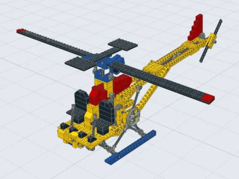</a><h3><a href="https://erik-larsen.github.io/kinebrick/?model=852-Helicopter&autospin=143&rpm=135">852 Helicopter</a> <i>1977</i></h3>A crank drives both rotors; the pilots’ levers slide the swashplate up and down, pitching the blades.

Details

Turn the crank at its side, or Ctrl-click it as the card does, and its gears turn the tail rotor and, through a crown gear, the main rotor, a third as fast; each rotor is a Technic plate gripped by bushes on its shaft. Pull either pilot's lever and the swashplate slides up or down the rotor shaft, its two halves together (the top one turns with the rotor, the bottom one doesn't), and its pitch links tilt both blades alike: collective pitch, as on a real helicopter.

 </td>
<td align="center" valign="top" width="33%"><a href="https://erik-larsen.github.io/kinebrick/?model=854-Go%20Kart&turn=155,60&autospin=323&rpm=54">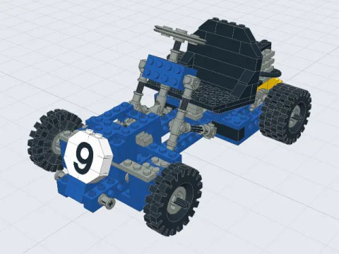</a><h3><a href="https://erik-larsen.github.io/kinebrick/?model=854-Go%20Kart&turn=155,60&autospin=323&rpm=54">854 Go-Kart</a> <i>1978</i></h3>Steers on turntables through a universal joint; rolling it runs its one-cylinder engine.

Details

One of the first Technic sets. Its steering wheel turns the front wheels on 2x2 turntables, through a universal joint and a rack, and as it rolls, its rear wheel turns a crank that runs a piston up and down in a block of bricks. Its seat sits on a hinge; its hoses are decoration. Its front wheels turn alike, and its rear wheels share a solid axle, so steered, its tyres scrub; its file allows it 16% (<a href="#options">Tyre scrub</a>), enough to roll at full lock, its front wheels turned about 33 degrees. The card opens it with its steering turned a little, driving round in a circle.

 </td>
<td align="center" valign="top" width="33%"><a href="https://erik-larsen.github.io/kinebrick/?model=855-Mobile%20Crane&autospin=313,cw">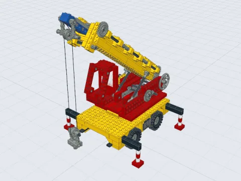</a><h3><a href="https://erik-larsen.github.io/kinebrick/?model=855-Mobile+Crane&autospin=313,cw&rpm=55">855 Mobile Crane</a> <i>1978</i></h3>The cab slews, the boom luffs, the outriggers slide out, and the winch winds the hook up on its string.

Details

Its cab slews on a turntable, and a crank on the cab raises and lowers the boom; its four outriggers slide out on tiles; its cab's shutters swing on finger hinges. Its winch, the crank at the back of the cab, winds its string in or out, which runs over a pulley at the boom tip, down round a pulley on the hook, and back up: so the hook rises or falls half as far as the string winds, straight down beneath the boom tip as the boom slews and luffs. The card opens it winding the hook up.

 </td>
</tr>
<tr>
<td align="center" valign="top" width="33%"><a href="https://erik-larsen.github.io/kinebrick/?model=952-Tractor">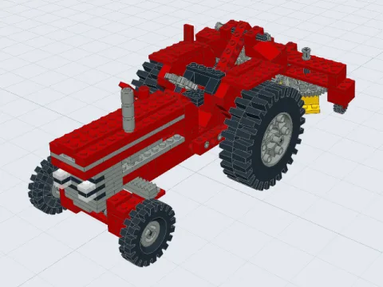</a><h3><a href="https://erik-larsen.github.io/kinebrick/?model=952-Tractor">952 Tractor</a> <i>1978</i></h3>Big driving rear wheels, steering through a universal joint, and a hitch raised by a lever.

Details

Its big rear wheels drive it; its steering column turns the front wheels on turntables through a universal joint and a rack, and the thresher attachment pivots on its frame. A lever beside the seat raises and lowers the hitch, which hangs on both rear half axles; lowered all the way, the thresher's 40 tooth gear meets a crown gear the rear axle drives, so as the tractor rolls, the thresher's gears spin. Its front wheels turn alike, so steered, its tyres scrub: up to 7% of how far they roll with its front wheels turned 40 degrees, within the 10% Kinebrick allows (<a href="#options">Tyre scrub</a>).

 </td>
<td align="center" valign="top" width="33%"><a href="https://erik-larsen.github.io/kinebrick/?model=956-Auto+Chassis&turn=354,-67.2&autospin=453">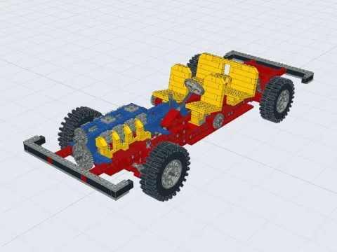</a><h3><a href="https://erik-larsen.github.io/kinebrick/?model=956-Auto+Chassis&turn=354,-67.2&autospin=453">956 Auto Chassis</a> <i>1978</i></h3>Rolling it runs a four-cylinder engine; rack and tie-rod steering.

Details

As it rolls, its drive shaft turns a four-cylinder engine, the pistons running up and down, in either of two speeds: its gear lever slides the shaft back and forth, meshing its 8 tooth gear with one that drives the engine through a 24 tooth gear, or straight with the crankshaft's own; its steering wheel turns the front wheels through a double universal joint, a guided rack and tie rods; its seats slide on racks. Its rear axle has no differential, so steered, its rear tyres skid round the bend. Its front wheels turn alike, rather than the inner one further, so at full lock, about 33 degrees, where its front tyres meet its chassis, its tyres scrub sideways by about a twentieth of how far they roll, within the 10% Kinebrick allows (<a href="#options">Tyre scrub</a>).

 </td>
<td align="center" valign="top" width="33%"><a href="https://erik-larsen.github.io/kinebrick/?model=856-Bulldozer&autospin=12">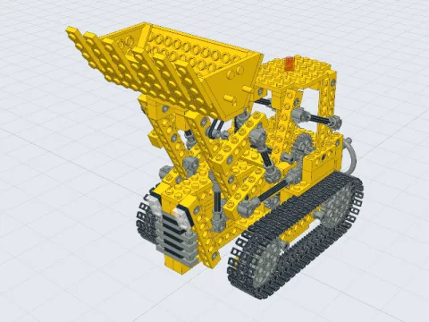</a><h3><a href="https://erik-larsen.github.io/kinebrick/?model=856-Bulldozer&autospin=12">856 Bulldozer</a> <i>1979</i></h3>Runs on two chain tracks, and turns by skidding them.

Details

It runs on two tracks of chain tread links, each round two 40 tooth gears. Turn a track's gear, or Ctrl-click it as the card does, and the track runs round, its links going round with it, and the bulldozer turns, skidding its tracks as a real one does. Its bucket's plates slot into grooves in its tipper ends.

 </td>
</tr>
<tr>
<td align="center" valign="top" width="33%"><a href="https://erik-larsen.github.io/kinebrick/?model=950-Fork+Lift&turn=178,101.2&autospin=188,cw">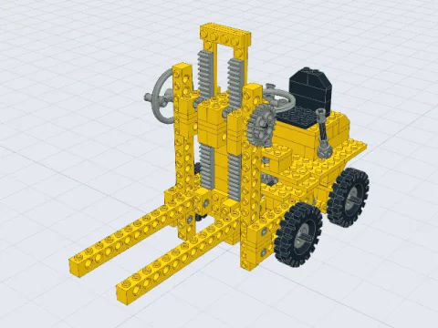</a><h3><a href="https://erik-larsen.github.io/kinebrick/?model=950-Fork+Lift&turn=178,101.2&autospin=188,cw">950 Fork-Lift Truck</a> <i>1979</i></h3>A crank runs the forks up the mast on racks; it steers through a crown gear.

Details

Its steering wheel turns a crown gear, which steers the wheels on turntables through a rack. A crank raises the forks, which ride up the mast on racks, 10 LDU per radian, until the gears reach the end of the teeth.

 </td>
<td align="center" valign="top" width="33%"><a href="https://erik-larsen.github.io/kinebrick/?model=858-Auto+Engines-2-Cycle+Engine&autospin=20&rpm=100">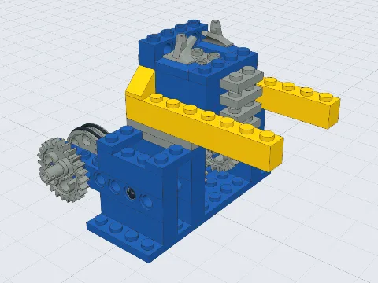</a><h3><a href="https://erik-larsen.github.io/kinebrick/?model=858-Auto+Engines-2-Cycle+Engine&autospin=20&rpm=100">858 2-Cycle Engine</a> <i>1980</i></h3>One piston, run by a hand wheel on a rubber band.

Details

The first of the four engines of LEGO set 858, Auto Engines, each a model of its own. Its crankshaft is built of 24 tooth gears joined by an axle off their middles. Turn the hand wheel, the 24 tooth gear with a pin for a handle, or Ctrl-click it as the card does, and a rubber band from its belt wheels turns the crankshaft about 2.9 times as fast, so the piston runs up and down its 32 LDU stroke.

 </td>
<td align="center" valign="top" width="33%"><a href="https://erik-larsen.github.io/kinebrick/?model=858-Auto+Engines-Boxer+Engine&autospin=91&rpm=100">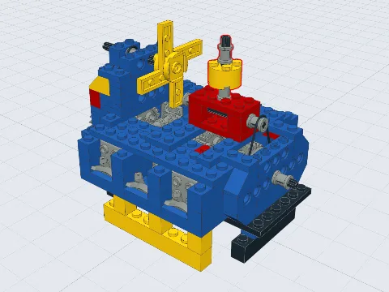</a><h3><a href="https://erik-larsen.github.io/kinebrick/?model=858-Auto+Engines-Boxer+Engine&autospin=91&rpm=100">858 Boxer Engine</a> <i>1980</i></h3>Six pistons, three a side; rubber bands turn its fan.

Details

Turn the crank, the 40 tooth gear on the end of the crankshaft with a pin for a handle, or Ctrl-click it as the card does, and its six pistons run in and out, three each side, while rubber bands from the crankshaft's belt wheels turn the fan and the axle across the top, about 2.9 times as fast. Its round cap, a 2 x 2 round brick on an axle, stands on a bush between four studs, which grip it.

 </td>
</tr>
<tr>
<td align="center" valign="top" width="33%"><a href="https://erik-larsen.github.io/kinebrick/?model=858-Auto+Engines-Inline+Engine&autospin=43&rpm=100">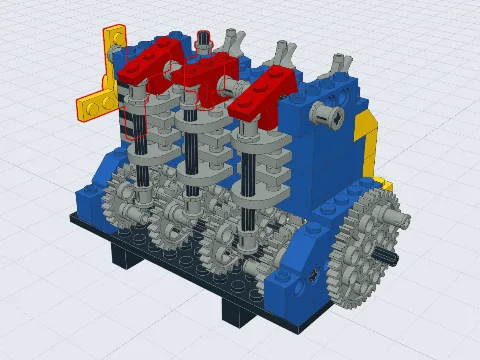</a><h3><a href="https://erik-larsen.github.io/kinebrick/?model=858-Auto+Engines-Inline+Engine&autospin=43&rpm=100">858 Inline Engine</a> <i>1980</i></h3>Three pistons, and a camshaft whose pins lift push rods that tip the valves.

Details

Turn the crank, the 40 tooth gear with a pin for a handle, or Ctrl-click it as the card does, and its three pistons run up and down, rubber bands turn the fan and the distributor, and four pairs of 24 tooth gears turn the camshaft as fast as the crankshaft. Pins on the camshaft's gears lift the three push rods in turn, each up to 14 LDU, and each rod tips its valve's rocker on the axle across the top; between pins, a rod drops back onto the plate it stands through, and its rocker onto the rod, or the studs under it. Kinebrick keeps each resting on whatever is highest under it, as gravity would. Its file had the camshaft 2 LDU off the hole it runs in, so its gears missed; that's corrected. Its round cap stands on a bush between four studs, as on the boxer engine, and its fan's round plates are pressed onto the tip of their axle pin, past the bush its rubber band runs in.

 </td>
<td align="center" valign="top" width="33%"><a href="https://erik-larsen.github.io/kinebrick/?model=858-Auto+Engines-V-6+Engine&autospin=133&rpm=100">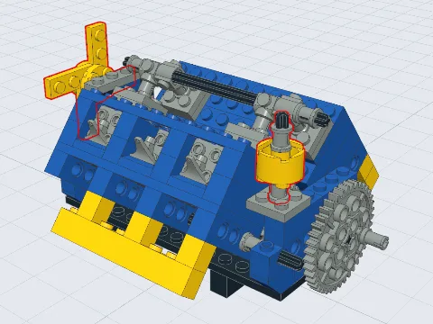</a><h3><a href="https://erik-larsen.github.io/kinebrick/?model=858-Auto+Engines-V-6+Engine&autospin=133&rpm=100">858 V-6 Engine</a> <i>1980</i></h3>Six pistons in two banks in a V; rubber bands turn its fan.

Details

Its two banks of three cylinders stand in a V, each hung on an axle along the block and held by an axle through both their tops. Turn the crank, the 40 tooth gear with a pin for a handle, or Ctrl-click it as the card does, and the pistons run in and out, and rubber bands turn the fan and the long axle along the side, about 2.9 times as fast. Its file had each bank a stud too far in on the 1 x 4 Technic bricks it hangs from, so the banks leaned 102° apart, the crankshaft's gears were built into them, and its connecting rods and pistons ran into the banks and the taps on their cylinders; with each bank a stud further out, they lean about 86° apart and nothing touches. The instructions' scans are too coarse to show that stud, but it's where everything fits, as on the boxer engine. Its round cap and its fan are held as on the inline engine.

 </td>
<td align="center" valign="top" width="33%"><a href="https://erik-larsen.github.io/kinebrick/?model=8448-Super%20Car-V8%20engine&autospin=89,cw&rpm=100">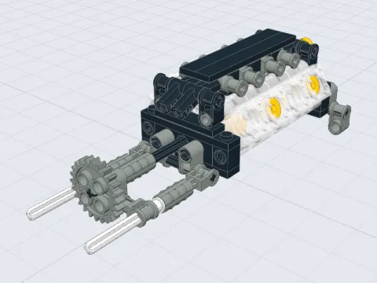</a><h3><a href="https://erik-larsen.github.io/kinebrick/?model=8448-Super%20Car-V8%20engine&autospin=89,cw&rpm=100">8448 V8 engine</a> <i>1999</i></h3>Eight pistons in two banks on a flat-plane crankshaft.

Details

The engine from LEGO set 8448, Super Street Sensation, as built in the LDraw Official Model Repository. Eight pistons in two banks run on a flat-plane crankshaft; turning the crankshaft, by its 24 tooth gear or its fan, takes all eight through their strokes. The card opens it running.

 </td>
</tr>
<tr>
<td align="center" valign="top" width="33%"><a href="https://erik-larsen.github.io/kinebrick/?model=8880-Super+Car&autospin=1401&turn=894,167.3">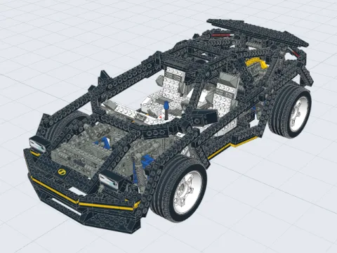</a><h3><a href="https://erik-larsen.github.io/kinebrick/?model=8880-Super+Car&autospin=1401&turn=894,167.3">8880 Super Car</a> <i>1994</i> · WIP</h3>Four-wheel drive through three differentials, four-wheel steering, a four-speed gearbox and a V8.

Details

1411 parts. Push it, or turn a wheel, and all four wheels drive it, through grooved balls in their hubs and three differentials. Its four-speed gearbox: move its gear lever into one of the four slots of its gate, which slides one of its two driving rings to one side or the other (or slide a ring yourself), and as the car rolls its V8 turns 2.25, 1.5, 0.75 or 0.5 times per turn of the wheels; with both in the middle, the engine stays still. Its steering wheel turns the front wheels one way and the rear ones the other, about half as far; each pair turns alike, so steered, its tyres scrub: up to 4% of how far they roll at full lock, within the 10% Kinebrick allows (<a href="#options">Tyre scrub</a>). Its bodywork is set at angles on swivel and finger hinges, its seats tip on hinge plates, and its headlights pop up on a knob. Its file in the OMR has four mistakes, which Kinebrick found because parts wouldn't attach or wouldn't mesh: an axle, a pin and a bracket out of place, and a plate missing under the rear steering rack. They're put right in <code>models/</code>, each with a comment saying how (the rear steering rack as the <a href="https://bricksafe.com">Bricksafe</a> reconstruction of the set builds it). The card opens it driving along.

 </td>
<td align="center" valign="top" width="33%"><a href="https://erik-larsen.github.io/kinebrick/?model=8448-Super%20Car">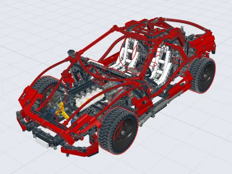</a><h3><a href="https://erik-larsen.github.io/kinebrick/?model=8448-Super%20Car">8448 Super Street Sensation</a> <i>1999</i> · WIP</h3>1290 parts. It loads, but doesn’t move as it should yet.

Details

WIP. the whole car from the same set, 1290 parts, its hoses and shock absorber springs included. It loads, but Kinebrick doesn't understand it yet: 8 parts it can't attach (two universal joints, two angle connectors, two axles). It now stands on its racing tyres, and a turn of a wheel rolls it and runs its V8. Being from 1999, it comes late in M7.

 </td>
</tr>
</table>

### Test models

Built for Kinebrick, each to try one kind of mechanism.

<table>
<tr>
<td align="center" valign="top" width="33%"><a href="https://erik-larsen.github.io/kinebrick/?model=simple-car">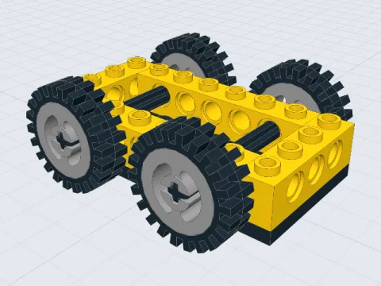</a><h3><a href="https://erik-larsen.github.io/kinebrick/?model=simple-car">Simple car</a></h3>Push it and it rolls, its wheels turning against the ground.

Details

Drag the frame and it rolls along its length, its wheels turning by distance ÷ tyre radius; turn a tyre and the car rolls with it.

 </td>
<td align="center" valign="top" width="33%"><a href="https://erik-larsen.github.io/kinebrick/?model=geared-car">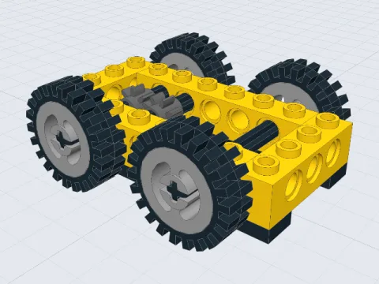</a><h3><a href="https://erik-larsen.github.io/kinebrick/?model=geared-car">Geared car</a></h3>Rolling it spins a second axle the other way through two gears.

Details

The same car with two 8 tooth gears inside, so rolling the car spins a second axle the other way.

 </td>
<td align="center" valign="top" width="33%"><a href="https://erik-larsen.github.io/kinebrick/?model=gear-train">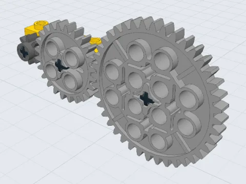</a><h3><a href="https://erik-larsen.github.io/kinebrick/?model=gear-train">Gear train</a></h3>8, 24 and 40 tooth gears, turning at the right ratios.

Details

8, 24 and 40 tooth gears on a Technic brick. Turning any gear turns the others at the right ratios (the 40 tooth gear turns 1/5 as far as the 8 tooth gear).

 </td>
</tr>
<tr>
<td align="center" valign="top" width="33%"><a href="https://erik-larsen.github.io/kinebrick/?model=right-angle">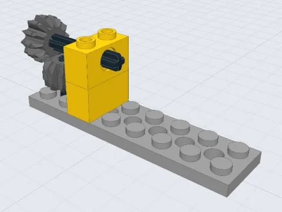</a><h3><a href="https://erik-larsen.github.io/kinebrick/?model=right-angle">Right-angle drive</a></h3>Two bevel gears meshing at a right angle.

Details

Two 12 tooth double bevel gears meshing at a right angle, one on a horizontal axle and one on a vertical axle.

 </td>
<td align="center" valign="top" width="33%"><a href="https://erik-larsen.github.io/kinebrick/?model=differential">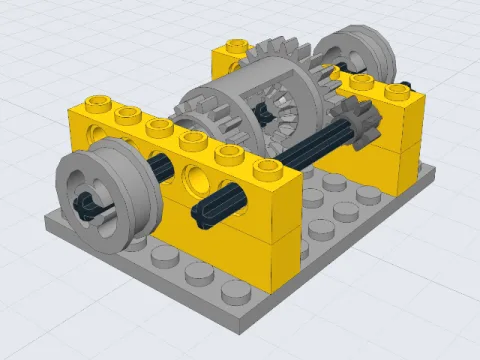</a><h3><a href="https://erik-larsen.github.io/kinebrick/?model=differential">Differential</a></h3>Freeze the input, and one output turns the other backwards.

Details

A differential on a stand, driven by an 8 tooth gear. Turning the input turns both outputs together. Freeze the input (Alt-click it) and turning one output turns the other the opposite way.

 </td>
<td align="center" valign="top" width="33%"><a href="https://erik-larsen.github.io/kinebrick/?model=steering-car">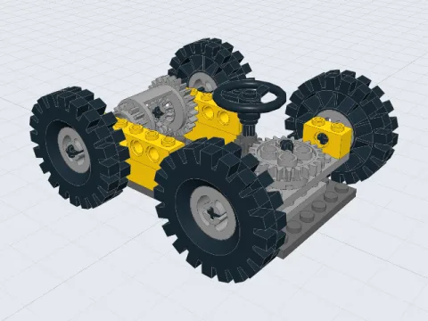</a><h3><a href="https://erik-larsen.github.io/kinebrick/?model=steering-car">Steering car</a></h3>Steer it, push it, and it drives round a circle on its differential.

Details

A car whose front axle pivots in the middle, turned by a steering wheel through 8 and 24 tooth gears, with big tyres and the differential at the back. Turn the steering wheel, then push the car: it drives round a circle, every wheel at its own speed. The steering stops at about 20 degrees either way, where the front tyres meet the chassis.

 </td>
</tr>
<tr>
<td align="center" valign="top" width="33%"><a href="https://erik-larsen.github.io/kinebrick/?model=steering-car-solid">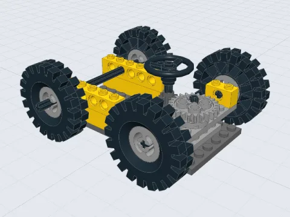</a><h3><a href="https://erik-larsen.github.io/kinebrick/?model=steering-car-solid">Steering car, solid rear axle</a></h3>No differential: steered, its rear tyres skid round the bend.

Details

The same car with one solid axle at the back, and no differential. Steered, it still rolls round the bend, but its rear tyres skid: the axle turns them alike, though the outer one travels further than the inner one.

 </td>
<td align="center" valign="top" width="33%"><a href="https://erik-larsen.github.io/kinebrick/?model=ackermann-car">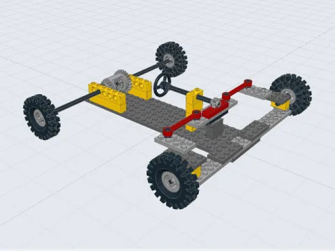</a><h3><a href="https://erik-larsen.github.io/kinebrick/?model=ackermann-car">Ackermann car</a></h3>Rack and pinion steering; the inside wheel turns further.

Details

A wide car whose front wheels each turn on their own kingpin. The steering wheel's 8 tooth gear slides a rack, and a steering link on ball joints at each end of the rack pulls a steering arm that points back and in, at the middle of the rear axle. At full lock, 30 LDU of rack travel, the inside wheel turns 30 degrees and the outside one 20, and pushed, the car drives round a circle with every tyre scrubbing sideways by under 1% of how far it rolls.

 </td>
<td align="center" valign="top" width="33%"><a href="https://erik-larsen.github.io/kinebrick/?model=worm-drive">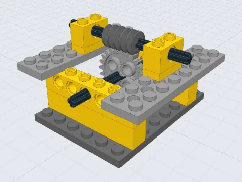</a><h3><a href="https://erik-larsen.github.io/kinebrick/?model=worm-drive">Worm drive</a></h3>The worm turns the gear, but the gear can’t turn the worm.

Details

A worm driving a 24 tooth gear, one tooth per turn of the worm. Turning the gear does nothing: a worm can't be driven from its gear.

 </td>
</tr>
<tr>
<td align="center" valign="top" width="33%"><a href="https://erik-larsen.github.io/kinebrick/?model=gearbox">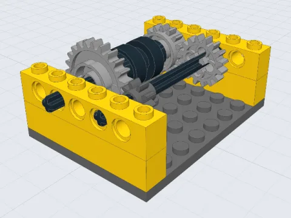</a><h3><a href="https://erik-larsen.github.io/kinebrick/?model=gearbox">Two-speed gearbox</a></h3>Move the gear lever, or slide the driving ring, to change gear.

Details

An input axle with 8 and 16 tooth gears, driving a 24 and a 16 tooth clutch gear that freewheel on the output shaft, with a driving ring between them. Slide the ring towards the 24 tooth gear for first gear (the output turns a third as far as the input), towards the 16 tooth gear for second (as far as the input), or to the middle for neutral (the output stays put). Or move the gear lever above it, the 8880 Super Car's kind, into a slot of its gate: its foot swings the other way, into the ring, and slides it. The two slots on the input axle's side give first and second; the two on the other side swing its foot away from the ring, so they're neutral, like the middle.

 </td>
<td align="center" valign="top" width="33%"><a href="https://erik-larsen.github.io/kinebrick/?model=single-piston-engine">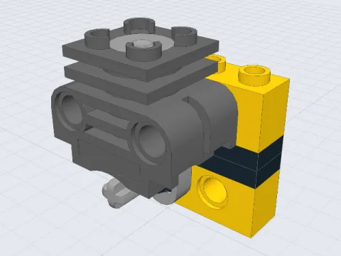</a><h3><a href="https://erik-larsen.github.io/kinebrick/?model=single-piston-engine">Single-cylinder engine</a></h3>A crank, connecting rod and piston.

Details

A crank on an axle drives a piston up and down its cylinder through a connecting rod. Turning the crank once moves the piston down its one-stud stroke and back; pushing the piston turns the crank, except at the top and bottom of its stroke.

 </td>
<td align="center" valign="top" width="33%"><a href="https://erik-larsen.github.io/kinebrick/?model=four-bar">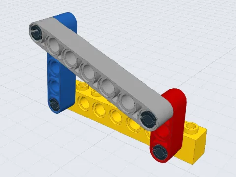</a><h3><a href="https://erik-larsen.github.io/kinebrick/?model=four-bar">Four-bar linkage</a></h3>The crank turns all the way round; the far beam rocks.

Details

Four beams pinned in a loop on a Technic brick. The short crank turns all the way round, rocking the far beam to and fro through about 63 degrees.

 </td>
</tr>
<tr>
<td align="center" valign="top" width="33%"><a href="https://erik-larsen.github.io/kinebrick/?model=rack-and-pinion">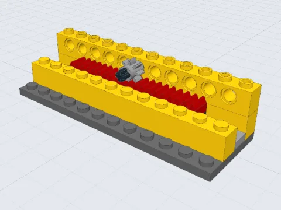</a><h3><a href="https://erik-larsen.github.io/kinebrick/?model=rack-and-pinion">Rack and pinion</a></h3>The gear slides the rack until it runs out of teeth.

Details

An 8 tooth gear on two 1x4 racks, which ride on a plate that slides along a row of tiles between rails. A quarter turn of the gear moves the rack 2 teeth; pushing the rack turns the gear. The rack travels 80 LDU either way, until the gear reaches the end of the teeth, its plate overhanging the tiles.

 </td>
<td align="center" valign="top" width="33%"><a href="https://erik-larsen.github.io/kinebrick/?model=linear-actuator">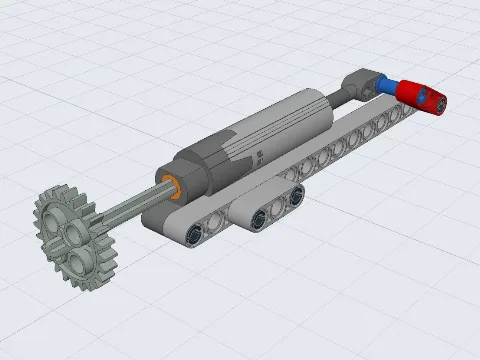</a><h3><a href="https://erik-larsen.github.io/kinebrick/?model=linear-actuator">Linear actuator</a></h3>Turning the gear pushes the piston out, raising the arm.

Details

A large linear actuator pinned to a beam, its piston pinned to an arm that turns on the beam's far end. Each turn of the gear on its input slides the piston out 3.7 LDU, tipping the actuator and swinging the arm up, until the piston reaches the end of its stroke. Pushing the arm does nothing: the actuator's screw can't be driven from its piston.

 </td>
</tr>
</table>

### Your own model

Pick **Open a model file…** at the bottom of the model menu, or drop an LDraw file (`.ldr`, or `.mpd` with submodels) or a BrickLink Studio file (`.io`) anywhere on the page. Kinebrick fetches the parts it uses from [its copy of the LDraw parts library](https://github.com/erik-larsen/ldraw) and works out the mechanism as it does for its own models.

Your file stays in your browser; nothing is uploaded. The browser keeps it so the page can reload with it (the address names it, as `file=`), so a link to it only works in that browser.

Kinebrick knows the moving parts of its own models and the most common ones in the OMR's Technic sets, but not every part yet. The panel lists any part it has no connection data for (marked ⚠, as loose parts are); any moving part it can't move yet, such as shock absorbers, pneumatics and some gears and tyres, with what it doesn't do ("doesn't mesh", "doesn't roll"); and any file the parts library hasn't got, which isn't drawn: usually a part LDraw hasn't made official yet, which the model file didn't bring along.

## Status

Every [milestone](#milestones) of version 1.0, the kinematics, is done but M7.

**Under way: M7, real LEGO sets, oldest first.** Every set under [Models](#models) works in full, except the 8448 Super Street Sensation, whose V8 engine works on its own. Next: more sets.

**[Function check](ARCHITECTURE.md#the-function-check) on all 186 sets.** Each set's functions, from its instruction book, tried on its model.

| Result | Functions | Share |
|---|---|---|
| Works | 517 | 42% |
| Partly | 357 | 29% |
| Doesn't work | 175 | 14% |
| Skipped or not checked | 175 | 14% |

Of the functions checked, 49% work in full. Only 13 of the 186 sets have every function working.

**Major things left:**

1. **Finish the surveys.** The function check is done, and the OMR control surveys' results are on the `omr-survey` branch.
2. **Refine the kinematics from those results.** This is the bulk of the remaining work: turning the 357 "partly" and 175 "doesn't work" functions into working ones, a part type or connection rule at a time. Grouped by cause, the biggest is a drag choosing the wrong way for a mechanism to move, in about 130 sets; then parts Kinebrick doesn't connect or mesh yet, in about 90.
3. **Optimize, only once the refine phase is done.** Solve only the part of a mechanism a control reaches, and cache each set's inferred mechanism. Speed matters already: three sets ran past 30 minutes in the function check.
4. **Version 2.0, forces through MuJoCo.** Springs and shocks, clutches that slip under load, and momentum.
5. **[Later](#later):** other LEGO lines (Creator, trains), marching ants on loose parts, and suggested fixes for loose parts.

**Done:**

- Rolling on tyres, gear trains, bevel gears and differentials (M1–M3)
- Steering: a pivoting axle, rack and pinion, and Ackermann steering, the inside wheel turning further (M4, M6.2, M6.3)
- Collisions: parts can't pass through each other (M4.5)
- Worms, clutches and gearboxes (M5)
- Closed loops of parts, such as an engine's crank, connecting rod and piston, that stay together however long they run (M6.1)
- Chains and tracks, on which the bulldozer runs (M8)
- Strings and rubber bands: the crane's winch raises and lowers its hook (M9)
- Parts resting on others, kept on whatever is highest under them, as gravity would: an engine's push rods on its camshaft's pins, and its valves' rockers on the rods
- [Your own models](#your-own-model): open any LDraw file; Kinebrick lists what it can't connect or move yet

The models' files are in [`models/`](models/).

## What else it turns up

Working out how a set moves means reading every part of it closely, and that turns up more than motion:

- **[Mechanism catalog](docs/mechanisms/README.md).** The kinds of mechanism in the 186 Technic sets Kinebrick has surveyed, from rack and pinion steering to swing wings: the year each first appears, which sets use it, and how often, decade by decade. Each set's functions are tagged with their kinds from what its building instructions show, and each kind's page says how many of its functions Kinebrick moves today.
- **[LDraw errata](docs/ldraw-errata.md).** Ten errors Kinebrick has found in the published LDraw models of six sets (852, 858, 8844, 8849, 8854 and 8880), such as a part a few LDU out of place that attaches to nothing, each with the exact lines and the correction Kinebrick uses where it has one, so they can be corrected where the models are published.

## What Kinebrick is, and isn't

- **It is** a mechanism inferrer. Each LEGO part gets a description of what it can do (an axle turns in a round hole, a tyre rolls on the ground). Kinebrick reads where the parts sit in the model, decides how they connect, and solves how they move together.
- **It is** iterative. Part types are added one at a time, starting with the ones that move. A brick that only holds things together needs no special treatment: it moves with whatever it's attached to.
- **It isn't** a new 3D viewer. Rendering comes from [three.js](https://threejs.org) and its `LDrawLoader`.
- **It isn't** a general physics engine. Movement comes from the mechanism's geometry (kinematics). Forces, springs and mass come in version 2.0, through an existing physics engine rather than our own.

## How it works

Kinebrick looks up each part's connection points (where its holes, axles, pins and studs are), finds the ones that line up, and groups parts that move together into bodies. Bodies are joined by joints: an axle turning in a hole, a beam turning on a pin, a piston sliding in its cylinder. Each joint, each pair of meshing gears and each tyre on the ground gives equations between the bodies' speeds, and whatever motion the equations leave free is what you can drive. When you drag a part, Kinebrick moves the mechanism along that motion in small steps, and stops where two parts would run into each other.

The details, from the connection table and part roles to how a drag decides what to move, are in [ARCHITECTURE.md](ARCHITECTURE.md).

## Interaction

Everything happens in the 3D view: drag parts with the mouse or a finger. A part only moves the ways its mechanism allows, and everything connected follows. Pressing a part shows how it can move, with an arc for turning or an arrow for pushing. Dragging empty space turns the camera.

| Do this | And |
|---|---|
| Hover over a part | It glows yellow, the rest of its body faintly, and a label gives its number, name, role and body. Not while you're turning, panning or zooming the view. |
| Drag a part that spins on an axle (a gear, a crank, a wheel) | It turns like a knob, following the pointer round its axle. |
| Drag any other part (a frame, a piston, a rack, a linkage's middle beam) | It's pushed along the way it can move: a car rolls, a piston turns its crank (except at dead centre, top and bottom of its stroke). |
| Drag a gearbox's driving ring | It clicks into the nearest gear. |
| Drag a gear lever (the 8880 Super Car's, by its knob) | It clicks into the place in its gate nearest the pointer, sliding the driving ring it moves into that gear; in the middle, neutral. One that slides the shaft it rides on (the 956 Auto Chassis's) clicks it from one gear to the other. |
| Ctrl-click a part that spins on an axle | It keeps turning on its own, like a motor, counter-clockwise as you look at it, at the **Spin speed** set in the Options panel (whole rpm, 15 unless set). When it gets as far as it can go (it runs into something, or a slide or rack reaches its end), it turns back, so a crane's hook goes up and down for as long as you leave it. Ctrl-click it again to reverse, a third time to stop, or use **Reverse** and **Stop**, which show in the Options panel while it turns. One part turns at a time, and the camera follows the model while it turns. The address keeps it too ([Auto spin](#options)), so a link to the page shares the animation. |
| Ctrl-click any other part (a frame, a rack, a piston) | It keeps moving the way a drag would push it, starting away from you, at a tenth of the model's size that way each second, and turns back where it can go no further, so a rack runs to and fro and a car keeps rolling. Ctrl-click it again to reverse, a third time to stop, as for a part that spins. |
| Alt-click (Option-click on a Mac) a part | Its body is frozen until you Alt-click it again, or click **Unfreeze all** in the Options panel. Useful where a mechanism can move more than one way: freeze a differential's input, and turning one output turns the other the opposite way. |
| Click **Reset** in the Options panel | The model goes back as it was loaded, any motor stops, and the camera goes back to where it started. |

Parts a drag doesn't need stay put: pushing a car leaves its steering alone, and turning its steering wheel leaves the car where it is. Motion stops where two parts would run into each other, or at the end of a slide's travel or a rack's teeth, and those two parts flash red; it stops too where a part would go below the ground (a crane's hook let down too far), and that part flashes red. A part that can't move at all says why: the mechanism is jammed, a worm can't be driven from its gear, the model has no wheels to roll on, or its tyres would scrub sideways more than **Tyre scrub** allows (and by how much); a part kept turning that comes to such a stop says so too. Gears a drag brings together (a tractor's thresher lowered onto its power take-off) mesh from then on, and gears it draws apart stop meshing: when a drag ends, Kinebrick works out afresh how the model moves if its gears' meshes have changed. Let go, and the model stays where it is; momentum waits for forces in 2.0.

The **Readout**, which opens under the model's summary, shows how far the frame has moved and each body has turned or slid, so the motion can be checked by eye. A wheel on the ground also shows how far it rolled ÷ its radius, which its turn should match, and once it has scrubbed, how far sideways, and how much of its roll that is just now.

Each kind of information has its own channel: fill colour shows the parts' LEGO colours, a yellow glow what the pointer is on, and an outline their status (cyan frozen, green kept turning, red loose), with a 📌 or ⚠ badge pinned to frozen and loose parts, and with **Drivetrain focus** on, see-through what the last drag didn't move. Outlines show through other parts in a darker shade.

### Options

These are off, or at their usual values, unless you set them, in the Options panel at the top right or in the address, so the published viewer shows the plain model. Switching model keeps them, except Spin speed, Turned parts, Auto spin and Tyre scrub, which belong to a model.

- **Body colours** (`option=bodycolours`): each body in its own colour instead of the parts' LEGO colours, the frame grey.
- **Joint axes** (`option=axes`): each joint's axis as a thin pink rod.
- **Gear contacts** (`option=contacts`): a pink dot where each pair of gears' teeth meet.
- **Drivetrain focus** (`option=focus`): only what a drag or a part kept turning moves draws solid, everything else see-through, so turning a car's steering wheel shows just its steering (the wheel, its column and universal joints, the rack, tie rods and wheels) and rolling it just its wheels and drivetrain. A part counts if it moves against the frame, so a car's frame and what it carries stay see-through as it rolls. Until the next drag or spin moves something, the last one's stay solid; Reset shows everything again.
- **Spin speed** (`rpm=60`): how fast Ctrl-click turns a part, in whole revolutions per minute. It's 15 unless set, and switching model goes back to 15.
- **Auto spin** (`autospin=271`, or `autospin=271,cw`): a part kept turning from the moment the page opens, as if Ctrl-clicked, by its place in the model file: the number the hover label gives it (counting from 0, submodels flattened). It turns counter-clockwise as seen from where the camera starts, or with `,cw` clockwise; a part kept moving rather than turning starts away from where the camera starts, or with `,cw` towards it. Ctrl-click, Reverse and Stop keep it up to date, so copying the address shares the animation. Switching model drops it.
- **Turned parts** (`turn=155,60`, again for each part: `turn=155,60&turn=12,-30`): parts turned as the page opens, each as if dragged, by its place in the model file (as for Auto spin) and how many degrees, counter-clockwise as seen from where the camera starts, or clockwise if negative, one after another before Auto spin starts. Dragging a part like a knob keeps it up to date, so copying the address shares how you've set the model (a car's steering, say); Reset clears it. Switching model drops it.
- **Tyre scrub** (`scrub=10`): how far tyres may slide sideways, as a percentage of how far they roll. It's 10% unless the model says otherwise (see below), and switching model goes back to the new model's own. More lets a car whose steering is far from every wheel turning round one centre roll at bigger steering angles; too much would let a car with no steering at all turn.

A model file can carry Kinebrick's own settings as LDraw meta-commands, which other LDraw programs skip. `0 !KINEBRICK SCRUB [percent=16]` in its main file sets its tyre scrub (the 854 Go-Kart has it: its front wheels turn alike, and at full lock its tyres scrub more than 10%). `0 !KINEBRICK SLIDE [part=3737.dat] [at=0 -147.6 -108.5] [dir=0 0 -1] [positions=0,20]` lets a part slide, with whatever turns on it, between those click positions, in LDU that way from where it's built (the 956 Auto Chassis's input shaft, which its gear lever slides from one gear to the other). A real LEGO set's lines are kept in its file in [data/sets/](data/sets/README.md), by its name in `models/`, rather than edited into its model file: `npm run data` puts them there, so a fresh copy from the OMR gets them too.

For example, `?model=8448-Super%20Car-V8%20engine&option=bodycolours,axes&rpm=60` opens the V8 with body colours and joint axes on, spinning at 60 rpm.

## Milestones

Each milestone ends with a model that moves correctly and a test that checks it.

| # | Milestone | Done when |
|---|---|---|
| M0 | Viewer and connection debug view | The test car loads. Each body is drawn in its own colour and each joint shows its axis. Hovering a part highlights it, tints its body, and labels it with its number, name, role and body. |
| M1 | Rolling car | Pressing a frame part of the test car shows an arrow along the car's length. Dragging either 1x4 brick rolls the car in the direction of the drag, and all four wheels turn by the right amount (distance ÷ tyre radius), shown in the readout. Straight line only. |
| M2 | Spur gears | Gear trains on parallel axles turn at the right ratios. Pushing the car can drive a gear train. Dragging any spinning part (a gear, a crank, a tyre) turns it along an arc about its axle, and the rest of the mechanism follows. |
| M3 | Bevel gears and differential | Right-angle drives work. A differential lets the two wheels on one axle turn at different speeds. |
| M4 | Steering | The front axle pivots in the middle, like a wagon's, turned by a gear on a steering column. Pushing the steered car makes it follow a curve, each wheel turning at its own speed; the rear wheels are on a differential. The same car with a solid rear axle rolls round bends too, its rear tyres skidding. |
| M4.5 | Collisions | Parts stop when they'd run into each other: the steering car's front wheels stop at the chassis, about 20 degrees either way. No part of any test model passes through another. |
| M5 | Worm gears, clutches, gearboxes | A worm turns its gear one tooth per turn and locks when driven from the gear. A two-speed gearbox shifts by sliding its driving ring: first gear turns the output a third as far as the input, second as far, and in neutral the output stays put. Clutches that slip under load wait for forces in 2.0. |
| M6 | Linkages | In three parts, below. These need sliding joints, ball joints, and closed loops of parts kept together. |
| M6.1 | Loops | A single-cylinder engine runs: turning its crank all the way round moves the piston up and down its cylinder, and pushing the piston turns the crank until dead centre. A four-bar linkage of beams on pins (a crank that turns all the way round, rocking a beam to and fro) moves through its full range. After many turns, no joint has drifted apart. |
| M6.2 | Rack and pinion | Turning a gear slides a rack along: a quarter turn of an 8 tooth gear moves the rack 2 teeth. Pushing the rack turns the gear. The racks ride on a plate sliding along tiles between rails, which may overhang them, and stop when the gear reaches the end of the teeth. |
| M6.3 | Ackermann steering | Rack and pinion steering, with steering links on ball joints to a steering arm at each front wheel. Each front wheel pivots on its own, the inside one turning further, so pushing the steered car makes every wheel roll round about the same centre. Tyres may scrub sideways a little, as real ones do. |
| M7 | Real models, oldest first | LEGO Technic sets from the LDraw Official Model Repository load and move as they should, taken in the order they came out, starting with the first Technic sets of 1977, so the basic parts are covered before later ones. Models load straight from multi-part files (MPD), with their submodels and the parts they bring with them. Each set that works joins the tests. |
| M8 | Chains and tracks | A chain or track couples its sprockets like gears that turn the same way, its links moving round the loop. A tracked vehicle turns by skidding its tracks sideways. |
| M9 | Belts, pulleys and strings | A rubber band couples its pulleys by their sizes, and a crossed one reverses them. A string wound on a winch drum and run over pulleys raises a hook as the drum turns, by less through a block and tackle. The hook hangs straight down. |

With M9 the kinematics is complete: version 1.0. Version 2.0 adds forces, through the [MuJoCo](https://mujoco.org) physics engine: momentum, springs that spring, clutches that slip under load.

A car with two fixed axles can't turn without its tyres sliding sideways, which is why M1 is straight-line only and turning waits for steering in M4. Steering alone isn't enough either: in a turn the inside wheels travel a shorter path than the outside ones, so two wheels on one solid axle can't both roll without slipping. Real LEGO cars just scrub their tyres. A tyre on its own axle never slips along the way it rolls in Kinebrick, so the M4 car has a differential at the back and each front wheel spinning on its own stub axle; tyres sharing a solid axle may skid that way, as on a real car, one back and the other forward, rolling without slipping only on average. Sideways, a tyre may scrub by up to 2% of how far it rolls, since real steering only gets close to every wheel rolling round one centre (Ackermann steering, M6.3); and rolling the way that scrubs least, up to 10%, so a car whose front wheels turn alike can roll with its steering turned. A car whose tyres would scrub more than that won't roll, unless its model allows more ([Tyre scrub](#options)).

### Later

- **Beyond Technic.** Other LEGO lines with moving parts, such as Creator sets (hinges, turntables, wheels on plain bricks) and trains (bogies that swivel, wheels on rails).
- **Marching ants for loose parts.** A loose part's own edge lines drawn dashed and crawling, on top of its red outline. Motion draws the eye, and it would only appear when something's wrong.
- **Suggest a fix for a loose part.** For a part that isn't attached, find the nearest position where its anti-studs would land on studs, and suggest moving it there ("move 10 LDU along z to sit on the plate"). Suggest only; Kinebrick doesn't edit models.

## Getting started

You need [Node.js](https://nodejs.org) (which comes with `npm`).

1. Install the dependencies: `npm install`
2. Start the viewer: `npm run dev`, then open the address it prints. Pick a test model from the menu at the top left, or [open your own](#your-own-model).

The viewer doesn't need the LDraw parts library: each test model is packed, with every part it uses, into one file in `packed/`. A model you open yourself is packed the same way in your browser, its parts fetched from [Kinebrick's copy of the library](https://github.com/erik-larsen/ldraw). The libraries are only needed to rebuild the data after changing a test model (see below).

The project uses plain TypeScript, and [Vite](https://vite.dev) as its development server: Vite serves the code to the browser, converts TypeScript to JavaScript as it goes, and reloads the page whenever a file is saved.

Other commands:

- `npm test` runs the tests.
- `npm run omr` downloads every Technic set in `models/technic-sets.csv` that the LDraw Official Model Repository has into `omr/` (not committed): the exact version its `omr_file` column pins, so every scan reads the same files. A set new to the list gets pinned to the repository's current version; to take a newer one, empty its `omr_file` and run it again. Then `npm run scan` reads them all as the viewer reads a model you open yourself and writes `omr/coverage.md`: how much of each set Kinebrick connects, and the parts most worth teaching it next. The scan needs the LDraw parts library in `ldraw/`.
- `npm run joints` tries every control of every model: it turns each part that turns like a knob both ways, as a drag does, and compares how far it turns and what it moves with what it did last time (kept in `tests/joints/`), failing if any got worse. It takes a few minutes, so it isn't part of `npm test`; run it after changing how mechanisms are worked out or moved. `npm run joints -- --update` writes down what it finds as the new normal, and `npm run joints -- --report` lists the knobs that stop after a little or turn only one way. [docs/omr-survey.md](docs/omr-survey.md) says how to run it over all the OMR's sets: by default only the controls a person would use (wheels, steering wheels, and big gears within reach), and with `--all` every knob, which takes days; each set's findings can land on the `omr-survey` branch as it's done.
- `npm run functions` checks each real set's functions, what [its controls are supposed to do](data/sets/README.md), against what Kinebrick does with its model, and writes what it found into the set's file in `data/sets/` (see [The function check](ARCHITECTURE.md#the-function-check)). `npm run instructions` downloads each set's building instructions into `omr/instructions/` (not committed) and writes down which file is which book.
- `npm run mechanisms` writes the [mechanism catalog](docs/mechanisms/README.md) into `docs/mechanisms/` from the kinds in `data/mechanisms.json` and the `mechanisms` each set's functions list in `data/sets/`. Run it after tagging a set's functions.
- `npm run build` builds the site into `dist/`. Every push to `main` runs the tests, then builds and publishes it to GitHub Pages (see `.github/workflows/pages.yml`). If a test fails, the live site stays as it was.
- `npm run data` rebuilds the [connection table](ARCHITECTURE.md#the-connection-table) (and the one for the whole LDraw library, for models you open yourself) and the packed models, after adding or changing a test model (an `.ldr`, or an `.mpd` with submodels, in `models/`). First it brings in any real LEGO set newly downloaded from the [LDraw Official Model Repository](https://library.ldraw.org/omr) into `models/`: `956 - Auto Chassis.mpd` becomes `956-Auto Chassis.mpd`, replacing an older copy, and so do the names of the files inside it; and it gives every set Kinebrick's own lines for it from `data/sets/` (see [Options](#options)). It needs both libraries in the project folder (neither is committed):
  - the LDraw parts library: download [complete.zip](https://library.ldraw.org/library/updates/complete.zip) and unzip it, so you have `ldraw/parts`, `ldraw/p` and `ldraw/LDConfig.ldr`;
  - the LDCad shadow library: `git clone --depth 1 https://github.com/RolandMelkert/LDCadShadowLibrary.git ldcad-shadow`.
- `npm run thumbs` makes the pictures on the [Models](#models) cards, `media/thumbs/<model>.webp`, for every model in `models/` (or only those named: `npm run thumbs -- "956-Auto Chassis"`). It opens each one in Google Chrome, out of sight, and crops the view as the viewer first shows it to the model. Set `CHROME` to the program's path if Chrome isn't in `/Applications`, or to use Chromium.

## Data sources and licenses

| Source | Used for | License |
|---|---|---|
| [LDraw parts library](https://library.ldraw.org) | Part shapes and connection primitives; the packed models in `packed/` include the parts they use, and models you open yourself fetch theirs from [a copy published beside Kinebrick](https://github.com/erik-larsen/ldraw) | CC BY 4.0 |
| [three.js](https://threejs.org) | Rendering and LDraw loading | MIT |
| [three-mesh-bvh](https://github.com/gkjohnson/three-mesh-bvh) | Fast tests of whether two parts' shapes overlap | MIT |
| [LDCad shadow library](https://github.com/RolandMelkert/LDCadShadowLibrary) | Connection points in the [connection table](ARCHITECTURE.md#the-connection-table) | CC BY-SA 4.0 |
| [LDraw Official Model Repository](https://library.ldraw.org/omr) | The real LEGO sets in `models/`: 852 Helicopter by Allard van Efferen; 854 Go-Kart by Stefan Frenz; 855 Mobile Crane and 856 Bulldozer by Marc Giraudet; 950 Fork-Lift Truck by Merlijn Wissink; 952 Tractor by Nathan Perry; 956 Auto Chassis by N. W. Perry; the 858 Auto Engines' four engines by Takeshi Takahashi; 8880 Super Car, and 8448 Super Street Sensation and its V8 engine, by Orion Pobursky | CC BY 2.0 (CCAL 2.0) |

## License

The code is [MIT](LICENSE). The connection table is derived from the LDCad shadow library, so it is shared under the same license, [CC BY-SA 4.0](https://creativecommons.org/licenses/by-sa/4.0/). The real LEGO set models are from the LDraw Official Model Repository, by the authors listed above, under [CC BY 2.0](https://creativecommons.org/licenses/by/2.0/).
