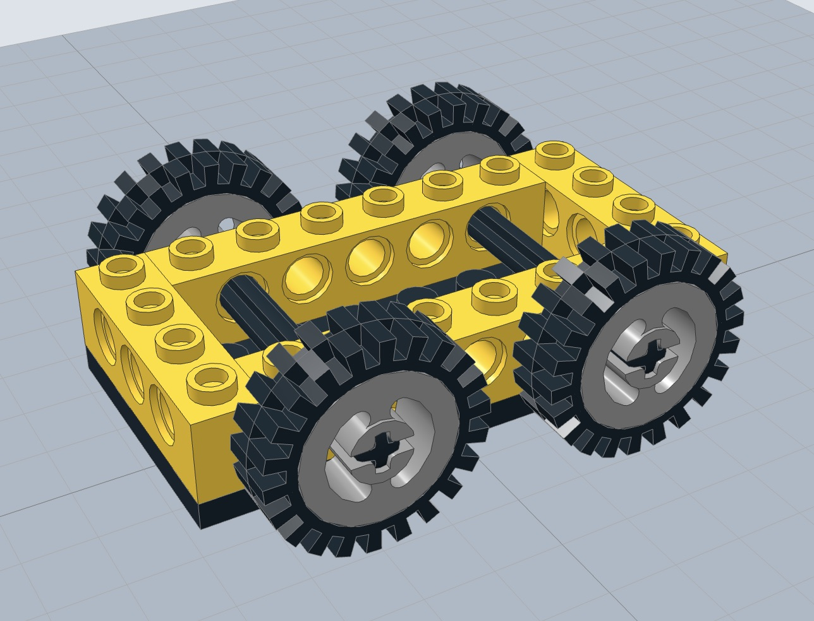

# [KineBrick](https://erik-larsen.github.io/kinebrick/)

A web viewer that makes LEGO Technic models move. Load an LDraw model of a simple car, push the chassis, and the car rolls: the tyres turn against the ground, the rims and axles turn with them, and the bricks ride along. KineBrick works this out from the parts themselves, with no hand-made animation.

## Status

M5 works, and parts can't pass through each other. Nine test models, picked from a menu in the viewer:

- [Simple car](models/simple-car.ldr): drag the frame and it rolls along its length, its wheels turning by distance ÷ tyre radius; turn a tyre and the car rolls with it.
- [Geared car](models/geared-car.ldr): the same car with two 8 tooth gears inside, so rolling the car spins a second axle the other way.
- [Gear train](models/gear-train.ldr): 8, 24 and 40 tooth gears on a Technic brick. Turning any gear turns the others at the right ratios (the 40 tooth gear turns 1/5 as far as the 8 tooth gear).
- [Right-angle drive](models/right-angle.ldr): two 12 tooth double bevel gears meshing at a right angle, one on a horizontal axle and one on a vertical axle.
- [Differential](models/differential.ldr): a differential on a stand, driven by an 8 tooth gear. Turning the input turns both outputs together. Hold the input still (Alt-click it) and turning one output turns the other the opposite way.
- [Steering car](models/steering-car.ldr): a car whose front axle pivots in the middle, turned by a steering wheel through 8 and 24 tooth gears, with big tyres and the differential at the back. Turn the steering wheel, then push the car: it drives round a circle, every wheel at its own speed. The steering stops at about 20 degrees either way, where the front tyres meet the chassis.
- [Worm drive](models/worm-drive.ldr): a worm driving a 24 tooth gear, one tooth per turn of the worm. Turning the gear does nothing: a worm can't be driven from its gear.
- [Two-speed gearbox](models/gearbox.ldr): an input axle with 8 and 16 tooth gears, driving a 24 and a 16 tooth clutch gear that freewheel on the output shaft, with a driving ring between them. Slide the ring towards the 24 tooth gear for first gear (the output turns a third as far as the input), towards the 16 tooth gear for second (as far as the input), or to the middle for neutral (the output stays put).
- [Steering car, solid rear axle](models/steering-car-solid.ldr): the same car with one solid axle at the back. It rolls straight ahead, but once steered it jams, because the inner and outer rear wheels would have to roll different distances.

The viewer draws each body in its own colour, each joint's axis and each gear mesh, and labels the part under the pointer. Next is M6: linkages.

## What KineBrick is, and isn't

- **It is** a mechanism inferrer. Each LEGO part gets a description of what it can do (an axle turns in a round hole, a tyre rolls on the ground). KineBrick reads where the parts sit in the model, decides how they connect, and solves how they move together.
- **It is** iterative. Part types are added one at a time, starting with the ones that move. A brick that only holds things together needs no special treatment: it moves with whatever it's attached to.
- **It isn't** a new 3D viewer. Rendering comes from [three.js](https://threejs.org) and its `LDrawLoader`.
- **It isn't** a general physics engine. Movement comes from the mechanism's geometry (kinematics). Forces, springs and mass come later, through an existing physics engine rather than our own.

## How it works

1. **Load.** `LDrawLoader` reads the model and the official LDraw parts library. Each part becomes its own 3D object that can be moved on its own.
2. **Assign roles.** Each part is looked up in KineBrick's role list (see [Part roles](#part-roles)). Parts not in the list are `structure`.
3. **Look up connection points.** Each part's connection points come from KineBrick's [connection table](#the-connection-table): where the part's holes, axles, pins and studs are, which way they point, how long they are, and what shape they are.
4. **Connect.** Connection points from different parts that line up become connections. An axle passing through a round hole becomes a *joint* (it can turn). An axle passing through an axle hole becomes a *rigid* connection (the parts turn together). A tyre sitting on its rim is rigid too. A stud sitting in an anti-stud (the socket under a brick or plate) attaches two parts as well.
5. **Check.** Every part should be attached to the rest of the model through some chain of connections. Parts that aren't get a red outline and a ⚠ badge, and are listed in the viewer, since they're usually in the wrong place: a brick half a stud off, sitting between the studs instead of on them, or floating above the plate.
6. **Group.** Parts that are rigidly connected (an axle in an axle hole, a tyre on a rim) or attached by studs move as one *body*. The body with the most `structure` parts is the *frame*. The simple car has three bodies: the frame (plate plus bricks), and two axles, each with its two rims and tyres locked onto it. The steering car's pivoting front axle carrier, a few bricks and plates of its own, is a separate body that turns on the frame.
7. **Solve.** Joints and ground contact become equations between the bodies' speeds. A joint says two bodies move together except for turning about its axis. Two meshing gears say their teeth move at the same speed where they touch, so their speeds are in the ratio of their tooth counts; that works the same for spur gears side by side and bevel gears at an angle. A part the user holds still says its body doesn't turn. A tyre on the ground says the point touching the ground doesn't move, so the tyre rolls without slipping. The ground is level with the lowest tyre; a model with no tyres has no means of locomotion, so its frame stays put, as if standing on a table. Whatever motion the equations leave free is what the user can drive. If no motion is left free, the mechanism is jammed.
8. **Animate.** The user drags a part (see [Interaction](#interaction)); the solver works out how every body moves, in small steps; the viewer moves each body's parts. After each step, KineBrick checks whether any two parts have started to pass through each other; if so, it undoes the step and the drag stops there, like a steering wheel turned until the front tyres meet the chassis. It only checks parts that aren't directly connected (an axle in a hole, a tyre on its rim and meshing gear teeth all touch legitimately) and that don't already touch when the model loads. The shapes are the parts' own LDraw meshes, tested with [three-mesh-bvh](https://github.com/gkjohnson/three-mesh-bvh). Shifting a gearbox changes what's connected to what, so when a driving ring clicks into a new position, KineBrick works the mechanism out afresh (steps 2 to 7) from where every part now is.

Treating every `structure` part as one frame only works while no group of structure parts moves against the rest. That stops being true with a steering front axle (M4) and suspension arms (M6). From M4, structure parts form bodies by how they're attached, through stud and rigid connections (already found for the check in step 5), and the frame is the largest of those bodies.

## The connection table

The connection table lists the connection points of every part KineBrick knows about. The viewer only reads the table; a script builds it from three sources:

1. **The LDraw parts library.** Parts are built from shared pieces of geometry called primitives, and the library says which primitives each part uses and where they sit. Many parts reuse the same primitives for the same features: a rim's centre is a copy of `axlehol5.dat`, a stud is a copy of `stud.dat`.
2. **The [LDCad shadow library](https://github.com/RolandMelkert/LDCadShadowLibrary).** LDCad is a LEGO CAD program, and its shadow library adds connection data to LDraw parts and primitives: each hole, axle, pin or stud with its position, direction, length and cross-section (round, axle-shaped, or a pin's ridges and collars). Data on a primitive carries into every part that uses it, so describing `axlehol5.dat` once covers every rim built from it. It's called a shadow library because its files mirror the LDraw library's folders and file names, and LDCad loads each one alongside the LDraw file of the same name, as if its lines were part of that file, without changing the official file.
3. **KineBrick's own corrections.** A short hand-written file adds what neither source covers: where a tyre sits on its rim, gear tooth counts, the teeth that lock a clutch gear to a driving ring and the positions the ring clicks into, and whether a pin turns freely or holds by friction (the shadow library treats both kinds of pin the same). The script also measures each tyre's outer radius from its shape, since that sets how far it rolls per turn.

The table is committed to the repository so that changes to it can be reviewed. When the LDraw or shadow library updates, we rebuild it and check the diff. It covers every part used by the test models, and grows with each milestone's test models.

## Part roles

A role is a short label for what a part does in a mechanism. It tells KineBrick which connections the part makes and how it may move. Each part has exactly one role, and parts nobody has described yet get `structure`.

| Role | Examples | What it does |
|---|---|---|
| `structure` | bricks, plates, beams | Nothing on its own. Part of the frame. |
| `axle` | 3706 Technic Axle 6 | Locks into axle holes, turns freely in round holes. |
| `rim` | 3482 Wheel Rim 8 x 17.5 | Carries a tyre. Locks onto an axle through its axle hole. |
| `tyre` | 3483 Tyre 56 x 17; 3634 Tyre 10/130 x 17 (a bigger tyre for the same rim) | Locks onto the rim it sits on. Rolls on the ground without slipping. |
| `gear` | 3647, 4019, 3648, 3649 Technic Gear 8, 16, 24, 40 Tooth | Locks onto an axle through its axle hole. Meshes with a gear whose axle is parallel and exactly the two gears' pitch radii away (1.25 LDU per tooth). |
| `gear` (bevel) | 32270, 32269 Technic Gear 12, 20 Tooth Double Bevel; 6589 Technic Gear 12 Tooth Bevel | Bevel teeth lie on a 45 degree cone. Meshes with another bevel gear whose axle crosses its own, when the tips of their cones meet where the axles cross. Double bevel gears also mesh side by side, like spur gears. |
| `worm` | 4716 Technic Worm Gear 2L | Locks onto an axle through its axle hole. Meshes with a spur gear whose axle crosses its own at right angles, the two pitch radii apart (2 studs for a 24 tooth gear); each turn of the worm moves the gear on one tooth. Can't be driven from the gear: it locks. |
| `gear` (clutch) | 2471, 18946 Technic Gear 24, 16 Tooth with Clutch on Both Sides | Turns freely on an axle through its round hole. The clutch teeth on each face lock it to a driving ring pushed against them. |
| `driving ring` | 18947 Technic Transmission Driving Ring 3L | Locks onto the ridged axle joiner it slides on (18948), and clicks into three positions along it: the middle (neutral) and half a stud either way, where its teeth lock it to the clutch gear on that side. Dragging it shifts gear (see [Interaction](#interaction)). |
| `steering wheel` | 2819 Technic Steering Wheel Small | Locks onto an axle through its axle hole. Like `structure`, but the body it's on is named after it. |
| `differential` | 6573 Technic Differential with Gear 16 Tooth and 24 Tooth | Turns on the two output axles that pass into it. Carries a 16 and a 24 tooth gear ring outside, and a post inside for the middle (planet) bevel gear, which meshes with a bevel gear on each output. |

More roles arrive with each milestone: the rack, pins, linkages, springs.

## Interaction

All manipulation happens directly in the 3D view, by dragging parts with the mouse or a finger. There are no dialogs for moving parts, and no free xyz gizmo: a part can only move the ways its mechanism allows, so the view only offers those.

1. **Hover.** The part under the cursor glows yellow, and the rest of its body (the parts that would move with it) glows faintly. A label shows the part's number, name, role and body, for example "3701 Technic Brick 1 x 4 with Holes · structure · frame".
2. **Press.** Pressing on a part fixes a grab point where the cursor touched it. The view shows how that point can move. Pressing a frame part shows an arrow for its straight-line motion (the car rolling). Pressing a part that spins on an axle (a gear, a crank, a tyre) shows an arc around the axle: dragging it turns the part, and everything connected follows. A tyre on the ground turns the same way, and the car rolls as it turns, so to push the car, grab the frame. The arc is measured against whatever the axle is mounted in, so it travels with a moving car and stays in step with the part. Pressing a gearbox's driving ring shows an arrow along the shaft it slides on. A part that can't move shows no handle, and a brief cue says why: it's jammed, or it's part of a frame that stays put because the model has no means of locomotion (only wheels so far; tracks and legs would count too).
3. **Drag.** Pushing a frame part: as the cursor moves, the mechanism moves as far along its allowed motion as needed to bring the grab point as close to the cursor as it can get. Every body moves with it. Dragging either 1x4 brick of the test car rolls the car in the direction of the drag. Turning a part that spins on an axle: the part turns like a knob, by the angle the cursor sweeps around its axle, and everything connected follows. A cursor that stops moving stops the turn, even if the axle is still being carried along (the car rolling), and close to the axle the turn is damped, so a short drag never gives a big turn. Gearing can still make the rest of the model move further than the cursor: on the geared car, turning the small 8 tooth gear rolls the car about three times as far, the other way. Anything the drag doesn't need to move stays put: pushing a car leaves its steering alone, and turning its steering wheel leaves the car where it is. For the length of a drag, KineBrick holds still every part it can without stopping the drag, trying the deepest parts of the mechanism first (a differential's planet gear before the differential), but never holding a part in a way that carries along the shaft it turns on, if that shaft could have stayed put: in neutral, the gearbox's clutch gears spin freely and its output shaft stays still. Wheels on the ground are never held this way, since rolling is their job. Worms lock: a worm is held still during any drag that would drive it from its gear's side, so turning the gear of a worm drive does nothing, as on the real thing. Sliding a driving ring: the ring jumps to whichever of its positions is nearest to where the cursor has dragged it along the shaft, and that shifts gear. The mechanism is worked out afresh at each shift, so parts held still are let go.
4. **Release.** The model stays where it was left. Momentum waits for forces in M7.
5. **Hold.** Alt-clicking (Option-clicking on a Mac) a part holds its body still: its parts get a cyan outline and the body a 📌 badge, like a grounded part in Fusion 360; Alt-clicking it again lets go, and "Let go of all" lets go of everything. A held part that turns on an axle stops turning; a held frame stops moving. This matters when a mechanism can move more than one way: a differential's two outputs can turn independently, so turning one alone leaves it open how the other and the housing share the motion. Hold the input still, and the other output must turn the opposite way.

While dragging, a small readout shows the numbers, so the motion can be checked by eye: how far the frame has moved and the size of the circle it's turning on, and how far each body has turned. A wheel on the ground also shows how far it rolled ÷ its radius, which its turn should match. After a shift, the readout counts from zero again. Reset puts the model back as it was loaded, gearbox shifted back too.

Dragging on a part moves the mechanism; dragging on empty space turns the camera.

Each kind of information has its own channel, so they never fight: fill colour says which body a part belongs to (or shows its own LEGO colours), a yellow glow shows what the pointer is on, and status gets an outline and a badge pinned to the part (📌 held in cyan, ⚠ loose in red). When a drag stops because two parts would run into each other, those two parts flash a red outline. Outlines show through other parts in a darker shade.

## Milestones

Each milestone ends with a model that moves correctly and a test that checks it.

| # | Milestone | Done when |
|---|---|---|
| M0 | Viewer and connection debug view | The test car loads. Each body is drawn in its own colour and each joint shows its axis. Hovering a part highlights it, tints its body, and labels it with its number, name, role and body. |
| M1 | Rolling car | Pressing a frame part of the test car shows an arrow along the car's length. Dragging either 1x4 brick rolls the car in the direction of the drag, and all four wheels turn by the right amount (distance ÷ tyre radius), shown in the readout. Straight line only. |
| M2 | Spur gears | Gear trains on parallel axles turn at the right ratios. Pushing the car can drive a gear train. Dragging any spinning part (a gear, a crank, a tyre) turns it along an arc about its axle, and the rest of the mechanism follows. |
| M3 | Bevel gears and differential | Right-angle drives work. A differential lets the two wheels on one axle turn at different speeds. |
| M4 | Steering | The front axle pivots in the middle, like a wagon's, turned by a gear on a steering column. Pushing the steered car makes it follow a curve, each wheel turning at its own speed; the rear wheels are on a differential. The same car with a solid rear axle jams when steered. |
| M4.5 | Collisions | Parts stop when they'd run into each other: the steering car's front wheels stop at the chassis, about 20 degrees either way. No part of any test model passes through another. |
| M5 | Worm gears, clutches, gearboxes | A worm turns its gear one tooth per turn and locks when driven from the gear. A two-speed gearbox shifts by sliding its driving ring: first gear turns the output a third as far as the input, second as far, and in neutral the output stays put. Clutches that slip under load wait for forces in M7. |
| M6 | Linkages | Rack and pinion steering with tie rods and Ackermann geometry (each front wheel pivots on its own, the inside one turning further). Pistons, crankshafts and suspension arms move through their full range. These need sliding joints, ball joints, and closed loops of parts kept together. |
| M7 | Forces | Springs, shock absorbers, clutches that slip under load, and pushes or torques as input, through the MuJoCo physics engine. |

A car with two fixed axles can't turn without its tyres sliding sideways, which is why M1 is straight-line only and turning waits for steering in M4. Steering alone isn't enough either: in a turn the inside wheels travel a shorter path than the outside ones, so two wheels on one solid axle can't both roll without slipping. Real LEGO cars just scrub their tyres; KineBrick's tyres never slip, so the M4 car has a differential at the back and each front wheel spinning on its own stub axle.

### Later

- **Marching ants for loose parts.** A loose part's own edge lines drawn dashed and crawling, on top of its red outline. Motion draws the eye, and it would only appear when something's wrong.
- **Suggest a fix for a loose part.** For a part that isn't attached, find the nearest position where its anti-studs would land on studs, and suggest moving it there ("move 10 LDU along z to sit on the plate"). Suggest only; KineBrick doesn't edit models.
- **Clips, hinges and ball joints.** The LDCad shadow library describes these with their own kinds of snap line, which KineBrick doesn't read yet, so a part held only by a clip or hinge is wrongly reported as loose.

## Conventions

- **Units.** LDraw units (LDU). 1 stud = 20 LDU, a brick is 24 LDU tall, a plate is 8 LDU.
- **Axes.** LDraw's own axes: −Y is up. The viewer flips the model when it displays it.
- **Spelling.** Part names follow LDraw, so `tyre`, not `tire`.

## Getting started

You need [Node.js](https://nodejs.org) (which comes with `npm`).

1. Install the dependencies: `npm install`
2. Start the viewer: `npm run dev`, then open the address it prints. Pick a test model from the menu at the top left.

The viewer doesn't need the LDraw parts library: each test model is packed, with every part it uses, into one file in `packed/`. The libraries are only needed to rebuild the data after changing a test model (see below).

The project uses plain TypeScript, and [Vite](https://vite.dev) as its development server: Vite serves the code to the browser, converts TypeScript to JavaScript as it goes, and reloads the page whenever a file is saved.

Other commands:

- `npm test` runs the tests.
- `npm run build` builds the site into `dist/`. Every push to `main` builds and publishes it to GitHub Pages (see `.github/workflows/pages.yml`).
- `npm run data` rebuilds the [connection table](#the-connection-table) and the packed models, after adding or changing a test model. It needs both libraries in the project folder (neither is committed):
  - the LDraw parts library: download [complete.zip](https://library.ldraw.org/library/updates/complete.zip) and unzip it, so you have `ldraw/parts`, `ldraw/p` and `ldraw/LDConfig.ldr`;
  - the LDCad shadow library: `git clone --depth 1 https://github.com/RolandMelkert/LDCadShadowLibrary.git ldcad-shadow`.

## Project layout

| Path | What's in it |
|---|---|
| `models/` | Test models |
| `src/main.ts` | The viewer: model picker, loading, camera, readout |
| `src/ldr.ts` | Reads the parts of an LDraw model file |
| `src/mechanism.ts` | Works out bodies and joints from the connection table ([How it works](#how-it-works), steps 2 to 6) |
| `src/mechanism.test.ts` | Tests for the above, using the test car |
| `src/kinematics.ts` | Works out the allowed motions and moves the bodies (step 7) |
| `src/kinematics.test.ts` | Tests for the above: the car rolls the right distance per wheel turn and stays on the ground |
| `src/gears.test.ts` | Tests for gear trains: ratios, direction, and the geared car |
| `src/bevel.test.ts` | Tests for the right-angle drive and the differential, with and without parts held |
| `src/worm.test.ts` | Tests for the worm drive: one tooth per turn, and locking when driven from the gear |
| `src/gearbox.test.ts` | Tests for the gearbox: the ratio in each gear, and the output staying put in neutral |
| `src/steering.test.ts` | Tests for the steering car: steering without rolling, the turning circle, inner and outer wheels, the solid axle jamming |
| `src/shift.ts` | Finds the parts that slide into set positions (driving rings) and moves them |
| `src/collisions.ts` | Stops parts passing through each other |
| `src/collisions.test.ts` | Tests for the above, on simple shapes |
| `src/attachment.test.ts` | Tests that every test model is fully attached, and that misplaced parts are caught |
| `src/interaction.ts` | Hover, press, drag (see [Interaction](#interaction)) |
| `src/turn.ts` | How far to turn a part when the pointer moves, like a knob |
| `src/turn.test.ts` | Tests for the above |
| `src/appearance.ts` | How parts look: fill colour for which body, yellow glow for hover, outlines and badges for status |
| `src/outlines.ts` | Outlines drawn around parts after the scene renders |
| `src/jointAxes.ts` | Draws joint axes |
| `src/connections.ts` | What a connection point looks like in the table |
| `scripts/build-connections.ts` | Builds the connection table (`npm run connections`) |
| `scripts/pack-models.ts` | Packs each test model with the LDraw parts it uses (`npm run pack`) |
| `packed/` | The packed models and part titles the viewer loads (generated, don't edit) |
| `data/connections.json` | The connection table (generated, don't edit) |
| `data/corrections.ldr` | KineBrick's own additions to the connection table |
| `data/roles.json` | Each part's role; parts not listed are `structure` |

## Data sources and licenses

| Source | Used for | License |
|---|---|---|
| [LDraw parts library](https://library.ldraw.org) | Part shapes and connection primitives; the packed models in `packed/` include the parts they use | CC BY 4.0 |
| [three.js](https://threejs.org) | Rendering and LDraw loading | MIT |
| [three-mesh-bvh](https://github.com/gkjohnson/three-mesh-bvh) | Fast tests of whether two parts' shapes overlap | MIT |
| [LDCad shadow library](https://github.com/RolandMelkert/LDCadShadowLibrary) | Connection points in the [connection table](#the-connection-table) | CC BY-SA 4.0 |

## Prior art

- **[SR 3D Builder](https://wiki.ldraw.org/wiki/Sr3d).** Windows LEGO CAD that could animate gears, hinges and pistons. Discontinued, and its own website is gone, so this links to the LDraw wiki.
- **[LDCad](https://www.melkert.net/LDCad).** LEGO CAD whose animations are written by hand in Lua for each model.
- **[TechnicBrickPower gear calculator](https://www.eurobricks.com/forum/forums/topic/186656-new-technic-gear-ratio-calculator-tool).** Web tool that finds the gear trains in an LDraw file and shows their ratios. Gears only, and no live animation.
- **[yoff/LegoTechnicSimulation](https://github.com/yoff/LegoTechnicSimulation).** Python tool that finds bodies, joints and gear meshes in an LDraw file and exports them to Blender or MuJoCo. Like KineBrick's connection table, it gets connection points from LDraw primitives. Its code can't be reused directly: it's Python, and it has no license.

## License

The code is [MIT](LICENSE). The connection table is derived from the LDCad shadow library, so it is shared under the same license, [CC BY-SA 4.0](https://creativecommons.org/licenses/by-sa/4.0/).
