# [Kinebrick Play](https://erik-larsen.github.io/kinebrick/)

A web [viewer](https://erik-larsen.github.io/kinebrick/?model=956-Auto+Chassis&turn=354,-93.9&autospin=451&rpm=21) that enables LEGO [models](https://erik-larsen.github.io/kinebrick/?model=852-Helicopter&autospin=143&rpm=186) to [move](https://erik-larsen.github.io/kinebrick/?model=855-Mobile+Crane&autospin=313,cw&rpm=98) as they were [designed](https://erik-larsen.github.io/kinebrick/?model=8448-Super+Car-V8+engine&autospin=115,cw&rpm=171&option=focus). Load an LDraw model and drag its parts: push a car and it rolls, turn its steering wheel and the front wheels turn.

**Kinebrick works all this out from the parts themselves, with no hand-made animation.**

Technic models are the initial focus, since they are built to move. The long-term goal though is enabling full functionality of any LEGO model with moving parts.

## Credits

Kinebrick builds on these existing projects:

- **[Roland Melkert's LDCad](https://www.melkert.net/LDCad)** provides the [shadow library](https://github.com/RolandMelkert/LDCadShadowLibrary) to specify the location of each part's studs, holes and axles, and its path data specifies where a chain, track or string runs.
- **[LDraw's](https://www.ldraw.org)** parts library gives every part its shape, and its [Official Model Repository](https://library.ldraw.org/omr) provides official LEGO sets.
- **[LSynth](https://wiki.ldraw.org/wiki/LSynth)** draws the flexible hoses, cables and ropes in many OMR models, and Kinebrick reads its ropes as winch strings.
- **[Three.js's LDraw loader](https://threejs.org/examples/#webgl_loader_ldraw)** renders models in the browser.

Also see [Data sources and licenses](#data-sources-and-licenses).

## Enhanced Model Data

Besides providing a Lego viewer with automatic animation, Kinebrick is finding corrections for OMR models and documenting model functions.  See [Per-set data](ARCHITECTURE.md#per-set-data) and the [Mechanism catalog](docs/mechanisms/README.md) for further details.

## Models

Click a model to open it in the viewer; each opens ready to drag, and some with a part already turning.

### Official Models

Read straight from their files in the [LDraw Official Model Repository](https://library.ldraw.org/omr), oldest first.  Here are some initial working sets:

<table>
<tr>
<td align="center" valign="top" width="33%"><a href="https://erik-larsen.github.io/kinebrick/?model=852-Helicopter&rpm=135&autospin=143">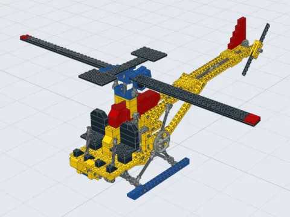</a> <b><a href="https://erik-larsen.github.io/kinebrick/?model=852-Helicopter&rpm=135&autospin=143">852 Helicopter</a></b>

Details
<i>1977</i> A crank drives both rotors; the pilots’ levers slide the swashplate up and down, pitching the blades.
</td>
<td align="center" valign="top" width="33%"><a href="https://erik-larsen.github.io/kinebrick/?model=854-Go+Kart&rpm=54&turn=155,60&autospin=323">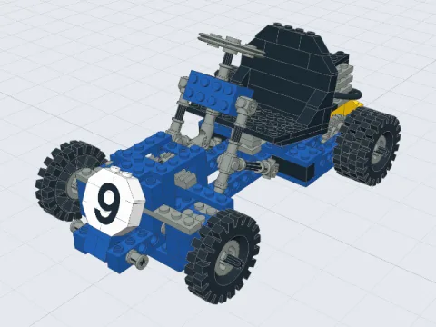</a> <b><a href="https://erik-larsen.github.io/kinebrick/?model=854-Go+Kart&rpm=54&turn=155,60&autospin=323">854 Go-Kart</a></b>

Details
<i>1978</i> Steers on turntables through a universal joint; rolling it runs its one-cylinder engine.
</td>
<td align="center" valign="top" width="33%"><a href="https://erik-larsen.github.io/kinebrick/?model=855-Mobile+Crane&rpm=79&autospin=313,cw">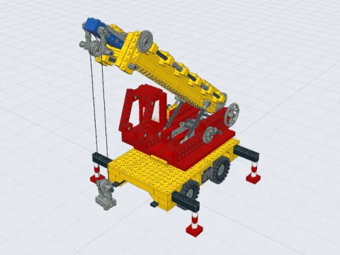</a> <b><a href="https://erik-larsen.github.io/kinebrick/?model=855-Mobile+Crane&rpm=79&autospin=313,cw">855 Mobile Crane</a></b>

Details
<i>1978</i> The cab slews, the boom luffs, the outriggers slide out, and the winch winds the hook up on its string.
</td>
</tr>
<tr>
<td align="center" valign="top" width="33%"><a href="https://erik-larsen.github.io/kinebrick/?model=952-Tractor&turn=68,141.6&autospin=252">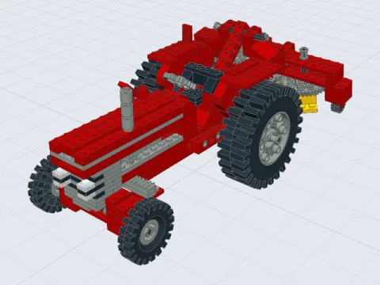</a> <b><a href="https://erik-larsen.github.io/kinebrick/?model=952-Tractor&turn=68,141.6&autospin=252">952 Tractor</a></b>

Details
<i>1978</i> Big driving rear wheels, steering through a universal joint, and a hitch raised by a lever.
</td>
<td align="center" valign="top" width="33%"><a href="https://erik-larsen.github.io/kinebrick/?model=956-Auto+Chassis&turn=354,-67.2&autospin=453">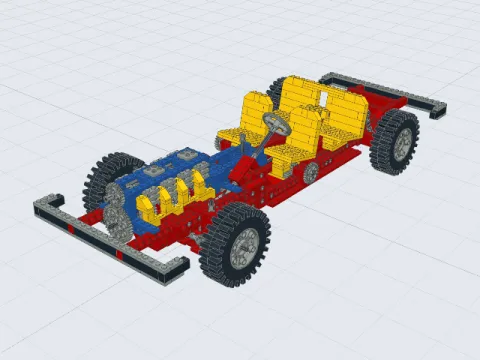</a> <b><a href="https://erik-larsen.github.io/kinebrick/?model=956-Auto+Chassis&turn=354,-67.2&autospin=453">956 Auto Chassis</a></b>

Details
<i>1978</i> Rolling it runs a four-cylinder engine; rack and tie-rod steering.
</td>
<td align="center" valign="top" width="33%"><a href="https://erik-larsen.github.io/kinebrick/?model=856-Bulldozer&autospin=51,cw">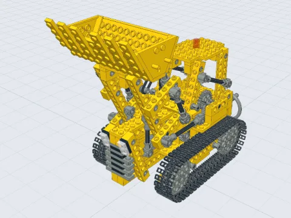</a> <b><a href="https://erik-larsen.github.io/kinebrick/?model=856-Bulldozer&autospin=51,cw">856 Bulldozer</a></b>

Details
<i>1979</i> Runs on two chain tracks, and turns by skidding them.
</td>
</tr>
<tr>
<td align="center" valign="top" width="33%"><a href="https://erik-larsen.github.io/kinebrick/?model=950-Fork+Lift&turn=178,101.2&autospin=188,cw&rpm=28">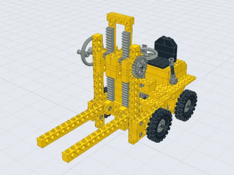</a> <b><a href="https://erik-larsen.github.io/kinebrick/?model=950-Fork+Lift&turn=178,101.2&autospin=188,cw&rpm=28">950 Fork-Lift Truck</a></b>

Details
<i>1979</i> A crank runs the forks up the mast on racks; it steers through a crown gear.
</td>
<td align="center" valign="top" width="33%"><a href="https://erik-larsen.github.io/kinebrick/?model=858-Auto+Engines-2-Cycle+Engine&rpm=100&autospin=20">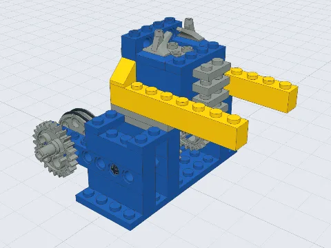</a> <b><a href="https://erik-larsen.github.io/kinebrick/?model=858-Auto+Engines-2-Cycle+Engine&rpm=100&autospin=20">858 2-Cycle Engine</a></b>

Details
<i>1980</i> One piston, run by a hand wheel on a rubber band.
</td>
<td align="center" valign="top" width="33%"><a href="https://erik-larsen.github.io/kinebrick/?model=858-Auto+Engines-Boxer+Engine&rpm=100&autospin=91">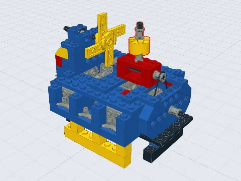</a> <b><a href="https://erik-larsen.github.io/kinebrick/?model=858-Auto+Engines-Boxer+Engine&rpm=100&autospin=91">858 Boxer Engine</a></b>

Details
<i>1980</i> Six pistons, three a side; rubber bands turn its fan.
</td>
</tr>
<tr>
<td align="center" valign="top" width="33%"><a href="https://erik-larsen.github.io/kinebrick/?model=858-Auto+Engines-Inline+Engine&rpm=100&autospin=43">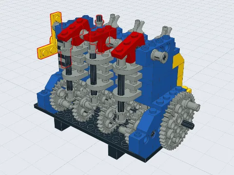</a> <b><a href="https://erik-larsen.github.io/kinebrick/?model=858-Auto+Engines-Inline+Engine&rpm=100&autospin=43">858 Inline Engine</a></b>

Details
<i>1980</i> Three pistons, and a camshaft whose pins lift push rods that tip the valves.
</td>
<td align="center" valign="top" width="33%"><a href="https://erik-larsen.github.io/kinebrick/?model=858-Auto+Engines-V-6+Engine&rpm=100&autospin=133">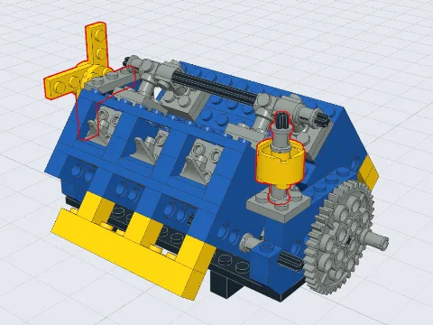</a> <b><a href="https://erik-larsen.github.io/kinebrick/?model=858-Auto+Engines-V-6+Engine&rpm=100&autospin=133">858 V-6 Engine</a></b>

Details
<i>1980</i> Six pistons in two banks in a V; rubber bands turn its fan.
</td>
<td align="center" valign="top" width="33%"><a href="https://erik-larsen.github.io/kinebrick/?model=8448-Super+Car-V8+engine&rpm=100&autospin=89,cw&option=focus">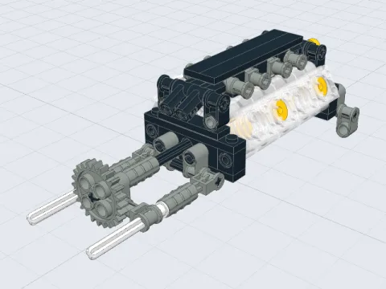</a> <b><a href="https://erik-larsen.github.io/kinebrick/?model=8448-Super+Car-V8+engine&rpm=100&autospin=89,cw&option=focus">8448 V8 engine</a></b>

Details
<i>1999</i> Eight pistons in two banks on a flat-plane crankshaft.
</td>
</tr>
<tr>
<td align="center" valign="top" width="33%"><a href="https://erik-larsen.github.io/kinebrick/?model=8880-Super+Car&autospin=1401&turn=894,167.3">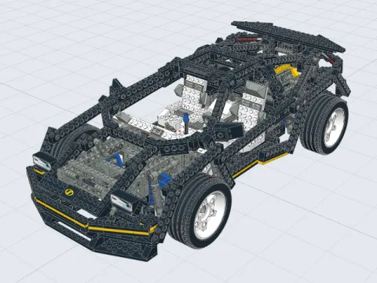</a> <b><a href="https://erik-larsen.github.io/kinebrick/?model=8880-Super+Car&autospin=1401&turn=894,167.3">8880 Super Car</a></b> · WIP

Details
<i>1994</i> Four-wheel drive through three differentials, four-wheel steering, a four-speed gearbox and a V8.
</td>
<td align="center" valign="top" width="33%"><a href="https://erik-larsen.github.io/kinebrick/?model=8448-Super%20Car">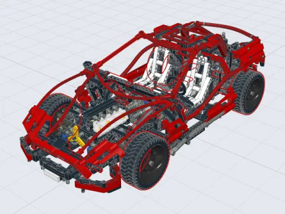</a> <b><a href="https://erik-larsen.github.io/kinebrick/?model=8448-Super%20Car">8448 Super Street Sensation</a></b> · WIP

Details
<i>1999</i> 1290 parts. It loads, but doesn’t move as it should yet.
</td>
</tr>
</table>

### Test models
These test mechanisms in isolation.

<table>
<tr>
<td align="center" valign="top" width="33%"><a href="https://erik-larsen.github.io/kinebrick/?model=simple-car&autospin=12">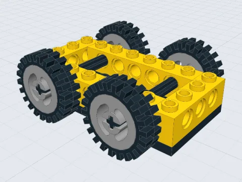</a> <b><a href="https://erik-larsen.github.io/kinebrick/?model=simple-car&autospin=12">Simple car</a></b>

Details
Push it and it rolls, its wheels turning against the ground.
</td>
<td align="center" valign="top" width="33%"><a href="https://erik-larsen.github.io/kinebrick/?model=geared-car&autospin=13&rpm=24">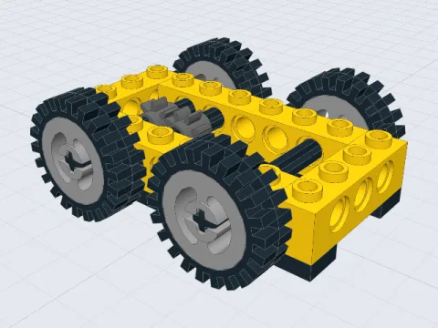</a> <b><a href="https://erik-larsen.github.io/kinebrick/?model=geared-car&autospin=13&rpm=24">Geared car</a></b>

Details
Rolling it spins a second axle the other way through two gears.
</td>
<td align="center" valign="top" width="33%"><a href="https://erik-larsen.github.io/kinebrick/?model=gear-train&autospin=6">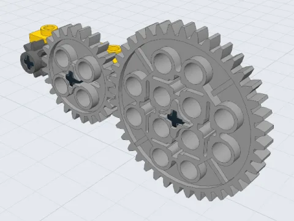</a> <b><a href="https://erik-larsen.github.io/kinebrick/?model=gear-train&autospin=6">Gear train</a></b>

Details
8, 24 and 40 tooth gears, turning at the right ratios.
</td>
</tr>
<tr>
<td align="center" valign="top" width="33%"><a href="https://erik-larsen.github.io/kinebrick/?model=right-angle&autospin=5">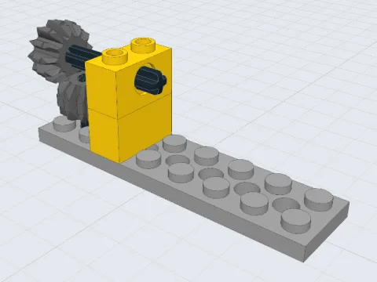</a> <b><a href="https://erik-larsen.github.io/kinebrick/?model=right-angle&autospin=5">Right-angle drive</a></b>

Details
Two bevel gears meshing at a right angle.
</td>
<td align="center" valign="top" width="33%"><a href="https://erik-larsen.github.io/kinebrick/?model=differential&autospin=11&rpm=39">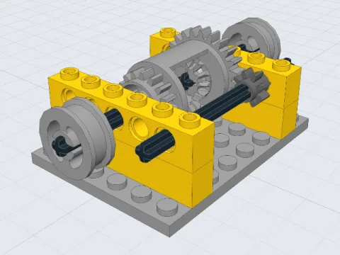</a> <b><a href="https://erik-larsen.github.io/kinebrick/?model=differential&autospin=11&rpm=39">Differential</a></b>

Details
Freeze the input, and one output turns the other backwards.
</td>
<td align="center" valign="top" width="33%"><a href="https://erik-larsen.github.io/kinebrick/?model=steering-car&turn=21,38.4&autospin=27,cw">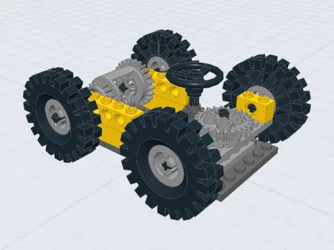</a> <b><a href="https://erik-larsen.github.io/kinebrick/?model=steering-car&turn=21,38.4&autospin=27,cw">Steering car</a></b>

Details
Steer it, push it, and it drives round a circle on its differential.
</td>
</tr>
<tr>
<td align="center" valign="top" width="33%"><a href="https://erik-larsen.github.io/kinebrick/?model=steering-car-solid&turn=16,-45.7&autospin=22,cw">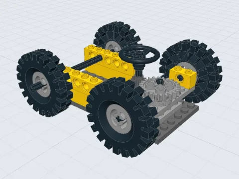</a> <b><a href="https://erik-larsen.github.io/kinebrick/?model=steering-car-solid&turn=16,-45.7&autospin=22,cw">Steering car, solid rear axle</a></b>

Details
No differential: steered, its rear tyres skid round the bend.
</td>
<td align="center" valign="top" width="33%"><a href="https://erik-larsen.github.io/kinebrick/?model=ackermann-car&turn=51,-160.6&autospin=55,cw">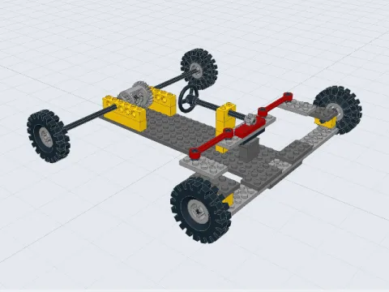</a> <b><a href="https://erik-larsen.github.io/kinebrick/?model=ackermann-car&turn=51,-160.6&autospin=55,cw">Ackermann car</a></b>

Details
Rack and pinion steering; the inside wheel turns further.
</td>
<td align="center" valign="top" width="33%"><a href="https://erik-larsen.github.io/kinebrick/?model=worm-drive&autospin=13&rpm=120">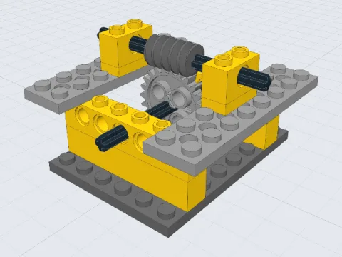</a> <b><a href="https://erik-larsen.github.io/kinebrick/?model=worm-drive&autospin=13&rpm=120">Worm drive</a></b>

Details
The worm turns the gear, but the gear can’t turn the worm.
</td>
</tr>
<tr>
<td align="center" valign="top" width="33%"><a href="https://erik-larsen.github.io/kinebrick/?model=gearbox&autospin=13">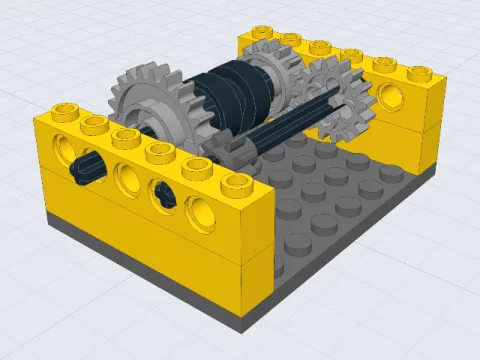</a> <b><a href="https://erik-larsen.github.io/kinebrick/?model=gearbox&autospin=13">Two-speed gearbox</a></b>

Details
Move the gear lever, or slide the driving ring, to change gear.
</td>
<td align="center" valign="top" width="33%"><a href="https://erik-larsen.github.io/kinebrick/?model=single-piston-engine&autospin=7,cw&rpm=200">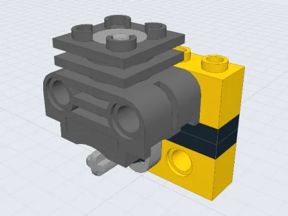</a> <b><a href="https://erik-larsen.github.io/kinebrick/?model=single-piston-engine&autospin=7,cw&rpm=200">Single-cylinder engine</a></b>

Details
A crank, connecting rod and piston.
</td>
<td align="center" valign="top" width="33%"><a href="https://erik-larsen.github.io/kinebrick/?model=four-bar&turn=3,-8.7&autospin=3">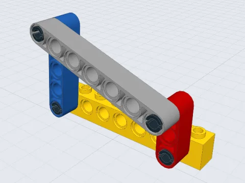</a> <b><a href="https://erik-larsen.github.io/kinebrick/?model=four-bar&turn=3,-8.7&autospin=3">Four-bar linkage</a></b>

Details
The crank turns all the way round; the far beam rocks.
</td>
</tr>
<tr>
<td align="center" valign="top" width="33%"><a href="https://erik-larsen.github.io/kinebrick/?model=rack-and-pinion&autospin=11&rpm=42">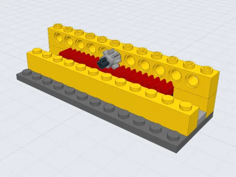</a> <b><a href="https://erik-larsen.github.io/kinebrick/?model=rack-and-pinion&autospin=11&rpm=42">Rack and pinion</a></b>

Details
The gear slides the rack until it runs out of teeth.
</td>
<td align="center" valign="top" width="33%"><a href="https://erik-larsen.github.io/kinebrick/?model=linear-actuator&autospin=12&rpm=160">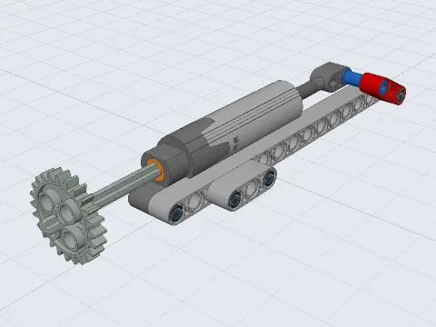</a> <b><a href="https://erik-larsen.github.io/kinebrick/?model=linear-actuator&autospin=12&rpm=160">Linear actuator</a></b>

Details
Turning the gear pushes the piston out, raising the arm.
</td>
</tr>
</table>

### Your own model

Load your own models with **Open a model file…** at the top of the model menu, or drop an LDraw file (`.ldr`, or `.mpd` with submodels) or a BrickLink Studio file (`.io`) anywhere on the page. Kinebrick fetches the parts it uses from [its copy of the LDraw parts library](https://github.com/erik-larsen/ldraw) and works out the mechanism as it does for its own models.

Your file stays in your browser; nothing is uploaded. The browser keeps it so the page can reload with it (the address names it, as `file=`), so a link to it only works in that browser. On your own computer, with `npm run dev` running, `file=` can also name a file in the checkout that the browser doesn't keep, such as `?file=omr/8081-1+Extreme+Cruiser.mpd`.

### Limitations

Kinebrick knows the moving parts of its own models and the most common ones in the OMR's Technic sets, but not every part yet. The panel lists any part it has no connection data for (marked ⚠, as loose parts are); any moving part it can't move yet, such as shock absorbers, pneumatics and some gears and tyres, with what it doesn't do ("doesn't mesh", "doesn't roll"); and any file the parts library hasn't got, which isn't drawn: usually a part LDraw hasn't made official yet, which the model file didn't bring along.

## Viewer

Everything happens in the 3D view: drag parts with the mouse or a finger. A part only moves the ways its mechanism allows, and everything connected follows. Pressing a part shows how it can move, with an arc for turning or an arrow for pushing. Dragging empty space turns the camera.

| Do this | And |
|---|---|
| Hover over a part | It glows yellow, the rest of its body faintly, and a label gives its number, name, role and body. Not while you're turning, panning or zooming the view. |
| Drag a part that spins on an axle (a gear, a crank, a wheel) | It turns like a knob, following the pointer round its axle. |
| Drag any other part (a frame, a piston, a rack, a linkage's middle beam) | It's pushed along the way it can move: a car rolls, a piston turns its crank (except at dead centre, top and bottom of its stroke). |
| Drag a gearbox's driving ring | It clicks into the nearest gear. |
| Drag a gear lever (the 8880 Super Car's, by its knob) | It clicks into the place in its gate nearest the pointer, sliding the driving ring it moves into that gear; in the middle, neutral. One that slides the shaft it rides on (the 956 Auto Chassis's) clicks it from one gear to the other. |
| Ctrl-click a part that spins on an axle | It keeps turning on its own, like a motor, counter-clockwise as you look at it, at the **Spin speed** set on the title card (whole rpm, 15 unless set). When it gets as far as it can go (it runs into something, or a slide or rack reaches its end), it turns back, so a crane's hook goes up and down for as long as you leave it. Ctrl-click it again to reverse, a third time to stop. The controls at the lower right of the title card work it too. The box holds the spin speed: type a speed in it, or click **−** or **+** either side to change it by 10. **Pause** makes the part wait and becomes **Play**, which makes it go on (it stays the part chosen), and **Reverse** turns it the other way; both are grey until a part is kept turning. One part turns at a time, and the camera follows the model while it turns. The address keeps it too ([Auto spin](#options)), so a link to the page shares the animation. |
| Ctrl-click any other part (a frame, a rack, a piston) | It keeps moving the way a drag would push it, starting away from you, at a tenth of the model's size that way each second, and turns back where it can go no further, so a rack runs to and fro and a car keeps rolling. Ctrl-click it again to reverse, a third time to stop, as for a part that spins. |
| Drag a part that can't move at all (a door on friction hinges) | If friction pins hold it, Kinebrick lets the fewest of them turn that the part needs to move, and says how many; then drag it again. Those pins can turn until **Reset**. Kinebrick reads a model with every friction pin holding its parts rigid, as glue would, since most of them are there to hold the model together; it reads them all as able to turn only if nothing could move otherwise. |
| Hold Shift and drag a part fixed to a frame that can roll (a car's door) | A plain drag pushes the car; with Shift held, Kinebrick lets the friction pins turn that hold the part to the frame, as above. If more than friction pins hold it, it says so. A touch screen has no Shift, so there such parts stay held. |
| Hold Shift and press a part that a drag turns along with more (a crane's cab door, which turns the cab) | Friction pins may hold it in that bigger body. With Shift held, Kinebrick lets turn those that hold it there; drag it again and it moves on its own. If more than friction pins hold it, or nothing but its joints, it says so. A plain drag is as before. |
| Hold Shift and press a part that no friction pin holds, where it could slide on its axle (a lock bar, a wheel) | It can slide along its axle: drag it along. Shift on it again takes that back, and it turns on its axle as before. Reset takes back every slide too. |
| Alt-click (Option-click on a Mac) a part | Its body is frozen until you Alt-click it again, or click **Unfreeze all** in the Options panel. Useful where a mechanism can move more than one way: freeze a differential's input, and turning one output turns the other the opposite way. A frozen part that turns on an axle doesn't turn against what that axle turns in: a gear on an axle that turns in another part, frozen, stops the axle too, and a frozen wheel on a steered knuckle stops rolling but still steers. |
| Click **Reset**, the last button on the title card | The model goes back as it was loaded, any motor stops, every friction pin holds again, and the camera goes back to where it started. |

Parts a drag doesn't need stay put: pushing a car leaves its steering alone. Motion stops where parts would collide, at the end of a slide or rack, or at the ground, and with [Warnings](#options) on the parts in the way flash red. A part that can't move at all says why (jammed, a worm driven from its gear, no wheels, too much [tyre scrub](#options)). Gears a drag brings together mesh from then on; gears it draws apart stop. Outlines show status: cyan frozen, green kept turning, magenta pointed at by the address, and with Warnings on, red loose. The **Stats** card, at the top right, shows the model's counts, any warnings, and how far each body has moved and each wheel has rolled.

### Options

| Option | In the address | What it does |
|---|---|---|
| **Body colours** | `option=bodycolours` | Each body in its own colour instead of the parts' LEGO colours, the frame grey. |
| **Joint axes** | `option=axes` | Each joint's axis as a thin pink rod. |
| **Gear contacts** | `option=contacts` | A pink dot where each pair of gears' teeth meet. |
| **Drivetrain focus** | `option=focus` | Only what a drag or a part kept turning moves draws solid, everything else see-through, so turning a car's steering wheel shows just its steering (the wheel, its column and universal joints, the rack, tie rods and wheels) and rolling it just its wheels and drivetrain. A part counts if it moves against the frame, so a car's frame and what it carries stay see-through as it rolls. Until the next drag or spin moves something, the last one's stay solid; Reset shows everything again. |
| **Warnings** | Off unless `option=warnings` | The warnings drawn on the model. A part with a steady red outline and a ⚠ pinned to it is loose: it is attached to nothing as Kinebrick reads the model, so it only rides along with the body it touches, or with the part nearest to it. Two parts that flash red for a moment are the two that would have run into each other, which stopped the drag or the motor. Unticked, none of these is drawn; the Warnings list in the Stats card still names the loose parts. A part kept turning keeps its green outline, and a frozen part its cyan one, either way. An address with the older `option=symbols` or `option=status` still works: both mean `option=warnings`. |
| **Spin speed** | `rpm=60` | How fast Ctrl-click turns a part, in whole revolutions per minute. It's 15 unless set, and switching model goes back to 15. It is set on the title card, not in the Options panel: in the box, from 1 to 300, or by 10 with the buttons either side of it. |
| **Auto spin** | `autospin=271`, or `autospin=271,cw` | A part kept turning from the moment the page opens, as if Ctrl-clicked, by its place in the model file: the number the hover label gives it (counting from 0, submodels flattened). It turns counter-clockwise as seen from where the camera starts, or with `,cw` clockwise; a part kept moving rather than turning starts away from where the camera starts, or with `,cw` towards it. Ctrl-click, Reverse and Stop keep it up to date, so copying the address shares the animation. Switching model drops it. With `,paused` last (`autospin=271,paused`) the part is chosen and outlined but waits, as after the pause button; pausing keeps the address up to date. |
| **Turned parts** | `turn=155,60`, again for each part: `turn=155,60&turn=12,-30` | Parts turned as the page opens, each as if dragged, by its place in the model file (as for Auto spin) and how many degrees, counter-clockwise as seen from where the camera starts, or clockwise if negative, one after another before Auto spin starts. Dragging a part like a knob keeps it up to date, so copying the address shares how you've set the model (a car's steering, say); Reset clears it. Switching model drops it. |
| **Shown parts** | `show=182,183` | Parts outlined in magenta from the moment the page opens, whether they can move or not, each by its place in the model file (as for Auto spin). The camera starts close to them. For a link that points at a part: "this beam is pinned at both ends". |
| **Turning friction pins** | `free=1086,1087` | Friction pins that can turn from the moment the page opens, each by its place in the model file (as for Auto spin), as if a drag of a part they held had let them turn. Such a drag keeps it up to date, so a link plays back the turns of a part only they held; Reset clears it. Switching model drops it. |
| **Tyre scrub** | `scrub=10` | How far tyres may slide sideways, as a percentage of how far they roll. It's 10% unless the model says otherwise ([Settings in a model file](#settings-in-a-model-file)), and switching model goes back to the new model's own. More lets a car whose steering is far from every wheel turning round one centre roll at bigger steering angles; too much would let a car with no steering at all turn. A motion that needs more raises it, to what it needs and 2 points over, up to 30%. |
| **Lift off the ground** | `lifted=1` | The model held up in the hand. No tyre touches the ground and the frame stays where it is, so the wheels turn freely: dragging a car's wheel turns that wheel and what it drives, and never rolls the car. Freeze a differential's input (Alt-click), and turning one wheel turns the other the opposite way, which on the ground would need the car to pivot on the spot. Parts frozen stay frozen when it's ticked or unticked. |

For example, `?model=8448-Super%20Car-V8%20engine&option=bodycolours,axes&rpm=60` opens the V8 with body colours and joint axes on, spinning at 60 rpm.

#### Settings in a model file

A model file can carry Kinebrick's own settings as LDraw meta-commands, which other LDraw programs skip. `0 !KINEBRICK SCRUB [percent=16]` in its main file sets its tyre scrub (the 854 Go-Kart has it: its front wheels turn alike, and at full lock its tyres scrub more than 10%). `0 !KINEBRICK SLIDE [part=3737.dat] [at=0 -147.6 -108.5] [dir=0 0 -1] [positions=0,20]` lets a part slide, with whatever turns on it, between those click positions, in LDU that way from where it's built (the 956 Auto Chassis's input shaft, which its gear lever slides from one gear to the other). A real LEGO set's lines are kept in its file in [data/sets/](data/sets/README.md), by its name in `models/`, rather than edited into its model file: `npm run data` puts them there, so a fresh copy from the OMR gets them too.

## How it works

The project is currently working its way through Technic models available on LDraw's Official Model Repository (OMR), generally from oldest and simplest models first.

To build and run Kinebrick locally, and to get project development details, see [DEVELOPER.md](DEVELOPER.md).

And for a deeper technical dive on Kinebrick, see [ARCHITECTURE.md](ARCHITECTURE.md).

## Related Projects

| Project | What it does | How Kinebrick differs |
|---|---|---|
| [Kinebrick Studio](https://youtube.com/@fhareide) | Desktop LDraw editor by fhareide, written in Rust, that solves motion as you build: chains, strings and shock absorbers, gears and mechanisms you can drive while building, and a simulation mode with forces. Mainly aimed at GBCs, and about to go public in beta. | Runs in a browser with nothing to install, and is a viewer, not an editor. No forces yet. |
| [SR 3D Builder](https://wiki.ldraw.org/wiki/Sr3d) | Windows LEGO CAD that could animate gears, hinges and pistons. Discontinued, and its own website is gone, so this links to the LDraw wiki. | Runs in a browser, and is a viewer, not a CAD program. |
| [LDCad](https://www.melkert.net/LDCad) | LEGO CAD whose animations are written by hand in Lua for each model. | Works out how a model moves from its parts, with nothing written by hand. Kinebrick uses LDCad's shadow library for its connection points. |
| [TechnicBrickPower gear calculator](https://www.eurobricks.com/forum/forums/topic/186656-new-technic-gear-ratio-calculator-tool) | Web tool that finds the gear trains in an LDraw file and shows their ratios. | Covers the whole mechanism, not only gears (axles, pins, pistons, steering, wheels on the ground), and moves it live as you drag. |
| [yoff/LegoTechnicSimulation](https://github.com/yoff/LegoTechnicSimulation) | Python tool that finds bodies, joints and gear meshes in an LDraw file and exports them to Blender or MuJoCo. | Closest in approach: both find connection points from LDraw primitives. Kinebrick solves and animates in the browser instead of exporting to another program. LTS code can't be reused directly: it's Python and has no license. |

## Data sources and licenses

| Source | Used for | License |
|---|---|---|
| [LDraw parts library](https://library.ldraw.org) | Part shapes and connection primitives; the packed models in `packed/` include the parts they use, and models you open yourself fetch theirs from [a copy published beside Kinebrick](https://github.com/erik-larsen/ldraw) | CC BY 4.0 |
| [three.js](https://threejs.org) | Rendering and LDraw loading | MIT |
| [three-mesh-bvh](https://github.com/gkjohnson/three-mesh-bvh) | Fast tests of whether two parts' shapes overlap | MIT |
| [LDCad shadow library](https://github.com/RolandMelkert/LDCadShadowLibrary) | Connection points in the [connection table](ARCHITECTURE.md#the-connection-table) | CC BY-SA 4.0 |
| [LDraw Official Model Repository](https://library.ldraw.org/omr) | The real LEGO sets in `models/`: 852 Helicopter by Allard van Efferen; 854 Go-Kart by Stefan Frenz; 855 Mobile Crane and 856 Bulldozer by Marc Giraudet; 950 Fork-Lift Truck by Merlijn Wissink; 952 Tractor by Nathan Perry; 956 Auto Chassis by N. W. Perry; the 858 Auto Engines' four engines by Takeshi Takahashi; 8880 Super Car, and 8448 Super Street Sensation and its V8 engine, by Orion Pobursky | CC BY 2.0 (CCAL 2.0) |

## License

The code is [MIT](LICENSE). The connection table is derived from the LDCad shadow library, so it is shared under the same license, [CC BY-SA 4.0](https://creativecommons.org/licenses/by-sa/4.0/). The real LEGO set models are from the LDraw Official Model Repository, by the authors listed above, under [CC BY 2.0](https://creativecommons.org/licenses/by/2.0/).
